# Lab 2: gNB TDD Traffic Analysis

**Name:** Petrajoy Davidson  
**Student ID:** M11502803  
**Date:** 04/11/26

## Report Context

This report compares three gNB traffic scenarios: a downlink test and two uplink tests. It combines iperf3 JSON results with packet-level Wireshark evidence and separately supplied SIB1 reference captures. The performance results describe the tested traffic; the reference captures describe the broadcast TDD configurations and are not time-correlated evidence of the configuration active during the iperf3 runs.

## Test Scenarios and Capture Mapping

| Scenario | TDD setting | Direction | iperf3 JSON | Scenario capture |
| --- | --- | --- | --- | --- |
| A | DL-heavy | Downlink | `scenario-a-downlink.json` | `scenario-a-dl-heavy-downlink.pcapng` |
| B | DL-heavy | Uplink | `scenario-b-uplink.json` | `scenario-b-dl-heavy-uplink.pcapng` |
| C | Balanced | Uplink | `scenario-c-uplink.json` | `scenario-c-balanced-uplink.pcapng` |

The supplied TDD reference captures are `tdd-dl-heavy-sib1.pcapng` for A/B and `tdd-balanced-sib1.pcapng` for C. They were recorded separately from the iperf3 runs; they document reference settings and do not independently prove which configuration was broadcast during an earlier performance test.

## 1. Traffic Direction

The iperf3 `reverse` setting identifies which endpoint sends the test data. A value of `1` reverses the normal client-to-server direction; `0` leaves it unchanged. The client/server addresses and the setting are included below so the assigned direction can be checked against the scenario labels.

| Scenario | `reverse` | Direction |
| --- | ---: | --- |
| A | 1 | Downlink |
| B | 0 | Uplink |
| C | 0 | Uplink |

### Scenario A

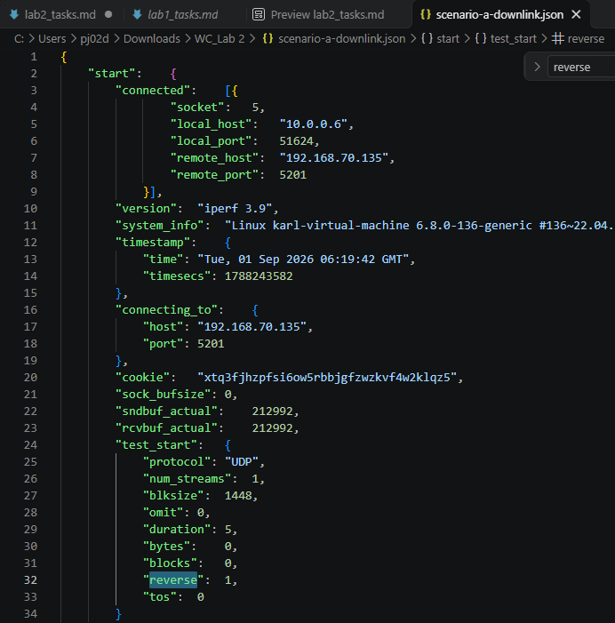

*Scenario A JSON evidence: `reverse` is 1, indicating server-to-client (downlink) traffic.*

```json
{
  "start": {
    "connected": [{
      "local_host": "10.0.0.6",
      "local_port": 51624,
      "remote_host": "192.168.70.135",
      "remote_port": 5201
    }],
    "test_start": {
      "reverse": 1
    }
  }
}
```

### Scenario B

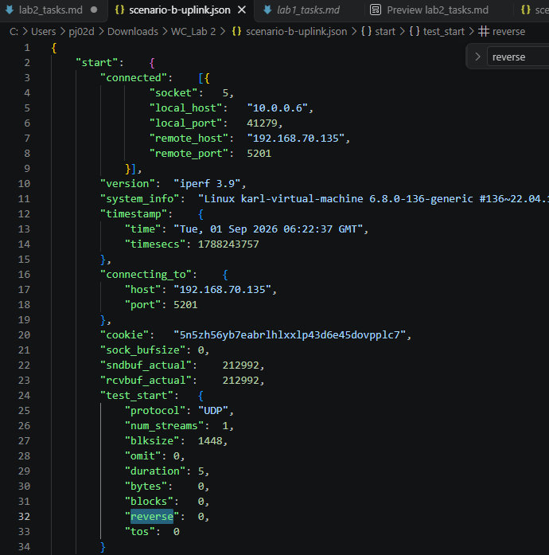

*Scenario B JSON evidence: `reverse` is 0, indicating client-to-server (uplink) traffic.*

```json
{
  "start": {
    "connected": [{
      "local_host": "10.0.0.6",
      "local_port": 41279,
      "remote_host": "192.168.70.135",
      "remote_port": 5201
    }],
    "test_start": {
      "reverse": 0
    }
  }
}
```

### Scenario C

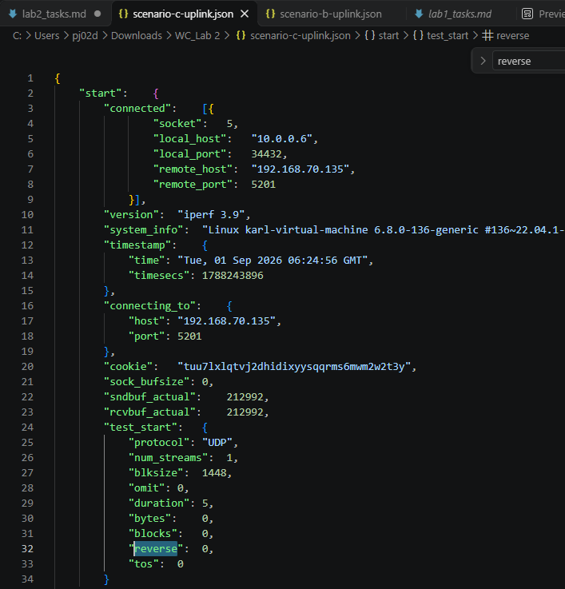

*Scenario C JSON evidence: `reverse` is 0, indicating client-to-server (uplink) traffic.*

```json
{
  "start": {
    "connected": [{
      "local_host": "10.0.0.6",
      "local_port": 34432,
      "remote_host": "192.168.70.135",
      "remote_port": 5201
    }],
    "test_start": {
      "reverse": 0
    }
  }
}
```

**Does the JSON traffic direction match the scenario descriptions?** Yes. The UE-side client (`local_host` = 10.0.0.6) connects to the server (`remote_host` = 192.168.70.135). In A, `reverse = 1`, so the server sends to the client (downlink). In B and C, `reverse = 0`, so the client sends to the server (uplink). These values match the scenario descriptions.

## 2. Throughput

This comparison uses the final aggregate iperf3 rate, `end.sum.bits_per_second`, converted from bits per second to decimal megabits per second (Mbps) by dividing by 1,000,000. The sender/receiver interpretation matters: in reverse mode the client receives, while in the normal mode used by B and C the client sends.

| Scenario | Direction | Throughput (Mbps) |
| --- | --- | ---: |
| A | Downlink | 90.65 |
| B | Uplink | 109.12 |
| C | Uplink | 124.42 |

Raw `end.sum.bits_per_second` values: A = 90654195.84, B = 109117249.69, C = 124416749.13.

### Scenario A

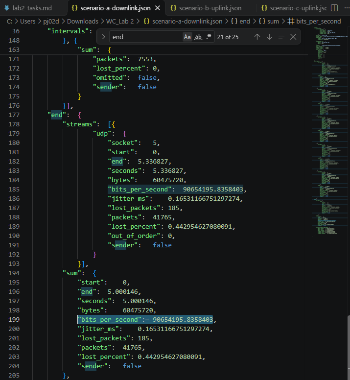

*Scenario A iperf3 JSON shows the aggregate downlink rate used in the report.*

```json
{
  "end": {
    "sum": {
      "bits_per_second": 90654195.8358403
    }
  }
}
```

### Scenario B

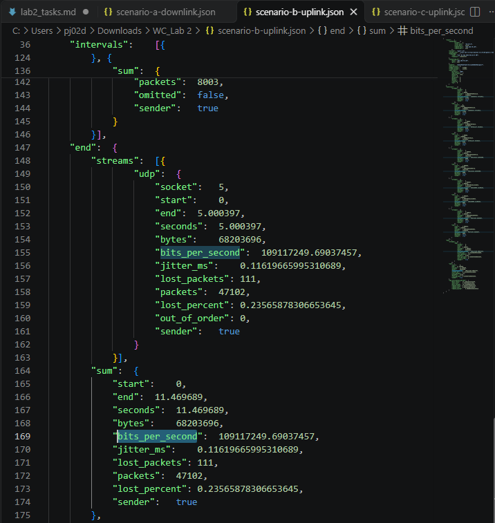

*Scenario B iperf3 JSON shows the aggregate uplink rate used in the report.*

```json
{
  "end": {
    "sum": {
      "bits_per_second": 109117249.69037457
    }
  }
}
```

### Scenario C

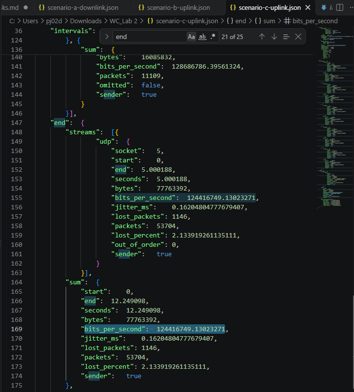

*Scenario C iperf3 JSON shows the aggregate uplink rate used in the report.*

```json
{
  "end": {
    "sum": {
      "bits_per_second": 124416749.13023271
    }
  }
}
```

**B-to-C throughput improvement:** `(124.42 - 109.12) / 109.12 × 100 = 14.02%`.

1. **Scenario A downlink throughput:** 90.65 Mbps.
2. **Scenario B uplink throughput:** 109.12 Mbps.
3. **Is uplink throughput higher in B or C?** C: 124.42 Mbps versus 109.12 Mbps.
4. **By approximately what percentage does C improve over B?** About 14% (14.02%).

iperf3 reports `end.sum` from the client's point of view. For A (reverse mode) the client is the receiver. For B and C the client is the sender (`"sender": true` in `end.streams[0].udp`), so the B/C values are send rates and loss is measured at the server. Using the received share (`1 - loss`), the received rates are approximately 108.86 Mbps (B) and 121.76 Mbps (C); C is still about 12% higher.

## 3. Packet Loss and Jitter

Packet loss and jitter qualify the throughput comparison: a higher rate is not necessarily a better result if delivery reliability or timing becomes worse. These are UDP iperf3 summary metrics; they are not the TCP retransmission counts reported later.

| Scenario | Throughput (Mbps) | Packet loss (%) | Jitter (ms) |
| --- | ---: | ---: | ---: |
| A | 90.65 | 0.44 | 0.165 |
| B | 109.12 | 0.24 | 0.116 |
| C | 124.42 | 2.13 | 0.162 |

### Scenario A raw metrics


*Scenario A raw iperf3 summary includes throughput, jitter, and packet loss.*

```json
{
  "end": {
    "sum": {
      "bits_per_second": 90654195.8358403,
      "jitter_ms": 0.16531166751297274,
      "lost_percent": 0.442954627080091
    }
  }
}
```

### Scenario B raw metrics


*Scenario B raw iperf3 summary includes throughput, jitter, and packet loss.*

```json
{
  "end": {
    "sum": {
      "bits_per_second": 109117249.69037457,
      "jitter_ms": 0.11619665995310689,
      "lost_percent": 0.23565878306653645
    }
  }
}
```

### Scenario C raw metrics


*Scenario C raw iperf3 summary includes throughput, jitter, and packet loss.*

```json
{
  "end": {
    "sum": {
      "bits_per_second": 124416749.13023271,
      "jitter_ms": 0.16204804777679407,
      "lost_percent": 2.133919261135111
    }
  }
}
```

1. **Does C have higher uplink throughput than B?** Yes. C is 124.42 Mbps, compared with B at 109.12 Mbps.
2. **Does C have lower packet loss than B?** No. C has higher packet loss: 2.13%, compared with B at 0.24%.
3. **What trade-off is visible from B to C?** C has higher throughput, but also higher packet loss and jitter (0.162 ms versus 0.116 ms). These results show a throughput-versus-reliability trade-off in this test; they do not prove that the TDD setting alone caused it.

## 4. SIB1 TDD Configuration and Time Allocation

SIB1 contains the cell's common configured downlink, uplink, and flexible resources, not actual slot-by-slot scheduling or proof of how individual packets were scheduled. At 30 kHz subcarrier spacing, each reference slot is 0.5 ms with 14 symbols. The totals below count configured symbols; flexible symbols are kept separate rather than assumed to be DL or UL.

### Decoded `pattern1` parameters

| Item | DL-heavy: A/B | Balanced: C |
| --- | --- | --- |
| Configuration capture | `tdd-dl-heavy-sib1.pcapng` | `tdd-balanced-sib1.pcapng` |
| SIB1 packet number | 2 | 2 |
| `referenceSubcarrierSpacing` | 30 kHz | 30 kHz |
| `dl-UL-TransmissionPeriodicity` | 5 ms | 2.5 ms |
| `nrofDownlinkSlots` | 7 | 2 |
| `nrofDownlinkSymbols` | 6 | 6 |
| `nrofUplinkSlots` | 2 | 2 |
| `nrofUplinkSymbols` | 4 | 4 |
| `pattern2` present | No | No |

### DL-heavy reference configuration

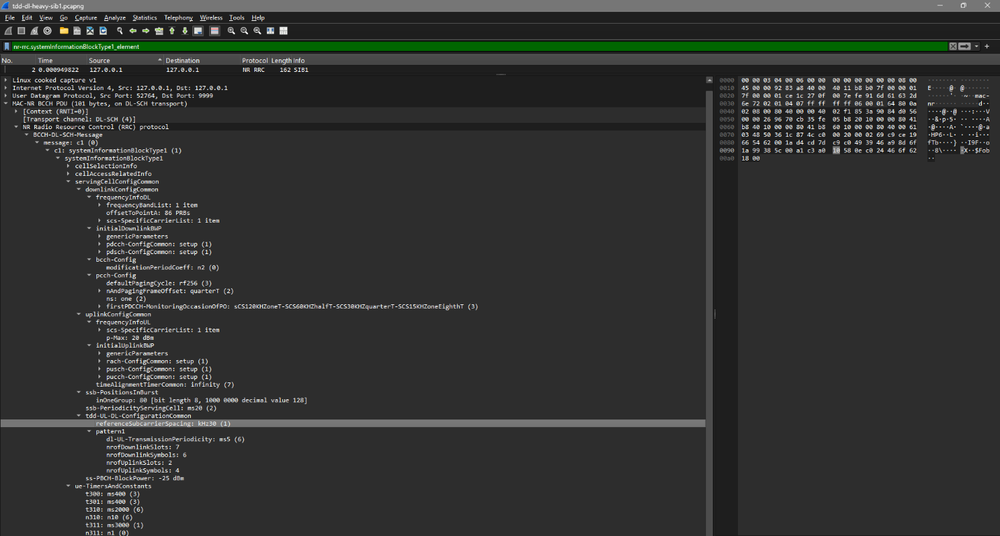

*Wireshark packet 2: decoded DL-heavy SIB1 TDD configuration.*

```json
{
  "capture": "tdd-dl-heavy-sib1.pcapng",
  "frame_number": 2,
  "SIB1": {
    "referenceSubcarrierSpacing": "30 kHz",
    "pattern1": {
      "dl-UL-TransmissionPeriodicity": "5 ms",
      "nrofDownlinkSlots": 7,
      "nrofDownlinkSymbols": 6,
      "nrofUplinkSlots": 2,
      "nrofUplinkSymbols": 4
    },
    "pattern2": "not present"
  }
}
```

### Balanced reference configuration

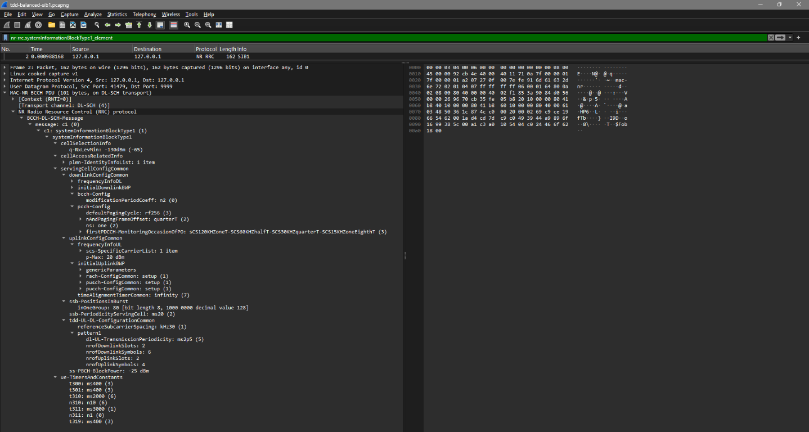

*Wireshark packet 2: decoded balanced SIB1 TDD configuration.*

```json
{
  "capture": "tdd-balanced-sib1.pcapng",
  "frame_number": 2,
  "SIB1": {
    "referenceSubcarrierSpacing": "30 kHz",
    "pattern1": {
      "dl-UL-TransmissionPeriodicity": "2.5 ms",
      "nrofDownlinkSlots": 2,
      "nrofDownlinkSymbols": 6,
      "nrofUplinkSlots": 2,
      "nrofUplinkSymbols": 4
    },
    "pattern2": "not present"
  }
}
```

At 30 kHz reference SCS, a reference slot is 0.5 ms and contains 14 symbols. The DL-heavy pattern spans 10 slots (5 ms); the balanced pattern spans 5 slots (2.5 ms) and repeats twice in a common 5 ms interval. In each pattern's mixed slot, symbols 0–5 are configured DL, 6–9 are flexible, and 10–13 are configured UL.

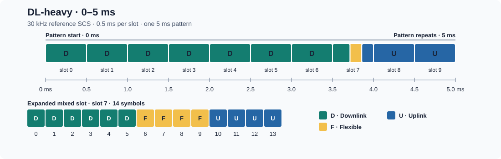

*Configured DL, flexible, and UL symbols in the DL-heavy pattern over 5 ms.*

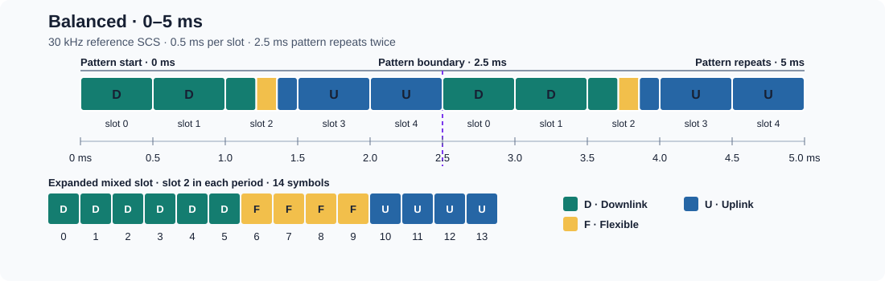

*Configured DL, flexible, and UL symbols in two repetitions of the balanced pattern over 5 ms.*

| TDD setting | Repeating duration (ms) | Total reference slots | DL symbols | UL symbols | Flexible symbols | Configured UL symbol share (%) |
| --- | ---: | ---: | ---: | ---: | ---: | ---: |
| DL-heavy | 5 | 10 | 104 | 32 | 4 | 22.86 |
| Balanced | 2.5 | 5 | 34 | 32 | 4 | 45.71 |

| TDD setting | Repeating duration (ms) | Repetitions in 5 ms | DL symbols in 5 ms | UL symbols in 5 ms | Flexible symbols in 5 ms |
| --- | ---: | ---: | ---: | ---: | ---: |
| DL-heavy | 5 | 1 | 104 | 32 | 4 |
| Balanced | 2.5 | 2 | 68 | 64 | 8 |

**Can two patterns have the same UL symbol count per period but provide different UL symbols per unit time?** Yes. Both patterns provide 32 configured UL symbols per period, but DL-heavy takes 5 ms while balanced takes 2.5 ms. Over the same 5 ms interval, balanced repeats twice and provides 64 configured UL symbols, compared with 32 for DL-heavy. The configured UL symbol shares are 45.71% and 22.86%, respectively.

### TDD configuration and performance

| Scenario | Reference TDD setting | JSON traffic direction | Configured UL symbol share (%) | Throughput (Mbps) | Packet loss (%) |
| --- | --- | --- | ---: | ---: | ---: |
| A | DL-heavy | Downlink | 22.86 | 90.65 | 0.44 |
| B | DL-heavy | Uplink | 22.86 | 109.12 | 0.24 |
| C | Balanced | Uplink | 45.71 | 124.42 | 2.13 |

1. **Which decoded TDD parameters differ between DL-heavy and balanced?** The transmission period differs (5 ms for DL-heavy versus 2.5 ms for balanced), as does `nrofDownlinkSlots` (7 versus 2). Both use 30 kHz reference SCS, 6 downlink symbols, 2 uplink slots, and 4 uplink symbols; neither has a second pattern.
2. **Which configuration provides more configured UL symbols per unit time?** Balanced provides more: it has 64 configured UL symbols in 5 ms versus 32 for DL-heavy. Its configured UL symbol share is 45.71%, compared with 22.86%. The diagrams show balanced repeating twice in the same interval.
3. **How does that difference help explain the B/C throughput comparison?** Scenario C uses the balanced reference setting, which provides more configured UL symbols per unit time than the DL-heavy reference setting used by B. C's measured uplink rate is 124.42 Mbps, higher than B's 109.12 Mbps. This is a plausible explanation, but the reference captures do not prove causation or that the original performance runs used identical conditions. C also has higher measured packet loss (2.13% versus 0.24%).
4. **Why can A and B use the same SIB1 TDD configuration despite different traffic directions?** The TDD pattern is a cell configuration broadcast in SIB1, not a setting selected anew for each iperf3 test. The same DL-heavy reference configuration can be used for both A and B; `reverse` determines whether test traffic is downlink or uplink.

## 5. TDD Setting Suitability

Suitability here means whether the configured direction resources appear aligned with the test traffic and whether the measured results support that interpretation. It is an evidence-based comparison of these scenarios, not a claim that the TDD pattern alone caused the throughput or loss.

| Scenario | TDD setting | Traffic direction | Suitability |
| --- | --- | --- | --- |
| A | DL-heavy | Downlink | Suitable: the reference pattern favors DL, with 104 configured DL symbols versus 32 UL symbols per 5 ms. Measured downlink throughput is 90.65 Mbps. |
| B | DL-heavy | Uplink | Less suitable for sustained uplink traffic: it provides 32 configured UL symbols per 5 ms, fewer than the balanced reference. Uplink still reached 109.12 Mbps in this test. |
| C | Balanced | Uplink | Suitable: its configured UL symbol share is higher than DL-heavy (45.71% versus 22.86%), providing more configured uplink opportunities. Measured uplink throughput is 124.42 Mbps, with 2.13% packet loss. |

**Why might Scenario C achieve better uplink throughput than Scenario B?** The balanced reference setting provides 64 configured UL symbols per 5 ms, compared with 32 in the DL-heavy reference setting. This offers a plausible explanation for C's higher measured uplink throughput (124.42 Mbps versus 109.12 Mbps), although the separately recorded configuration captures do not prove causation. C also has higher packet loss (2.13% versus 0.24%), so the throughput gain comes with a measured loss trade-off.

## 6. GTP-U Packet

GTP-U carries the UE's inner user-plane packet between the radio network and the core. The outer IP addresses identify the tunnel endpoints; the inner IP addresses identify the carried packet's endpoints. The TEID identifies the GTP tunnel context.

| Scenario | Capture | Frame | Outer IP source → destination | TEID | Inner IP source → destination | Inner protocol |
| --- | --- | ---: | --- | --- | --- | --- |
| A | `scenario-a-dl-heavy-downlink.pcapng` | 1892 | `192.168.70.134 → 192.168.70.129` | `0xcddc4529` | `192.168.70.135 → 10.0.0.6` | UDP (iPerf data) |
| B | `scenario-b-dl-heavy-uplink.pcapng` | 107877 | `192.168.70.129 → 192.168.70.134` | `0x00000012` | `10.0.0.6 → 192.168.70.135` | TCP |
| C | `scenario-c-balanced-uplink.pcapng` | 121677 | `192.168.70.129 → 192.168.70.134` | `0x00000013` | `10.0.0.6 → 192.168.70.135` | TCP |

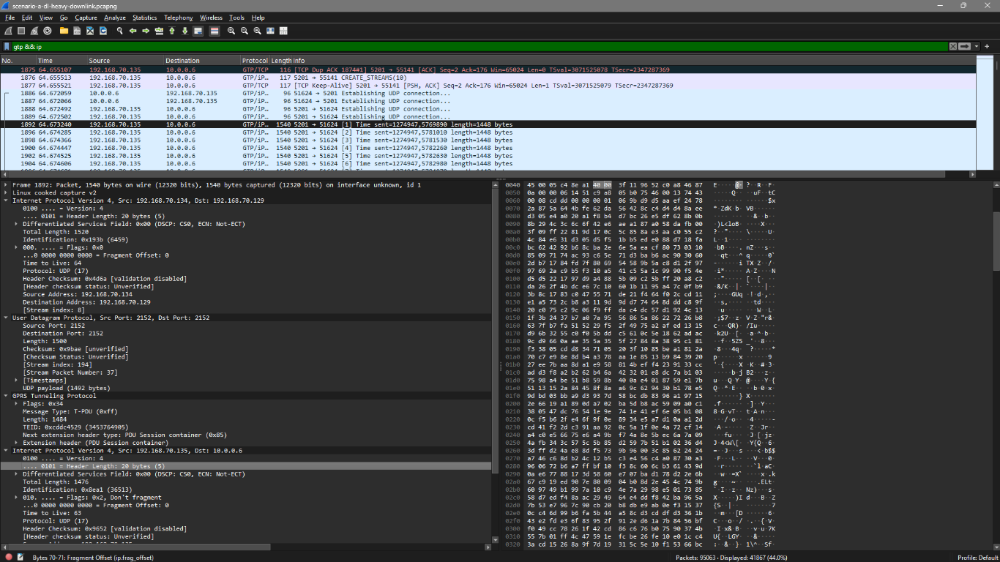

*Scenario A frame 1892: GTP-U encapsulates the UDP iperf3 data packet; outer/inner addresses and TEID are visible.*

```json
{
  "capture": "scenario-a-dl-heavy-downlink.pcapng",
  "frame_number": 1892,
  "outer_ipv4": {
    "source": "192.168.70.134",
    "destination": "192.168.70.129"
  },
  "gtp": {
    "teid": "0xcddc4529"
  },
  "inner_ipv4": {
    "source": "192.168.70.135",
    "destination": "10.0.0.6"
  }
}
```

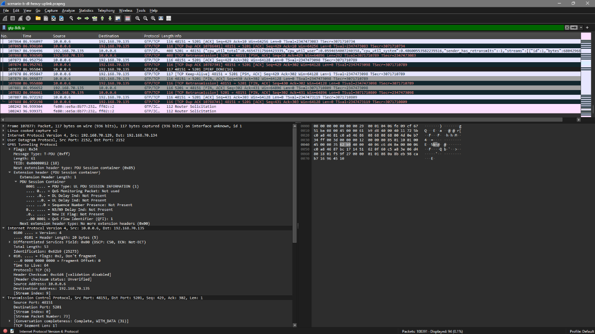

*Scenario B frame 107877: GTP-U tunnel details and encapsulated TCP packet.*

```json
{
  "capture": "scenario-b-dl-heavy-uplink.pcapng",
  "frame_number": 107877,
  "outer_ipv4": {
    "source": "192.168.70.129",
    "destination": "192.168.70.134"
  },
  "gtp": {
    "teid": "0x00000012"
  },
  "inner_ipv4": {
    "source": "10.0.0.6",
    "destination": "192.168.70.135",
    "protocol": "TCP"
  }
}
```

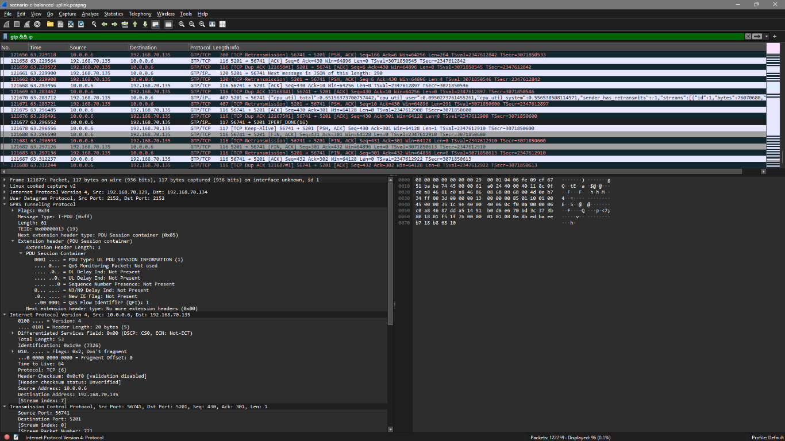

*Scenario C frame 121677: GTP-U tunnel details and encapsulated TCP packet.*

```json
{
  "capture": "scenario-c-balanced-uplink.pcapng",
  "frame_number": 121677,
  "outer_ipv4": {
    "source": "192.168.70.129",
    "destination": "192.168.70.134"
  },
  "gtp": {
    "teid": "0x00000013"
  },
  "inner_ipv4": {
    "source": "10.0.0.6",
    "destination": "192.168.70.135",
    "protocol": "TCP"
  }
}
```

Scenarios B and C show GTP-U encapsulating TCP packets, not UDP iPerf data; they are valid examples of GTP-U tunneling but should not be described as the iPerf data packets themselves. Scenario A's selected packet contains UDP iPerf data.

## 7. TCP Retransmissions

The filter counts packets Wireshark classifies as TCP retransmissions in each scenario capture. This is separate TCP evidence and must not be interpreted as a count of lost UDP iperf3 data packets.

| Scenario | Display filter | Displayed TCP retransmissions |
| --- | --- | ---: |
| A | `tcp.analysis.retransmission` | 14 |
| B | `tcp.analysis.retransmission` | 12 |
| C | `tcp.analysis.retransmission` | 12 |

### Scenario A

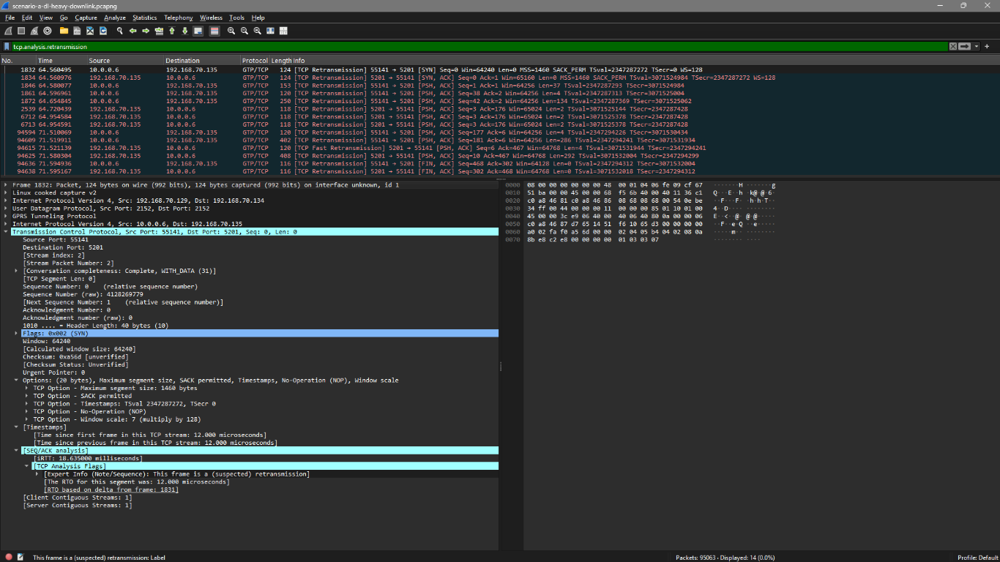

*Scenario A Wireshark result with the TCP retransmission display filter.*

```json
{
  "capture": "scenario-a-dl-heavy-downlink.pcapng",
  "display_filter": "tcp.analysis.retransmission",
  "displayed_packets": 14
}
```

### Scenario B

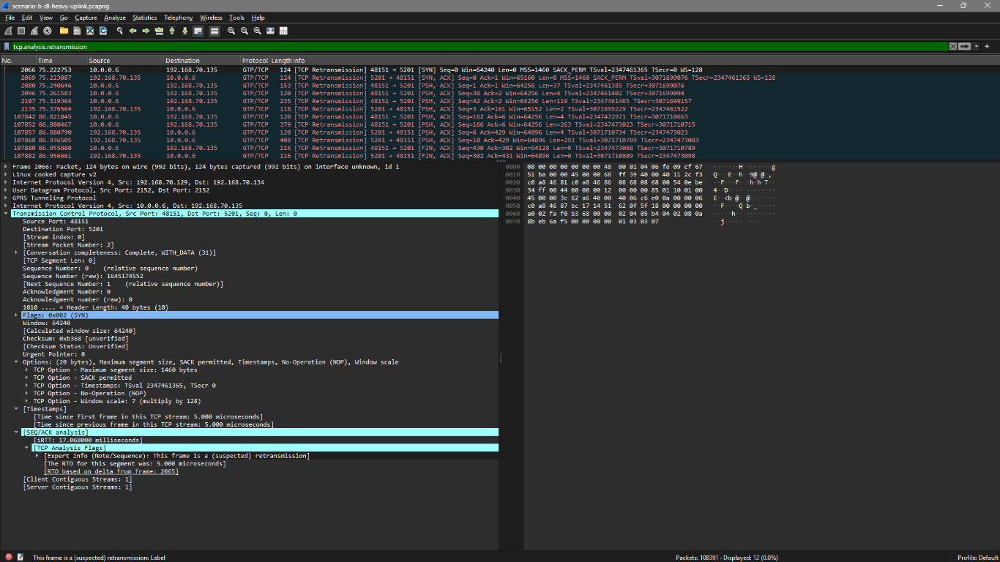

*Scenario B Wireshark result with the TCP retransmission display filter.*

```json
{
  "capture": "scenario-b-dl-heavy-uplink.pcapng",
  "display_filter": "tcp.analysis.retransmission",
  "displayed_packets": 12
}
```

### Scenario C

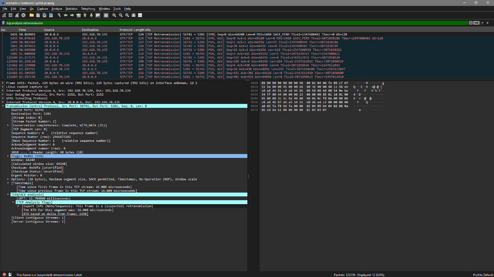

*Scenario C Wireshark result with the TCP retransmission display filter.*

```json
{
  "capture": "scenario-c-balanced-uplink.pcapng",
  "display_filter": "tcp.analysis.retransmission",
  "displayed_packets": 12
}
```

**Do these TCP retransmissions directly represent lost UDP performance packets?** No. These retransmissions are TCP control-connection packets, while iperf3's performance traffic is UDP. They are not direct evidence that a UDP performance packet was lost.

## 8. RTT and Packet Interval

These are two different timing observations. The TCP ACK RTT is calculated from a TCP control-connection acknowledgement, while the UDP packet interval is the timestamp difference between consecutive iPerf3 data packets. Neither should be presented as a UDP end-to-end RTT.

### TCP ACK RTT

| Scenario | Packet number | TCP ACK RTT (`tcp.analysis.ack_rtt`) | Initial RTT (`iRTT`) |
| --- | ---: | ---: | ---: |
| A | 1874 | 0.259 ms | 18.635 ms |
| B | 2068 | 0.331 ms | 18.076 ms |
| C | 121650 | 0.186 ms | 11.704 ms |

### Scenario A

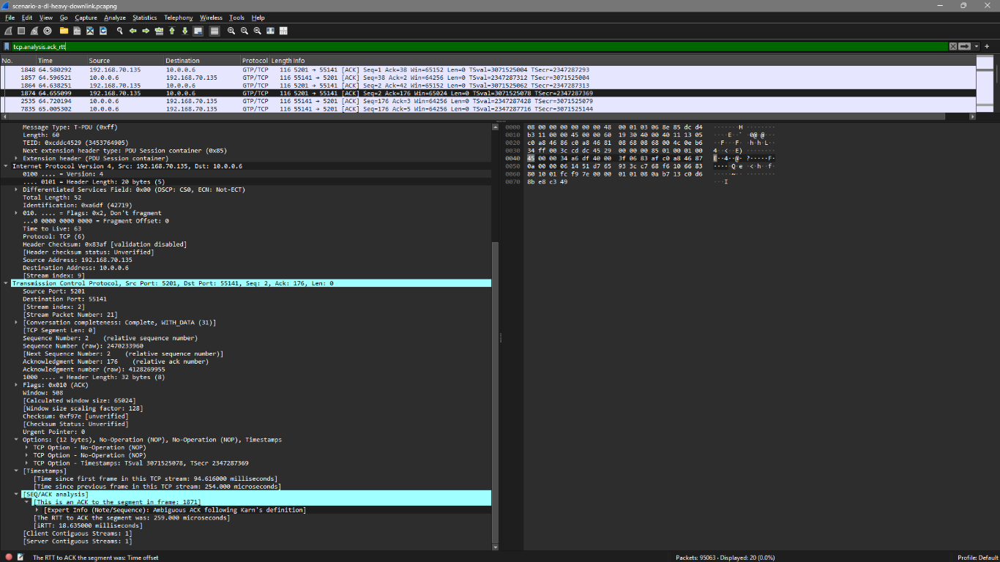

*Scenario A frame 1874: TCP ACK RTT details for the selected packet.*

```json
{
  "capture": "scenario-a-dl-heavy-downlink.pcapng",
  "display_filter": "tcp.analysis.ack_rtt",
  "frame_number": 1874,
  "tcp_ack_rtt_ms": 0.259,
  "tcp_initial_rtt_ms": 18.635
}
```

### Scenario B

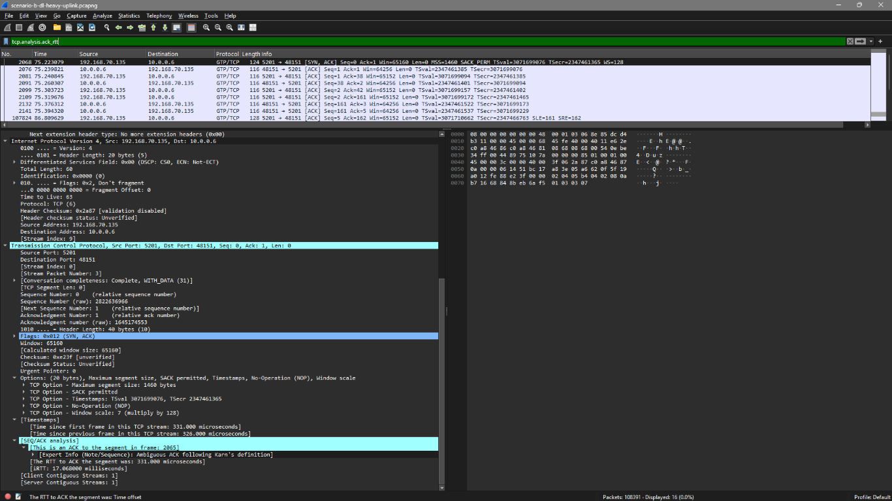

*Scenario B frame 2068: TCP ACK RTT details for the selected packet.*

```json
{
  "capture": "scenario-b-dl-heavy-uplink.pcapng",
  "display_filter": "tcp.analysis.ack_rtt",
  "frame_number": 2068,
  "tcp_ack_rtt_ms": 0.331,
  "tcp_initial_rtt_ms": 18.076
}
```

### Scenario C

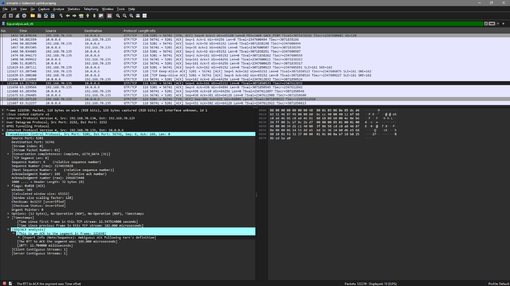

*Scenario C frame 121650: TCP ACK RTT and stream initial RTT are shown separately.*

```json
{
  "capture": "scenario-c-balanced-uplink.pcapng",
  "display_filter": "tcp.analysis.ack_rtt",
  "frame_number": 121650,
  "tcp_ack_rtt_ms": 0.186,
  "tcp_initial_rtt_ms": 11.704
}
```

The ACK RTT values are per-packet TCP measurements. Wireshark's initial RTT (`iRTT`) is a separate stream-level metric. Neither value should be described as the RTT of the UDP performance packets.

### UDP packet interval

| Scenario | Display filter | Packet numbers | Time interval |
| --- | --- | --- | --- |
| A | `gtp && iperf3.sequence && udp.srcport == 5201 && udp.dstport == 51624` | 1892 (seq. 1) → 1896 (seq. 2) | 1.045 ms |

Packets 1892 and 1896 are consecutive iPerf3 UDP data packets in the same flow and capture interface. Their packet-list times are 64.673240 s and 64.674285 s, respectively; the interval is their difference.

Using only the supplied files, the Scenario B and C captures contain the UDP connection-establishment exchange but no decoded `iperf3.sequence` data packets. Their provided display filters therefore show no iPerf UDP data packets, so an interval cannot be calculated for those scenarios from the available evidence. No additional test run or new capture has been used.

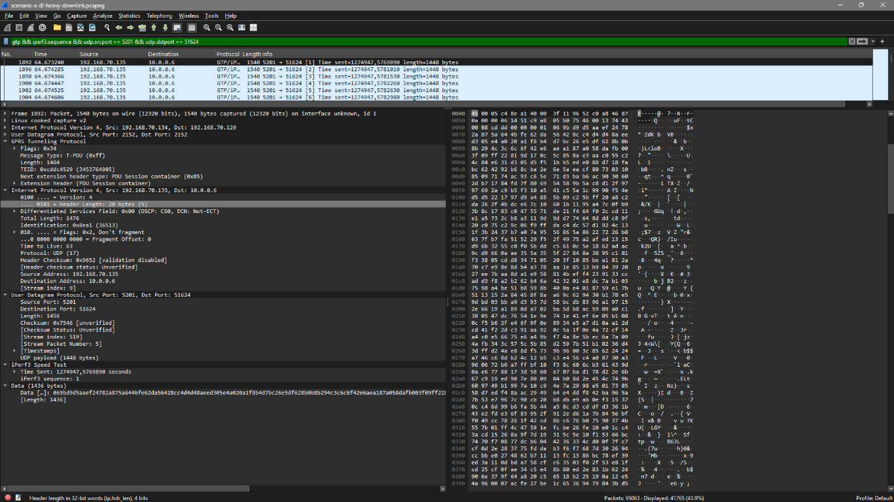

*Scenario A frame 1892: first of two consecutive iPerf3 UDP sequence packets used for the interval.*

```json
{
  "frame_number": 1892,
  "iperf3_sequence": 1,
  "frame_time_seconds": 64.673240
}
```

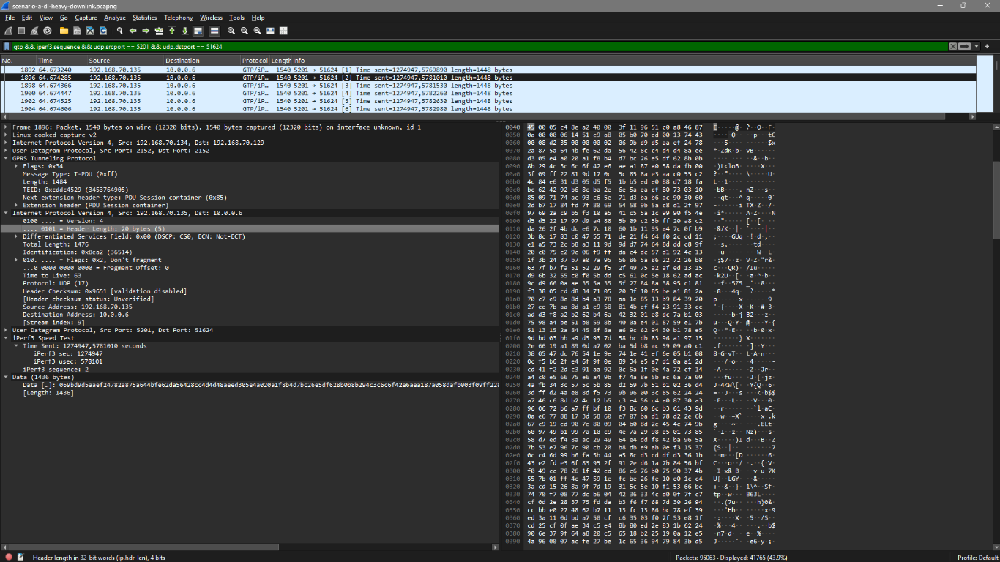

*Scenario A frame 1896: second consecutive iPerf3 UDP sequence packet, 1.045 ms after frame 1892.*

```json
{
  "frame_number": 1896,
  "iperf3_sequence": 2,
  "frame_time_seconds": 64.674285,
  "time_delta_from_previous_displayed_frame_ms": 1.045
}
```

## 9. Final Questions

1. **Does Scenario A use a TDD setting that matches its traffic direction?** Yes. Scenario A is downlink, and the DL-heavy reference configuration allocates 104 configured DL symbols and 32 configured UL symbols per 5 ms pattern, favoring downlink.
2. **Why is Scenario B expected to have limited uplink resources?** The DL-heavy SIB1 reference has two full UL slots and four UL symbols in a 10-slot, 5 ms pattern: 32 of 140 symbols, or 22.86%, are configured UL. This is fewer UL symbols per unit time than the balanced reference setting.
3. **How much does uplink throughput change from B to C?** It increases from 109.12 Mbps in B to 124.42 Mbps in C, a gain of 15.30 Mbps or approximately 14.02%. These are the iperf3 `end.sum.bits_per_second` rates converted to Mbps.
4. **What negative result is visible in C?** C has 2.13% packet loss, compared with 0.24% in B, and its jitter is also higher (0.162 ms versus 0.116 ms). Thus, C's higher measured throughput comes with higher loss and jitter in these tests.
5. **Why can increasing UL resources improve uplink throughput?** More configured UL symbols create more opportunities for the UE to transmit uplink data within each repeating TDD period. Actual throughput still depends on scheduling, radio conditions, overhead, and other settings.
6. **Is adding more UL resources always the best solution?** No. C's balanced reference setting has twice the configured UL symbol share of B's DL-heavy reference, but C also has higher measured packet loss (2.13% versus 0.24%). The resource change should be evaluated against both throughput and reliability.
7. **Suggest one simple follow-up test that could improve throughput without producing too much packet loss.** Repeat the uplink test with the balanced setting while increasing the offered UDP bitrate in small steps, keeping other test conditions the same. Record throughput, loss, and jitter at each step, repeat the measurements, and select the highest stable rate that meets the chosen packet-loss target.
8. **What can the configuration captures tell you that the iperf3 JSON cannot, and why are they not direct proof of the earlier test configuration?** The configuration captures show the decoded SIB1 common TDD parameters, while the iperf3 JSON reports traffic direction and performance but not the gNB TDD configuration. Because the SIB1 captures were recorded separately from the iperf3 runs, they document reference settings and cannot independently prove which configuration was broadcast during an earlier run.

## 10. Overall Interpretation

Across the two uplink scenarios, C has the higher reported sender throughput (124.42 Mbps versus 109.12 Mbps), while also showing higher packet loss (2.13% versus 0.24%) and jitter (0.162 ms versus 0.116 ms). The balanced SIB1 reference configuration provides a greater configured UL symbol share than the DL-heavy reference, which is consistent with the direction of the throughput difference. Since those SIB1 captures were recorded separately, this is a plausible explanation rather than proof of causation. The measured trade-off and the evidence limitations should be considered together when interpreting the results.

## 11. Deliverables Checklist

- [x] Identified the traffic direction for Scenarios A, B, and C from the JSON `reverse` values and included the relevant endpoint evidence.
- [x] Reported and compared the iperf3 throughput values, including the B-to-C percentage change.
- [x] Reported packet loss and jitter for all three scenarios and described the uplink throughput/reliability trade-off.
- [x] Decoded the SIB1 TDD reference settings for DL-heavy and balanced configurations.
- [x] Calculated configured DL, UL, and flexible symbol totals and shares; included diagrams over a common 5 ms interval.
- [x] Compared the TDD reference settings with the traffic direction and performance results, noting the limits of the evidence.
- [x] Identified a GTP-U packet's outer and inner addresses and TEID for all three scenarios with screenshot evidence.
- [x] Reported TCP retransmission counts for all three scenarios and clarified that these are not UDP loss counts.
- [x] Reported TCP ACK RTT examples for all three scenarios and a consecutive UDP packet interval for Scenario A, with the measurement distinction explained.
- [x] Reported the measurable UDP packet interval from Scenario A and documented that the supplied B/C captures do not contain iPerf UDP sequence-data packets for an interval calculation.
- [x] Answered the final analysis questions.
- [x] Included the raw-value JSON-style blocks alongside screenshot evidence.

## References

- [Wireshark NR RRC display-filter reference](https://www.wireshark.org/docs/dfref/n/nr-rrc.html)
- [3GPP TS 38.331, Release 18](https://www.etsi.org/deliver/etsi_ts/138300_138399/138331/18.08.00_60/ts_138331v180800p.pdf)
- [3GPP TS 38.213, Release 17, Section 11.1](https://www.etsi.org/deliver/etsi_ts/138200_138299/138213/17.06.00_60/ts_138213v170600p.pdf)
