# Lab 3: Deploying a 5G Standalone Network Using OpenAirInterface

## 1. Goal

In the previous labs, you analyzed 5G signaling messages and network performance using provided captures and measurements.

In this lab, you will deploy your own 5G Standalone (SA) network using OpenAirInterface (OAI), verify the complete connection, investigate RFsimulator communication, perform active network measurements, and troubleshoot a controlled connection failure.

Unlike the previous labs, you will collect measurements directly from your own running 5G network.

**Learning Objectives**

After completing this lab, you should be able to:

1. Deploy an OAI gNB, nrUE, and 5G Core Network.
2. Identify the main stages of 5G SA connection establishment.
3. Verify communication between gNB and nrUE through RFsimulator.
4. Measure user-plane connectivity under different packet sizes.
5. Diagnose connection failures using OAI and 5GC logs.
6. Explain the limitations of a software-simulated 5G network.

## 2. Experimental Environment

Use the *OAI v2.4.0 Build Guide* to prepare the environment before class.

| Component | Configuration |
|---|---|
| Ubuntu | 24.04 |
| OAI RAN | v2.4.0 |
| 5G Core | OAI CN5G |
| gNB | nr-softmodem |
| UE | nr-uesoftmodem |
| Radio interface | RFsimulator |
| Band | n78 |
| Subcarrier spacing | 30 kHz |
| Resource blocks | 106 |
| UE IMSI | 001010000000001 |
| External DN | 192.168.70.135 |

The experiment uses one Ubuntu machine without physical RF hardware.

## 3. Task 1 — Deploy and Verify the Complete 5G SA Network

Start the OAI CN5G:

```bash
cd ~/oai-cn5g
docker compose up -d
docker compose ps
```

Start the gNB and nrUE using the commands in the Build Guide.

Observe their terminal outputs and locate evidence of the following stages.

### Result

<p align="center">
  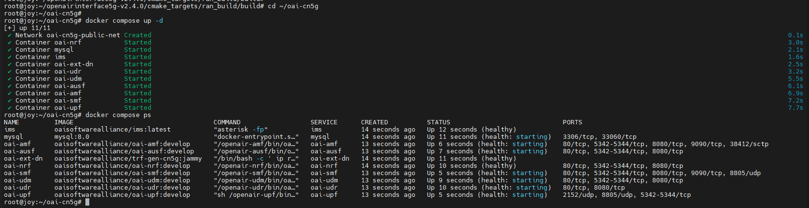
  <br>
  <em>Figure 1. OAI CN5G started with <code>docker compose up -d</code>. All 10 containers are up.</em>
</p>

All core containers started. Some still show `health: starting` because they were only a few seconds old. The gNB and UE logs I used for the table are in [lab3_requirements_tasks.md](lab3_requirements_tasks.md#part-b--lab-3-commands-optional-before-class).

| Stage | Successful? | Evidence from logs |
|---|---|---|
| CN5G initialization | ✅ | All 10 containers `Up` in `docker compose ps` |
| gNB NG Setup | ✅ | `Received NGSetupResponse from AMF` |
| UE synchronization | ✅ | `Initial sync successful, PCI: 0`, `UE synchronized!` |
| RRC connection establishment | ✅ | `State = NR_RRC_CONNECTED` |
| UE Registration | ✅ | `Received Registration Accept with result 3GPP` |
| PDU Session Establishment | ✅ | `Received PDU Session Establishment Accept, UE IPv4: 10.0.0.2` |
| UE tunnel creation | ✅ | `Interface oaitun_ue1 successfully configured, IPv4 10.0.0.2` |

### Answers

**1. Does a successful NG Setup guarantee that a UE can register?**

No. NG Setup only connects the gNB to the AMF. Registration is checked per UE by the core, so it can still fail if the UE's IMSI or keys are wrong or it isn't subscribed.

**2. Why can the UE establish an RRC connection but still fail Registration?**

RRC is only between the UE and the gNB, and the gNB doesn't check who the UE is. Registration is handled by the core (AMF/AUSF/UDM), which authenticates the UE. So the radio link can be fine while authentication fails.

**3. What additional procedure is required after Registration before user data can be exchanged?**

PDU Session Establishment. It gives the UE an IP address (`10.0.0.2`) and sets up the tunnel to the UPF. Without it, the UE is registered but can't send data.

## 4. Task 2 — Investigate RFsimulator Communication

OAI RFsimulator replaces the physical RF interface with software-based communication.

The gNB and nrUE exchange IQ samples through a TCP connection.

Check the running processes:

```bash
pgrep -a nr-softmodem
pgrep -a nr-uesoftmodem
```

Inspect the TCP connections:

```bash
sudo ss -tnp | grep 4043
```

If necessary, inspect the listener:

```bash
sudo ss -ltnp | grep 4043
```

The default RFsimulator port in this experiment is 4043.

### Result

<p align="center">
  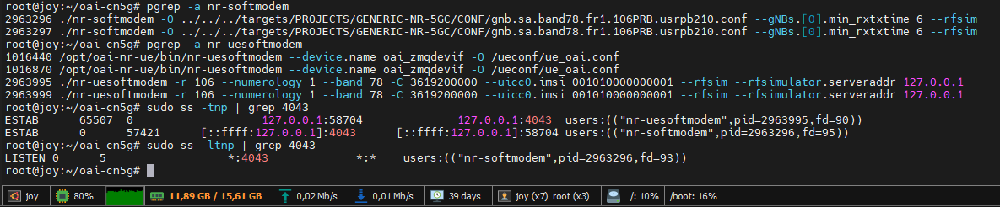
  <br>
  <em>Figure 2. gNB and nrUE processes, and the RFsimulator TCP connection on port 4043.</em>
</p>

| Item | Observed Value |
|---|---|
| gNB process ID | 2963296 |
| nrUE process ID | 2963995 |
| RFsimulator transport protocol | TCP |
| RFsimulator port | 4043 |
| TCP connection state | `ESTAB` (gNB socket also in `LISTEN`) |
| Connected process(es) | `nr-uesoftmodem` (127.0.0.1:58704) ↔ `nr-softmodem` (127.0.0.1:4043) |

The gNB is the server listening on 4043 and the UE connects to it as a client. `pgrep` shows two PIDs for each program, so I recorded the one that owns the socket in `ss`. The other `nr-uesoftmodem` entries (`/opt/oai-nr-ue/...`) belong to a separate container and aren't part of this setup.

### Answers

**1. Why does RFsimulator use a TCP connection instead of a physical antenna?**

There's no RF hardware here, so the gNB and UE send their IQ samples to each other over TCP instead of over the air. TCP is reliable and easy to use on one machine (localhost).

**2. Are the TCP packets exchanged by RFsimulator the same as the UE's application-layer IP packets?**

No. The TCP stream carries raw IQ samples, i.e. the simulated radio signal. The UE's IP packets (like ping) are encoded inside that signal by the 5G stack, so they're one layer deeper.

**3. Does using RFsimulator mean that the UE and gNB are performing no physical-layer processing?**

No. Both still do the full PHY processing (OFDM, coding, modulation, sync). RFsimulator only replaces the radio hardware and the air channel.

## 5. Task 3 — Verify End-to-End Connectivity

Check the UE tunnel interface:

```bash
ip -4 addr show oaitun_ue1
```

Test connectivity to the External DN:

```bash
ping -I oaitun_ue1 -c 10 192.168.70.135
```

### Result

<p align="center">
  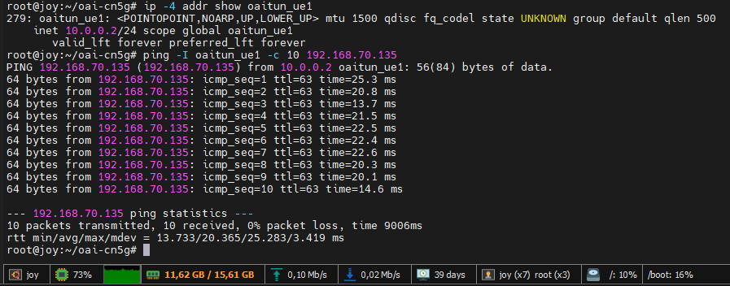
  <br>
  <em>Figure 3. UE tunnel <code>oaitun_ue1</code> (10.0.0.2) pinging the External DN with 0% packet loss.</em>
</p>

| Measurement | Observed Value |
|---|---|
| UE IP address | 10.0.0.2 |
| Destination IP | 192.168.70.135 |
| Packets transmitted | 10 |
| Packets received | 10 |
| Packet loss (%) | 0 |
| Minimum RTT (ms) | 13.733 |
| Average RTT (ms) | 20.365 |
| Maximum RTT (ms) | 25.283 |

### Answers

**1. Why must Ping use the `oaitun_ue1` interface in this experiment?**

`oaitun_ue1` is the UE's 5G data interface. The host can also reach `192.168.70.135` directly over the Docker bridge, so without `-I` the ping would skip the gNB and UPF and prove nothing about 5G.

**2. Does successful Registration guarantee successful user-plane connectivity?**

No. Registration is only signaling. User data still needs a working PDU session, which means the UPF, the GTP-U tunnel and the routing to the DN all have to work.

**3. What does a successful Ping prove, and what does it not prove about the simulated 5G system?**

It proves the whole path works: UE → gNB → UPF → DN and back. It doesn't prove real radio performance, because there's no real channel, noise or mobility, and a few small pings say nothing about throughput.

## 6. Task 4 — Investigate the Effect of Packet Size

You will now investigate whether changing the ICMP packet size affects the observed RTT.

Perform three experiments using the same established 5G connection.

**Scenario A — Small Packets**

```bash
ping -I oaitun_ue1 -s 56 -c 30 -i 0.2 192.168.70.135
```

**Scenario B — Medium Packets**

```bash
ping -I oaitun_ue1 -s 512 -c 30 -i 0.2 192.168.70.135
```

**Scenario C — Large Packets**

```bash
ping -I oaitun_ue1 -s 1200 -c 30 -i 0.2 192.168.70.135
```

Note: `-s` specifies ICMP payload size, not the complete IP packet size.

### Result

<table align="center">
  <tr>
    <td align="center">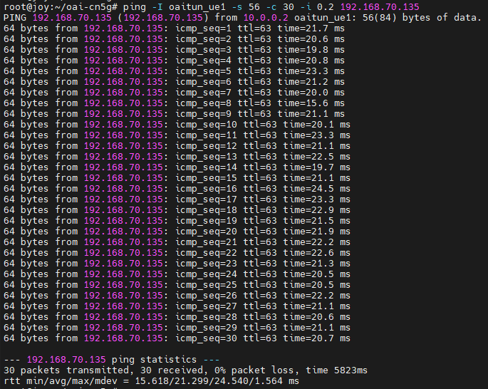</td>
    <td align="center">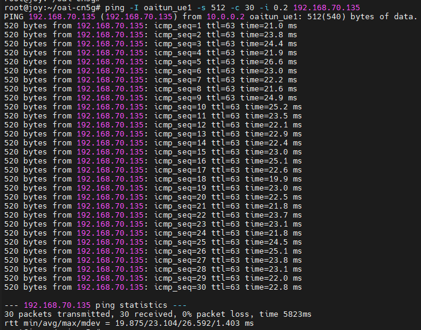</td>
    <td align="center">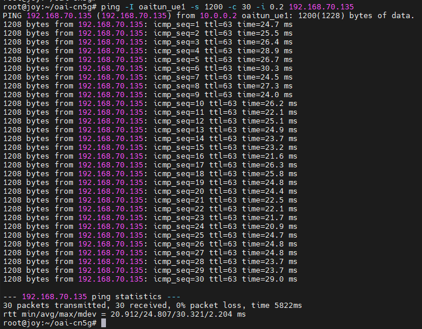</td>
  </tr>
  <tr>
    <td align="center"><em>(a) Scenario A: 56 bytes</em></td>
    <td align="center"><em>(b) Scenario B: 512 bytes</em></td>
    <td align="center"><em>(c) Scenario C: 1200 bytes</em></td>
  </tr>
</table>
<p align="center"><em>Figure 4. 30 pings at 0.2 s intervals for each payload size. All three runs had 0% packet loss.</em></p>

| Scenario | ICMP Payload | Avg. RTT (ms) | Max. RTT (ms) | Packet Loss (%) |
|---|---:|---:|---:|---:|
| A | 56 bytes | 21.299 | 24.540 | 0 |
| B | 512 bytes | 23.104 | 26.592 | 0 |
| C | 1200 bytes | 24.807 | 30.321 | 0 |

```text
RTT Difference = Average RTT(C) - Average RTT(A)
               = 24.807 - 21.299
               = 3.508 ms
```

### Answers

**1. Which scenario has the highest average RTT?**

Scenario C (1200 bytes), with 24.807 ms.

**2. Does increasing packet size always increase RTT in your measurements?**

On average, yes: 21.3 → 23.1 → 24.8 ms. But not for every packet. Some packets in C (min 20.9 ms) were faster than some in A (max 24.5 ms), so the ranges overlap and the increase is small (~3.5 ms).

**3. Why might a larger packet require more transmission or processing resources?**

A bigger packet needs more resource blocks or slots to send, and more coding/decoding work at the PHY. It may also be split into several transport blocks, so it can take more TDD slots to deliver.

**4. What factors other than packet size could affect RTT in a software-based 5G network?**

CPU load on the machine, the TDD slot timing (waiting for an UL or DL slot), the scheduler, HARQ retransmissions, and the Docker/core network processing.

**5. Can these results be interpreted as real over-the-air 5G latency? Explain.**

No. RFsimulator runs everything on one PC over TCP, so there's no real channel, fading or interference. The RTT mostly reflects software processing and slot timing, not real radio conditions.

## 7. Task 5 — Diagnose a Controlled UE Registration Failure

In this task, you will deliberately introduce one configuration error and investigate why the UE cannot complete registration.

**Important:** Save the original successful UE command before starting. Do not modify the CN5G subscriber database.

### Step 1 — Stop the UE

Press `Ctrl+C` in the nrUE terminal. Keep the CN5G and gNB running.

**Result:**

<p align="center">
  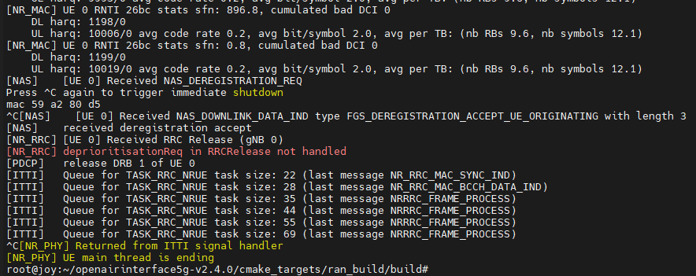
  <br>
  <em>Figure 5. The UE deregisters and gets an RRC Release when stopped.</em>
</p>

### Step 2 — Launch the UE with an Incorrect IMSI

Change only the IMSI:

```bash
sudo ./nr-uesoftmodem \
  -r 106 \
  --numerology 1 \
  --band 78 \
  -C 3619200000 \
  --uicc0.imsi 001010000000099 \
  --rfsim \
  --rfsimulator.serveraddr 127.0.0.1
```

The IMSI `001010000000099` is not provisioned in the standard classroom subscriber configuration. Verify this assumption against the instructor's database before class.

Observe the UE and AMF logs.

```bash
cd ~/oai-cn5g
docker compose logs --since=2m oai-amf
```

Allow time for registration attempts, then stop the UE.

**Result:**

<p align="center">
  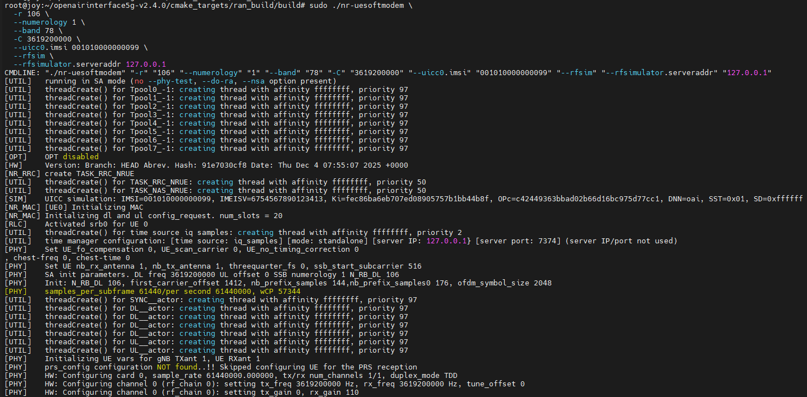
  <br>
  <em>Figure 6. nrUE started with the wrong IMSI <code>001010000000099</code>.</em>
</p>

<p align="center">
  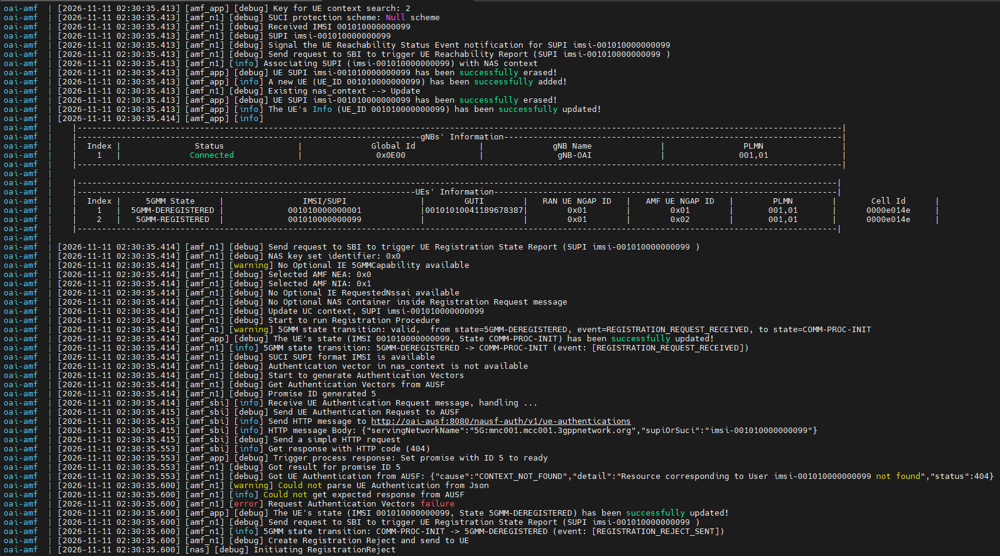
  <br>
  <em>Figure 7. AMF log: the AUSF returns <code>404 CONTEXT_NOT_FOUND</code> and the AMF rejects the registration.</em>
</p>

**UE log (key lines):**

```text
[SIM]    UICC simulation: IMSI=001010000000099, ...
[HW]     Connection to 127.0.0.1:4043 established
[PHY]    Initial sync successful, PCI: 0
[NR_RRC] SIB1 decoded
[MAC]    [UE 0][191.10][RAPROC] 4-Step RA procedure succeeded. CBRA: Contention Resolution is successful.
[NR_RRC] State = NR_RRC_CONNECTED
[NAS]    Generate Initial NAS Message: Registration Request
[NAS]    [UE 0] Received NAS_DOWNLINK_DATA_IND type FGS_REGISTRATION_REJECT with length 4
[NAS]    Received Registration reject message too short
```

**AMF log (key lines):**

```text
[amf_n1] [debug] Received Registration Request message, handling...
[amf_n1] [debug] Received IMSI 001010000000099
[amf_sbi] [info] Send HTTP message to http://oai-ausf:8080/nausf-auth/v1/ue-authentications
[amf_sbi] [info] Get response with HTTP code (404)
[amf_n1] [debug] Got UE Authentication from AUSF: {"cause":"CONTEXT_NOT_FOUND","detail":"Resource corresponding to User imsi-001010000000099 not found","status":404}
[amf_n1] [error] Request Authentication Vectors failure
[amf_n1] [info] 5GMM state transition: COMM-PROC-INIT -> 5GMM-DEREGISTERED (event: [REGISTRATION_REJECT_SENT])
[amf_n1] [debug] Create Registration Reject and send to UE
[common] [debug] [amf_n1]Registration-Reject message buffer
7e 00 44 03
```

| Item | Observation |
|---|---|
| Modified parameter | `--uicc0.imsi` changed from `001010000000001` to `001010000000099` |
| UE synchronized with gNB? | Yes (`Initial sync successful, PCI: 0`) |
| RRC connection established? | Yes (`State = NR_RRC_CONNECTED`) |
| Registration successful? | No |
| Error or rejection evidence | AUSF returned `404 CONTEXT_NOT_FOUND` for `imsi-001010000000099`; AMF sent Registration Reject (`7e 00 44 03`) and the UE got `FGS_REGISTRATION_REJECT` |
| Likely cause | The IMSI isn't in the subscriber database, so the core can't authenticate the UE |

The reject's last byte, `03`, is 5GMM cause #3 "Illegal UE". The UE's "message too short" line just means OAI's UE didn't fully decode the reject; it still received it.

### Step 3 — Restore the Original IMSI

Restart the nrUE using:

```text
--uicc0.imsi 001010000000001
```

Confirm that the UE successfully registers again and that Ping works.

**Result:**

**AMF log (key lines):**

```text
[amf_n1] [debug] Received IMSI 001010000000001
[amf_sbi] [info] Get response with HTTP code (201)
[amf_n1] [debug] Got ConfirmationDataResponse from AUSF: {"authResult":"AUTHENTICATION_SUCCESS", ...}
[amf_n1] [debug] Authentication successful by network!
[amf_n1] [info] UE (IMSI 001010000000001, GUTI 001010100414102450586, ...) has been registered to the network
[amf_n1] [info] 5GMM state transition: COMM-PROC-INIT -> 5GMM-REGISTERED (event: [REGISTRATION_COMPLETE_RECEIVED])
[amf_sbi] [debug] Handle PDU Session Establishment Request (SUPI imsi-001010000000001, PDU Session ID 10)
```

<p align="center">
  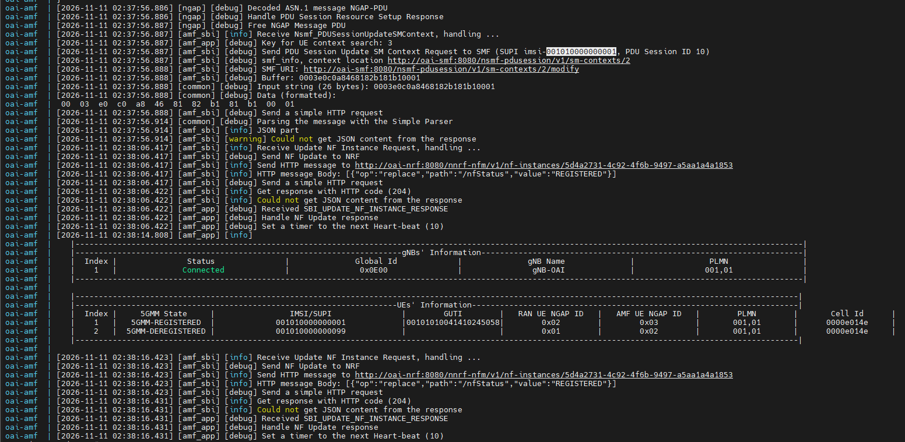
  <br>
  <em>Figure 8. AMF UE table after the fix: IMSI <code>…001</code> is <code>5GMM-REGISTERED</code> with a new GUTI, while the wrong IMSI <code>…099</code> stays <code>5GMM-DEREGISTERED</code>.</em>
</p>

<p align="center">
  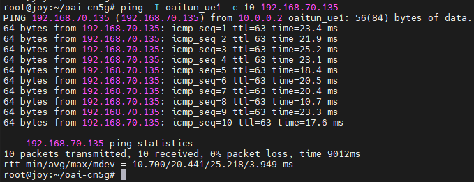
  <br>
  <em>Figure 9. After restoring IMSI <code>001010000000001</code>, the UE pings the DN again with 0% packet loss.</em>
</p>

| Check | Failed (IMSI …099) | Recovered (IMSI …001) |
|---|---|---|
| AUSF response | `404 CONTEXT_NOT_FOUND` | `201`, then `AUTHENTICATION_SUCCESS` |
| AMF 5GMM state | `5GMM-DEREGISTERED` | `5GMM-REGISTERED` |
| PDU session | none | Session ID 10, UE IP `10.0.0.2` |
| Ping to 192.168.70.135 | not possible | 10/10 received, 0% loss, avg 20.441 ms |

### Answers

**1. Why can the UE potentially synchronize with the gNB even when the IMSI is incorrect?**

Sync only uses the gNB's broadcast signals (SSB, SIB1), which any UE can receive. The IMSI isn't checked until the Registration Request reaches the core.

**2. Which network function is involved in UE authentication?**

The AUSF, together with the UDM/UDR that hold the subscriber data. The AMF asks the AUSF, and here the AUSF answered `404 CONTEXT_NOT_FOUND`.

**3. Why does changing an IMSI affect Registration but not the RFsimulator TCP connection itself?**

The TCP connection only carries the radio samples between the UE and gNB processes. It doesn't know anything about the IMSI. The IMSI is NAS-level data that only the core checks.

**4. What evidence proves that restoring the correct configuration solved the problem?**

With the correct IMSI, the AUSF authenticated the UE (`AUTHENTICATION_SUCCESS`), the AMF moved it to `5GMM-REGISTERED`, and a PDU session was set up. The ping then worked again (10/10, 0% loss), so the IMSI was the only problem.

## 8. Task 7 — Explain the Relationship Between Simulation and Real 5G

Your OAI gNB and nrUE perform 5G NR protocol processing even though they do not use physical antennas.

### Result

| Feature | OAI RFsimulator | Physical 5G System |
|---|---|---|
| gNB and UE protocol stack | Full stack (PHY to NAS) | Full stack (PHY to NAS) |
| OFDM signal processing | Yes, done in software | Yes |
| Physical antennas | No, IQ samples go over TCP | Yes |
| RF hardware impairments | None (ideal) | Phase noise, CFO, IQ imbalance, etc. |
| Wireless propagation effects | None (no fading, noise or path loss) | Fading, path loss, interference |
| 5G Core connectivity | Yes, real OAI CN5G | Yes |

### Answers

**1. Which parts of the 5G system remain functional when physical RF hardware is replaced with RFsimulator?**

Everything except the radio: the full gNB and UE stack (PHY, MAC, RLC, PDCP, RRC, NAS) and the whole 5G Core.

**2. Why is RFsimulator useful for testing the 5G protocol stack?**

It's cheap and easy to set up on one PC, and the results are repeatable because there's no random channel. That makes it good for debugging signaling and testing configs.

**3. Why might latency and throughput differ between RFsimulator and a real 5G deployment?**

RFsimulator depends on CPU speed and runs on an ideal channel. A real network has fading, interference, retransmissions and hardware delays.

**4. What would need to change if you wanted to test a physical UE instead of OAI nrUE?**

Replace `--rfsim` with real RF hardware (e.g. a USRP) on the gNB, and use a programmable SIM whose IMSI/Ki/OPc are provisioned in the core. The phone also has to support band n78 and the configured PLMN.

## 9. Final Analysis

Answer each question in three to five sentences.

### Answers

**1. Describe the complete process from starting the OAI 5GC to successful user-plane connectivity.**

First I started the CN5G containers, then the gNB, which did NG Setup with the AMF. The UE connected to the gNB over RFsimulator, synced to the cell, did random access and set up an RRC connection. Then it registered with the core (authentication and security mode) and set up a PDU session, which gave it IP `10.0.0.2` on `oaitun_ue1`. Finally, a ping to `192.168.70.135` confirmed the user plane worked.

**2. Explain the difference between an RFsimulator TCP connection and a 5G PDU Session.**

The RFsimulator TCP connection (port 4043) just carries raw IQ samples between the gNB and UE processes, replacing the radio. The PDU session is a 5G-level data connection set up by the SMF, with an IP address and a GTP-U tunnel to the UPF. So the TCP link is only the "air" between UE and gNB, while the PDU session runs end to end from the UE to the DN.

**3. Based on your measurements, how did packet size affect RTT and packet loss?**

Average RTT went up slightly with packet size: 21.3 ms (56 B), 23.1 ms (512 B) and 24.8 ms (1200 B), about 3.5 ms more for the largest packets. The ranges overlapped, so the effect is small compared to normal jitter. Packet loss was 0% in all three cases.

**4. Describe the registration failure you introduced and explain how you diagnosed and recovered from it.**

I restarted the UE with a wrong IMSI (`001010000000099`). The UE still synced and got RRC connected, but it received a Registration Reject. The AMF log showed the AUSF answering `404 CONTEXT_NOT_FOUND`, meaning that IMSI isn't in the subscriber database. Restoring the original IMSI fixed it: the UE registered and the ping worked again.

**5. Identify two limitations of this simulated environment and explain how they might affect experimental results.**

First, there's no real wireless channel (no fading, noise or interference), so BLER and retransmissions are close to zero and the results look better than in reality. Second, everything runs on one PC, so CPU load and scheduling affect timing. This means the RTT values reflect software performance more than real 5G latency.

## 10. Submission Checklist

Submit one Markdown or PDF report containing:

- Completed 5G SA connection verification table.
- gNB and nrUE connection screenshots.
- RFsimulator TCP connection evidence.
- Baseline Ping measurement.
- Three packet-size comparison results.
- RTT difference calculation.
- Controlled failure and recovery evidence.
- RFsimulator versus physical 5G comparison.
- Answers to the final analysis questions.

All measurements and log evidence must come from your own experimental environment.

## 11. Grading Rubric

| Item | Points |
|---|---:|
| Complete 5G SA deployment | 15 |
| RFsimulator TCP connection analysis | 15 |
| End-to-end user-plane verification | 15 |
| Packet-size experiment and analysis | 20 |
| Controlled failure and recovery | 20 |
| Simulation limitations and final analysis | 15 |
| **Total** | **100** |

Vote TOP3：https://forms.gle/Mvza68DFBzPcZXfW6