# Lab 4 — 5G CU/DU Split Deployment and F1-C/F1-U Analysis

**Student handout**  
**Environment:** Ubuntu 24.04 LTS · OpenAirInterface (OAI) v2.4.0 · RFsimulator · no SDR required  
**Prerequisite:** Lab 3 completed successfully (OAI CN5G, gNB, nrUE, UE tunnel and Ping)

> **Lab objective:** Replace the monolithic gNB from Lab 3 with a split gNB-CU and gNB-DU. Capture and analyze both **F1-C** (F1AP over SCTP) and **F1-U** (GTP-U over UDP) in a single PCAP file. Verify that the UE can still establish a PDU session and reach the external data network.
>
> **Instructor validation:** This lab's CU/DU split, F1 Setup, UE RRC signaling, UE Context procedures, GTP-U T-PDUs, and external-DN Ping were observed on the classroom OAI v2.4.0 environment. Exact IP addresses, frequencies and core network configuration must be checked on each student image.

---

## 1. Learning objectives

After completing this lab, you should be able to:

1. Explain the functional division between gNB-CU and gNB-DU.
2. Deploy a split 5G SA RAN with OAI and RFsimulator.
3. Identify **F1-C** control-plane messages (F1 Setup, RRC transfer, UE Context Setup).
4. Identify **F1-U** user-plane GTP-U packets, including their direction and TEID.
5. Verify UE IP connectivity through the split architecture.
6. Distinguish F1-U from the separate **N3** interface, even though both can use GTP-U.

## 2. Network architecture and experimental parameters

```text
                         OAI 5G Core
                     AMF / SMF / UPF
                           |
                   N2 (NGAP) / N3 (GTP-U)
                           |
                      +----------+
                      |  gNB-CU  |  F1-C IP: 127.0.0.3
                      | RRC/PDCP |  (example classroom setup)
                      +----------+
                         |     |
        F1-C: F1AP/SCTP |     | F1-U: GTP-U/UDP
                         |     |
                      +----------+
                      |  gNB-DU  |  F1 IP: 127.0.0.4
                      |RLC/MAC/PHY|
                      +----------+
                           |
                    RFsimulator (IQ/TCP)
                           |
                         nrUE
                           |
                      oaitun_ue1
                           |
                       ICMP Ping
```

| Parameter | Classroom configuration |
|---|---|
| OAI version | `v2.4.0` |
| RAN | One gNB-CU + one gNB-DU + one nrUE |
| Radio | RFsimulator, no physical SDR |
| NR band | n78 |
| Bandwidth | 106 PRBs |
| Numerology | 1 (30 kHz SCS) |
| CU F1 address (observed) | `127.0.0.3` |
| DU F1 address (observed) | `127.0.0.4` |
| DU SSB NR-ARFCN (observed) | `630048` (3,450.72 MHz) |
| UE frequency argument used in successful split test | `-C 3450720000` |
| UE IMSI | `001010000000001` |
| External DN | `192.168.70.135` |

**Important:** The Lab 3 monolithic gNB config used `absoluteFrequencySSB = 641280` (3,619.20 MHz), whereas the split DU config used `630048` (3,450.72 MHz). The frequency parameters **must match the working DU/UE pair**. Do not reuse Lab 3's `-C 3619200000` without checking the DU configuration. The `-C` argument and effective radio carrier placement should be verified against OAI startup logs; the above value is the one used in the successful classroom test, not a general formula for every DU file.

---

## 3. Task 1 — Inspect the split configurations

### Step 1. Confirm the configuration files exist

```bash
cd ~/openairinterface5g-v2.4.0

ls -l \
  targets/PROJECTS/GENERIC-NR-5GC/CONF/gnb-cu.sa.f1.conf \
  targets/PROJECTS/GENERIC-NR-5GC/CONF/gnb-du.sa.band78.106prb.rfsim.pci0.conf
```

#### Screenshot Result

<p align="center">
  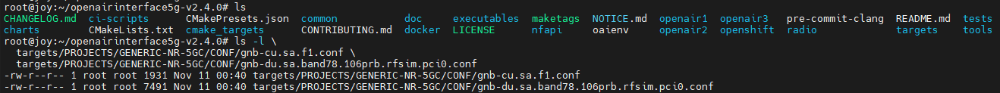
  <br>
  <em>Figure 1. Both split gNB configuration files exist in the OAI configuration directory.</em>
</p>

```text
-rw-r--r-- 1 root root 1931 Nov 11 00:40 targets/PROJECTS/GENERIC-NR-5GC/CONF/gnb-cu.sa.f1.conf
-rw-r--r-- 1 root root 7491 Nov 11 00:40 targets/PROJECTS/GENERIC-NR-5GC/CONF/gnb-du.sa.band78.106prb.rfsim.pci0.conf
```

### Step 2. Check frequency and F1 network settings

```bash
grep -nE \
'absoluteFrequencySSB|dl_absoluteFrequencyPointA|dl_carrierBandwidth|physCellId|min_rxtxtime|local_s_address|remote_s_address|local_n_address|remote_n_address|local_s_portd|remote_s_portd|local_n_portd|remote_n_portd|amf_ip_address' \
  targets/PROJECTS/GENERIC-NR-5GC/CONF/gnb-cu.sa.f1.conf \
  targets/PROJECTS/GENERIC-NR-5GC/CONF/gnb-du.sa.band78.106prb.rfsim.pci0.conf
```

**Record:**

- CU F1 address: `127.0.0.3`
- DU F1 address: `127.0.0.4`
- DU `absoluteFrequencySSB`: `630048`
- DU downlink absolute frequency point A: `628776`
- Downlink carrier bandwidth: `106` PRBs
- F1-C SCTP and F1-U GTP-U port: `2152`
- AMF IP address: `192.168.70.132`

#### Screenshot Result

<p align="center">
  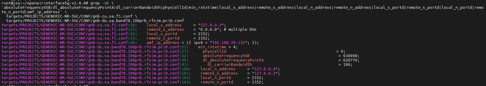
  <br>
  <em>Figure 2. OAI configuration values for F1 addresses, DU SSB frequency, carrier bandwidth, and AMF address.</em>
</p>

**Questions**

1. Which protocol layers mainly reside in the CU, and which reside in the DU?

The CU mainly contains RRC and PDCP. The DU mainly contains RLC, MAC, and PHY.

2. What is the purpose of the F1 interface?

The F1 interface connects the CU and DU. F1-C carries control-plane signaling, while F1-U carries the UE user-plane data.

3. Why must the UE radio frequency be compatible with the DU rather than taken blindly from the previous lab?

The DU determines the actual NR carrier and SSB used for radio communication. The UE must use matching frequency parameters to synchronize with the DU. For this configuration, the DU uses SSB NR-ARFCN `630048`, so the UE uses `-C 3450720000`.

---

## 4. Task 2 — Deploy the split 5G SA network

Before starting, stop the monolithic Lab 3 gNB and any old nrUE processes with `Ctrl+C`. Avoid running two gNB/DU RFsimulator servers on the same listening port.

### Terminal 1 — Start CN5G

```bash
cd ~/oai-cn5g
docker compose up -d
docker compose ps
```

<p align="center">
  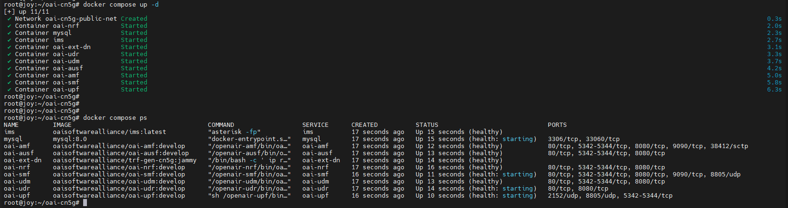
  <br>
  <em>Figure 3. OAI 5G Core started with <code>docker compose up -d</code>; <code>docker compose ps</code> shows the network containers running.</em>
</p>

### Terminal 2 — Start gNB-CU

```bash
cd ~/openairinterface5g-v2.4.0/cmake_targets/ran_build/build

sudo ./nr-softmodem \
  -O ../../../targets/PROJECTS/GENERIC-NR-5GC/CONF/gnb-cu.sa.f1.conf
```

<p align="center">
  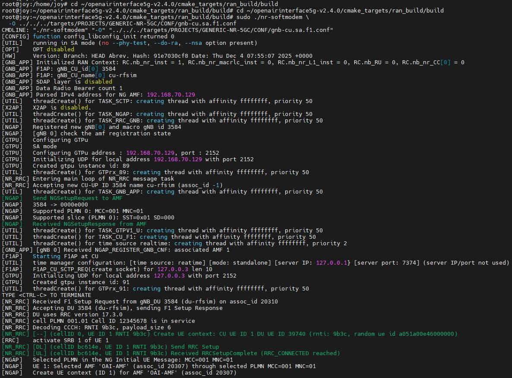
  <br>
  <em>Figure 4. The gNB-CU starts and opens the NG connection toward the 5G Core.</em>
</p>

<p align="center">
  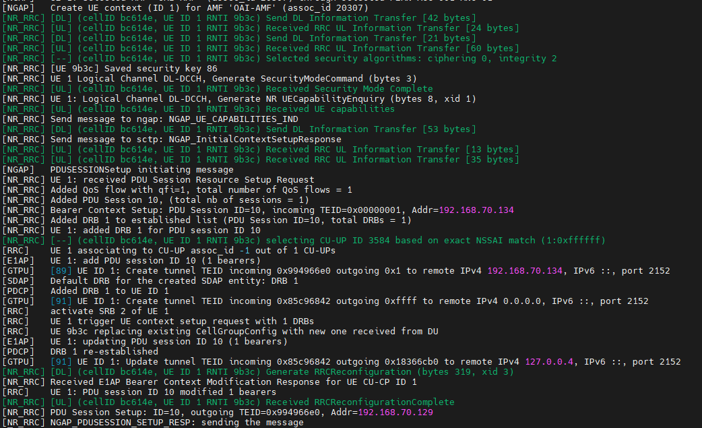
  <br>
  <em>Figure 5. The gNB-CU receives the F1 Setup Request and creates the UE context after RRC signaling begins.</em>
</p>

### Terminal 3 — Start gNB-DU

**Start the packet capture in Task 3 *before* starting the DU if you want to record the initial F1 Setup handshake.**

```bash
cd ~/openairinterface5g-v2.4.0/cmake_targets/ran_build/build

sudo ./nr-softmodem \
  -O ../../../targets/PROJECTS/GENERIC-NR-5GC/CONF/gnb-du.sa.band78.106prb.rfsim.pci0.conf \
  --rfsim
```

<p align="center">
  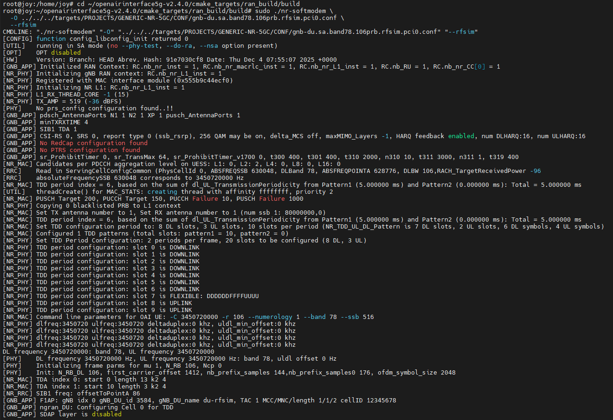
  <br>
  <em>Figure 6. The gNB-DU starts with SSB NR-ARFCN 630048 and 106 PRBs.</em>
</p>

<p align="center">
  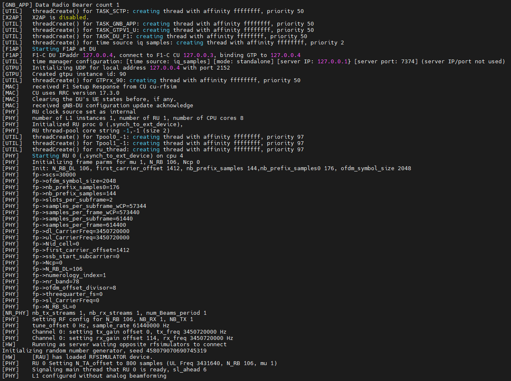
  <br>
  <em>Figure 7. The gNB-DU connects to the gNB-CU and RFsimulator starts listening for the UE.</em>
</p>

<p align="center">
  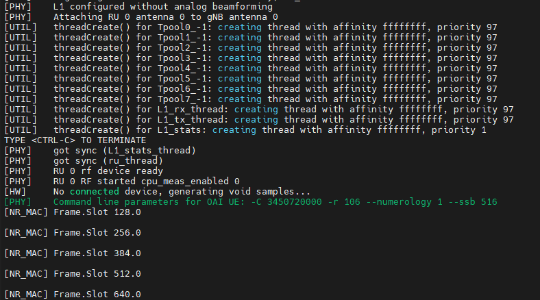
  <br>
  <em>Figure 8. The gNB-DU waits for the nrUE RFsimulator connection before it has an attached UE.</em>
</p>

<p align="center">
  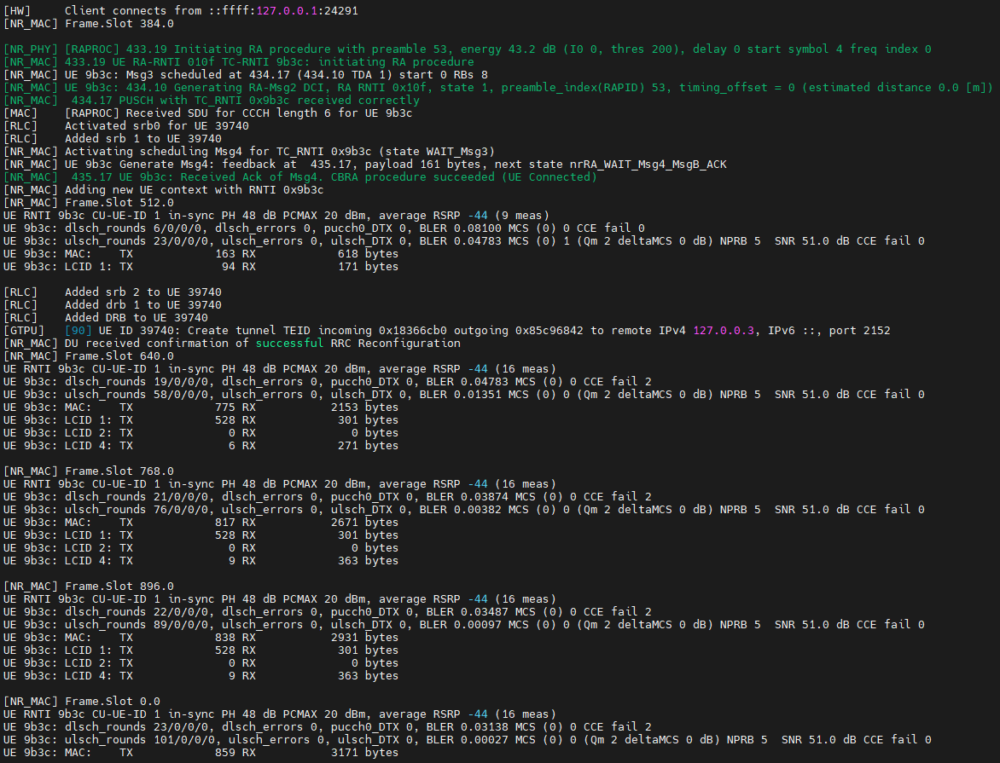
  <br>
  <em>Figure 9. The RFsimulator DU accepts the nrUE connection and begins UE registration and data radio bearer procedures.</em>
</p>

### Terminal 4 — Start nrUE

```bash
cd ~/openairinterface5g-v2.4.0/cmake_targets/ran_build/build

sudo ./nr-uesoftmodem \
  -r 106 \
  --numerology 1 \
  --band 78 \
  -C 3450720000 \
  --uicc0.imsi 001010000000001 \
  --rfsim \
  --rfsimulator.serveraddr 127.0.0.1
```

> **Instructor note:** This UE command reflects the working classroom split configuration. In particular, the original Lab 3 `-C 3619200000` setting was not compatible with this DU configuration. If a provided classroom image has different NR frequencies or UICC credentials, use the instructor-validated values.

<p align="center">
  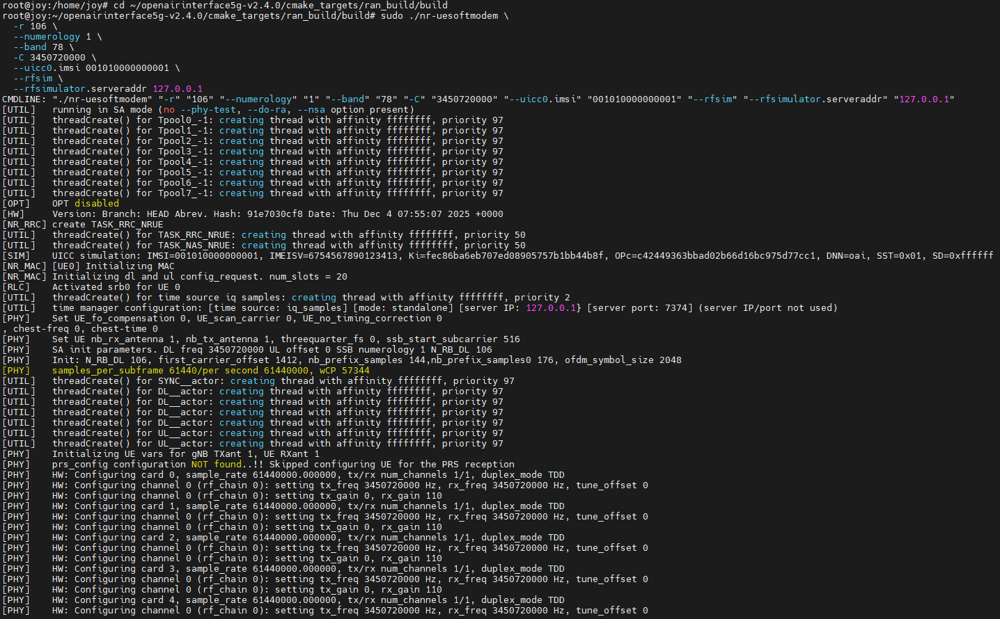
  <br>
  <em>Figure 10. The nrUE starts with band 78, numerology 1, 106 PRBs, carrier 3450720000 Hz, and the configured IMSI.</em>
</p>

<p align="center">
  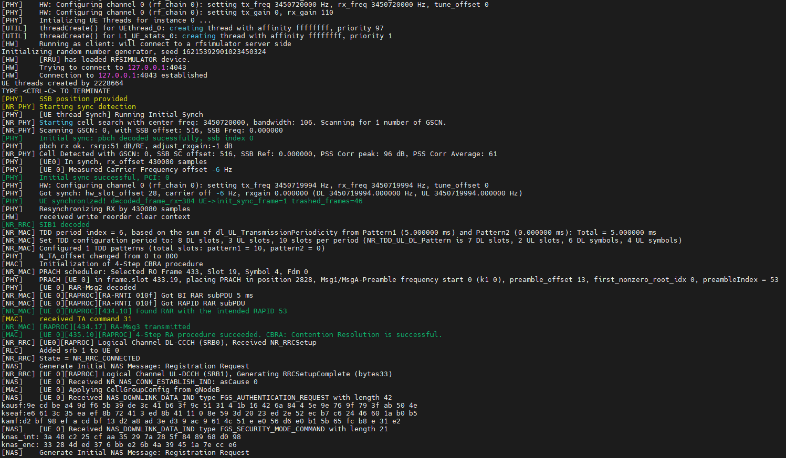
  <br>
  <em>Figure 11. The nrUE connects to RFsimulator and reaches successful cell and radio synchronization.</em>
</p>

<p align="center">
  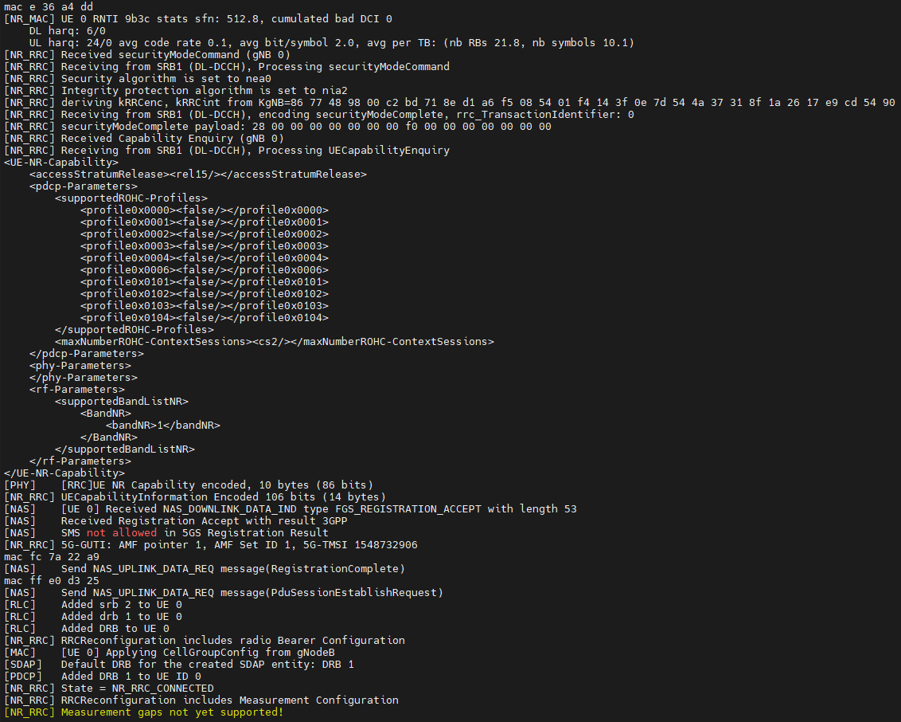
  <br>
  <em>Figure 12. The nrUE completes Initial Access, RRC Setup, authentication, security, and registration signaling.</em>
</p>

<p align="center">
  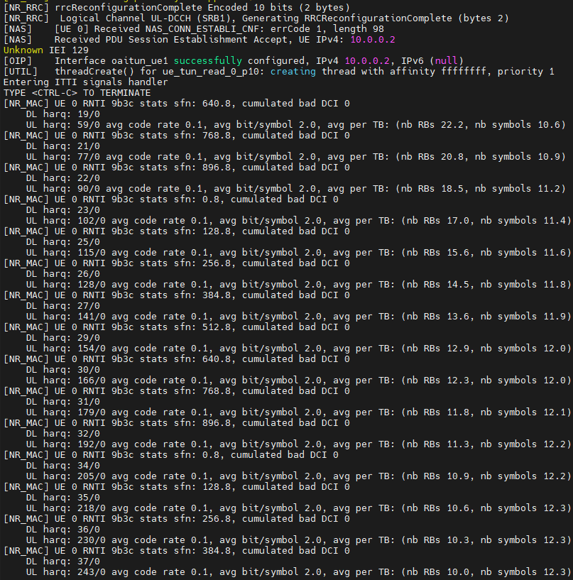
  <br>
  <em>Figure 13. The nrUE receives PDU Session Establishment Acceptance and creates the <code>oaitun_ue1</code> tunnel.</em>
</p>

### Check the UE connection

```bash
ip -4 addr show oaitun_ue1
ping -I oaitun_ue1 -c 10 192.168.70.135
```

<p align="center">
  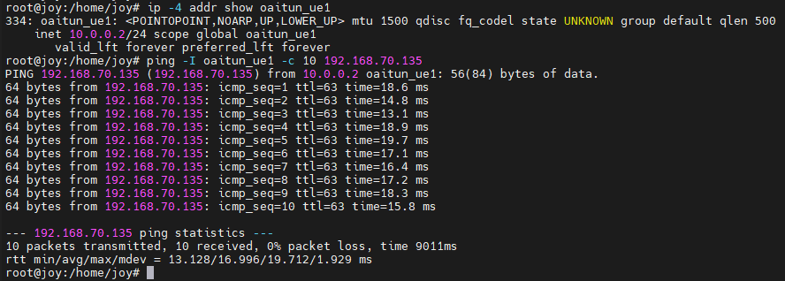
  <br>
  <em>Figure 14. The <code>oaitun_ue1</code> tunnel is configured with IP 10.0.0.2 and reaches 192.168.70.135.</em>
</p>

| Measurement | Observed Value |
|---|---|
| UE IP address | `10.0.0.2` |
| Destination IP | `192.168.70.135` |
| Packets transmitted | 10 |
| Packets received | 10 |
| Packet loss | 0% |
| Minimum RTT | 13.128 ms |
| Maximum RTT | 19.712 ms |
| Average RTT | 16.996 ms |

---

## 5. Task 3 — Capture F1-C and F1-U in a single PCAP

The classroom capture showed CU `127.0.0.3` and DU `127.0.0.4` on the Linux loopback interface (`lo`).

### Step 1. Start packet capture

Start CN5G and CU, but **before starting the DU** open another terminal:

```bash
sudo tcpdump -i lo -s 0 -nn \
  -w ~/lab4-f1-complete.pcap \
  'host 127.0.0.3 and host 127.0.0.4 and (sctp or udp port 2152)'
```

This captures:

- **F1-C:** F1AP carried over SCTP.
- **F1-U:** GTP-U carried over UDP port 2152, **provided the configured F1-U endpoints and port match these values**.

### Step 2. Trigger control-plane and user-plane traffic

1. Start the DU to trigger **SCTP association** and **F1 Setup**.
2. Start nrUE to trigger **RRC** and **UE Context** procedures.
3. After the UE tunnel appears, generate traffic:

```bash
ping -I oaitun_ue1 -c 30 -i 0.2 192.168.70.135
```

4. Press `Ctrl+C` in the **tcpdump terminal** to finish and save the PCAP.
5. Verify the file:

```bash
ls -lh ~/lab4-f1-complete.pcap
```

### Alternative: capture all traffic between CU and DU

If you are unsure of the F1-U UDP port, use this **instead of** the filtered capture above:

```bash
sudo tcpdump -i lo -s 0 -nn \
  -w ~/lab4-f1-all.pcap \
  'host 127.0.0.3 and host 127.0.0.4'
```

If the CU and DU are not communicating over `lo`, select the correct interface (`ip -br addr` or `tcpdump -D`) and update the IP filter.

---

## 6. Task 4 — Analyze F1-C (F1AP / SCTP)

Open the capture:

```bash
wireshark ~/lab4-f1-complete.pcap
```

### Evidence

<p align="center">
  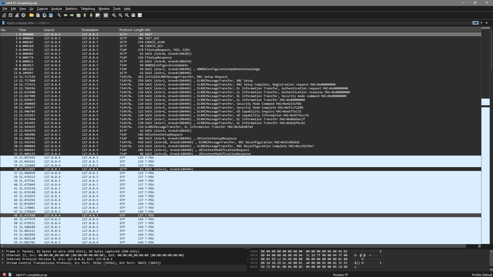
  <br>
  <em>Figure 15. Wireshark overview of SCTP, F1AP, and GTP traffic in the complete Lab 4 capture.</em>
</p>

Useful **Wireshark display filters**:

```text
sctp
f1ap
```

<p align="center">
  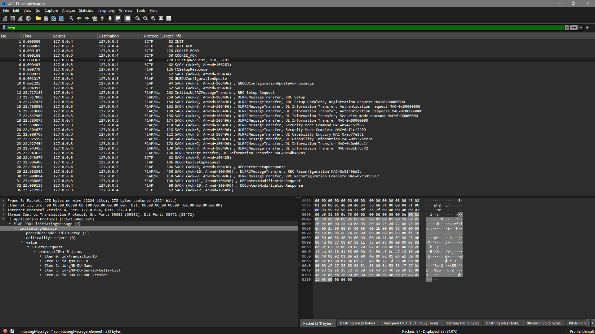
  <br>
  <em>Figure 16. SCTP association packets and F1 Setup traffic with the SCTP/F1AP display filter applied.</em>
</p>

<p align="center">
  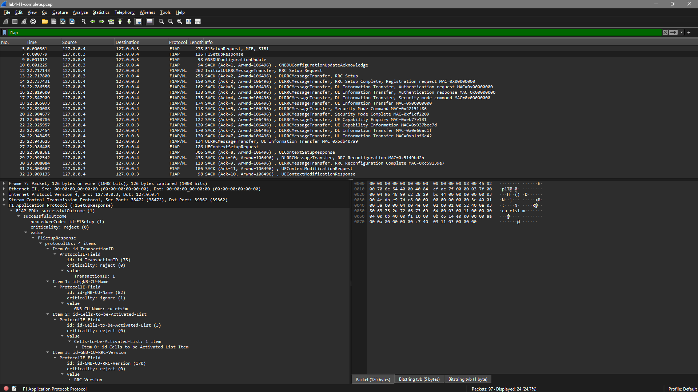
  <br>
  <em>Figure 17. F1AP UE-associated RRC and UE Context procedure messages.</em>
</p>

| Observed message | Packet | Source | Destination | Meaning |
|---|---:|---|---|---|
| SCTP INIT | 2 | `127.0.0.4` | `127.0.0.3` | DU starts the SCTP association. |
| SCTP INIT_ACK | 3 | `127.0.0.3` | `127.0.0.4` | CU acknowledges SCTP association setup. |
| F1 Setup Request | 5 | `127.0.0.4` | `127.0.0.3` | DU requests F1 setup and provides its served-cell information. |
| F1 Setup Response | 6 | `127.0.0.3` | `127.0.0.4` | CU accepts the DU F1 setup. |
| Initial UL RRC Message Transfer | 12 | `127.0.0.4` | `127.0.0.3` | DU forwards the UE RRC Setup Request to the CU. |
| DL RRC Message Transfer | 13 | `127.0.0.3` | `127.0.0.4` | CU sends RRC Setup to the UE. |
| UL RRC Message Transfer | 14 | `127.0.0.4` | `127.0.0.3` | DU forwards RRC Setup Complete and its NAS information toward the CU. |
| UE Context Setup Response | 30 | `127.0.0.4` | `127.0.0.3` | DU confirms creation of UE-specific radio resources. |

**Questions**

1. Which node initiates F1 Setup, and which acknowledges it?

The gNB-DU initiates F1 Setup with an F1 Setup Request. The gNB-CU acknowledges it with an F1 Setup Response.

2. Explain the difference between SCTP association establishment and F1 Setup.

SCTP association establishment creates the transport connection between the CU and DU. F1 Setup is the application-level procedure that declares and validates their F1 capabilities and served cells.

3. How can a NAS Registration Request be transported over F1-C?

The DU sends the UE RRC message to the CU inside Initial UL RRC Message Transfer or UL RRC Message Transfer. The NAS Registration Request is an embedded payload within the RRC signaling on F1-C.

4. What is the role of UE Context Setup?

UE Context Setup creates the UE-specific RAN context and radio bearer resources in the DU according to the CU's setup request. It allows subsequent UE traffic to be sent and received correctly.

5. Does F1 Setup alone prove successful UE Registration? Explain.

No. F1 Setup only establishes the interface and accepted configuration between the CU and DU. Successful UE Registration requires later RRC, NAS, authentication, security, and PDU Session signaling.

---

## 7. Task 5 — Analyze F1-U (GTP-U / UDP)

In the **same PCAP**, apply:

```text
gtp
```

If necessary, first check:

```text
udp.port == 2152
```

### Evidence

<p align="center">
  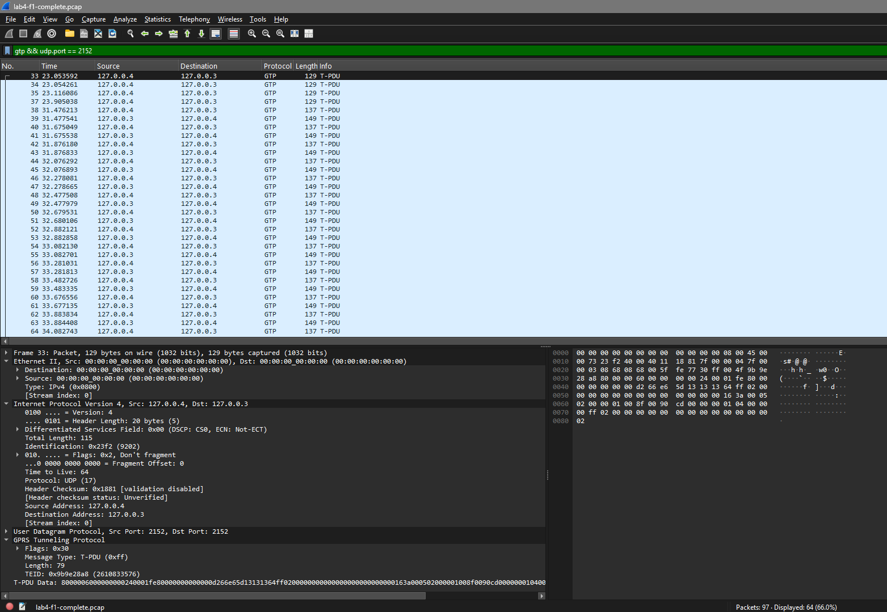
  <br>
  <em>Figure 18. GTP-U uplink T-PDU from DU 127.0.0.4 to CU 127.0.0.3 over UDP port 2152.</em>
</p>

Directional display filters (based on the observed CU/DU IP pair):

```text
gtp && ip.src == 127.0.0.4 && ip.dst == 127.0.0.3
gtp && ip.src == 127.0.0.3 && ip.dst == 127.0.0.4
```

<p align="center">
  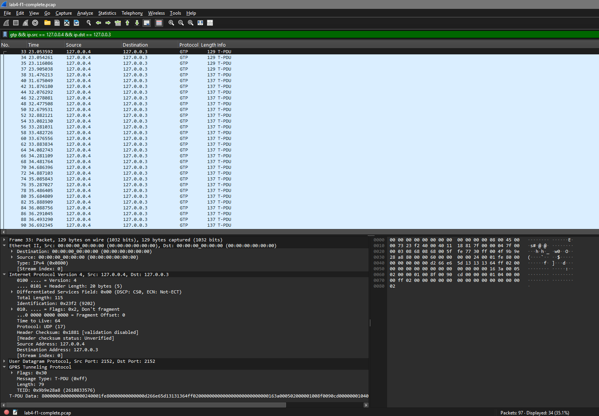
  <br>
  <em>Figure 19. Wireshark uplink filter showing repeated GTP T-PDUs from 127.0.0.4 to 127.0.0.3.</em>
</p>

<p align="center">
  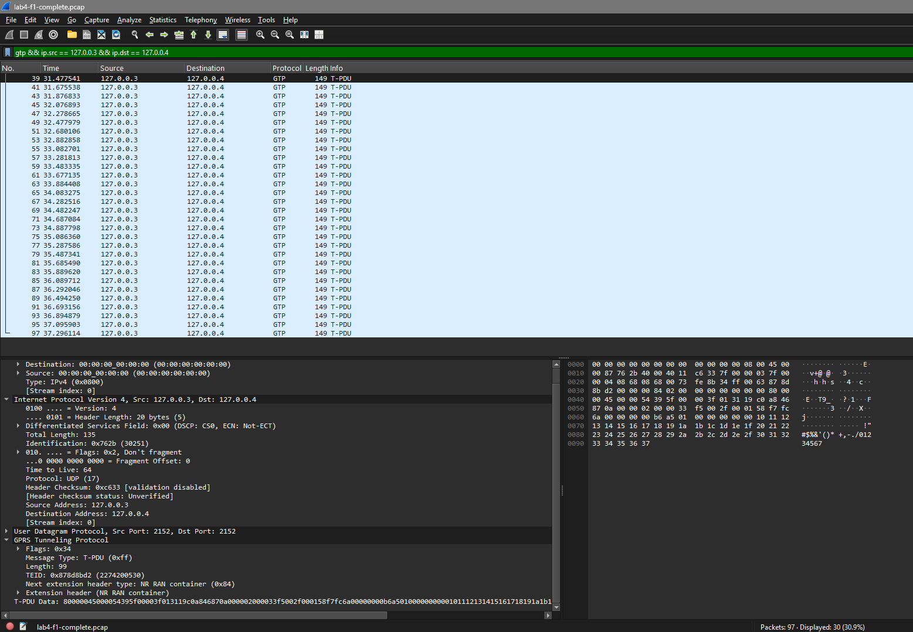
  <br>
  <em>Figure 20. GTP-U downlink T-PDU from CU 127.0.0.3 to DU 127.0.0.4 over UDP port 2152.</em>
</p>

| Observed item | Value |
|---|---|
| Transport | UDP |
| UDP source/destination port | `2152` |
| GTP-U message type | `T-PDU` |
| Uplink direction | `127.0.0.4` → `127.0.0.3` |
| Downlink direction | `127.0.0.3` → `127.0.0.4` |
| Observed TEID | `0x18366cb0` |
| Aggregate UL/DL packet counts | Uplink: 34 packets; Downlink: 30 packets |

### Distinguish F1-U from N3

Both **F1-U** and **N3** can use GTP-U. A packet is not identified as F1-U only because Wireshark shows GTP or UDP port 2152.

- **F1-U:** GTP-U between the gNB-DU and gNB-CU.
- **N3:** GTP-U between the gNB-CU and 5GC UPF.

The source and destination endpoints identify the interface.

**Questions**

1. Which transport protocol carries F1-U?

F1-U carries user-plane traffic with GTP-U over UDP.

2. What does a GTP-U **TEID** identify?

The TEID identifies the specific GTP-U tunnel and its associated UE bearer or PDU session path.

3. Which direction is `127.0.0.4 → 127.0.0.3` in this setup?

This is the uplink direction because the gNB-DU at `127.0.0.4` sends the UE's data to the gNB-CU at `127.0.0.3`.

4. How would you distinguish F1-U from N3 in a packet capture?

F1-U is identified by GTP-U traffic between `127.0.0.4` and `127.0.0.3`, the DU and CU addresses. N3 is GTP-U traffic between the CU and the UPF, normally using the configured CU/UPF IP addresses rather than the DU address.

5. Why do F1-C and F1-U use different transport protocols?

F1-C carries reliable RAN control signaling and uses F1AP over SCTP. F1-U carries high-rate user data and uses GTP-U over UDP for direct packet tunneling.

---

## 8. Task 6 — Compare monolithic and split gNB

Complete the table:

| Feature | Lab 3: Monolithic gNB | Lab 4: CU/DU Split |
|---|---|---|
| Number of RAN processes | One gNB process plus the nrUE and 5GC containers/processes | Two RAN processes: one gNB-CU process and one gNB-DU process, plus nrUE |
| Location of RRC/PDCP | In the monolithic gNB process | RRC and PDCP mainly in the gNB-CU |
| Location of RLC/MAC/PHY | In the monolithic gNB process | RLC, MAC, and PHY in the gNB-DU |
| F1-C interface present? | No | Yes; F1AP/SCTP between DU and CU |
| F1-U interface present? | No | Yes; GTP-U/UDP between DU and CU |
| UE connected to the same 5GC? | Yes | Yes |
| End-to-end Ping works? | Yes | Yes |

Splitting the gNB changes how RAN functions are divided and introduces F1-C and F1-U between the CU and DU. It does not remove the UE's need to synchronize with the DU, complete RRC and NAS procedures, or authenticate with the 5G Core. The UE must still establish a PDU session to receive an IP address and create the `oaitun_ue1` tunnel. The successful Ping confirms that data can travel through the split RAN and the same 5GC to the external data network.

---

## 9. Troubleshooting

| Symptom | First checks |
|---|---|
| DU cannot establish F1 Setup | CU running; CU/DU F1 IP and ports; SCTP association; `f1ap` capture |
| UE repeatedly fails to decode SIB1 | Verify DU `absoluteFrequencySSB` and UE `-C`; check PHY/MAC synchronization and DU logs |
| UE syncs but Registration fails | Check CU/AMF logs, subscriber credentials (IMSI/key/OPc), RRC/NAS progress |
| UE attaches but no `oaitun_ue1` | Check PDU Session Establishment, 5GC SMF/UPF and UE logs |
| Ping fails | Confirm the tunnel, external DN reachability, routing, and user-plane path |
| Only F1AP appears in PCAP | Run Ping; verify PDU session; verify F1-U endpoints/port and capture interface |
| GTP appears but could be N3 | Check source/destination IPs against DU, CU and UPF addresses |
| Wireshark does not decode UDP 2152 as GTP-U | Examine UDP payload and optionally use **Analyze → Decode As…** |

**Do not** assume a screenshot of F1 Setup proves that UE Registration and end-to-end connectivity have succeeded. Validate each stage separately.

---

## 10. Submission checklist

Submit **one Markdown or PDF report** and **one PCAP file** containing:

- [x] CU/DU configuration summary and frequency check.
- [x] CU/DU and nrUE running evidence.
- [x] UE tunnel IP and successful Ping result (loss and RTT).
- [x] One PCAP containing **F1-C and F1-U**.
- [x] F1 Setup Request/Response screenshot.
- [x] Three or more UE-related F1AP messages with explanation.
- [x] At least one GTP-U T-PDU screenshot with TEID and endpoints.
- [x] Explanation distinguishing F1-C, F1-U and N3.
- [x] Completed monolithic-vs-split comparison table.
- [x] Answers to all analysis questions.

All screenshots, packet numbers, TEIDs and measurements must come from **your own experiment**.

## 11. Suggested grading rubric

| Category | Points |
|---|---:|
| Correct CU/DU deployment and parameter verification | 20 |
| F1-C capture and F1 Setup analysis | 20 |
| RRC/UE Context messages over F1-C | 20 |
| F1-U GTP-U and TEID analysis | 20 |
| UE tunnel and end-to-end Ping | 10 |
| Monolithic vs split comparison and report quality | 10 |
| **Total** | **100** |

---

## 12. Stop the experiment

Stop nrUE, DU and CU with `Ctrl+C`. Then stop CN5G:

```bash
cd ~/oai-cn5g
docker compose down
```

**Takeaway:** In the same OAI 5G SA network, **F1-C** exchanges RAN control signaling between CU and DU using **F1AP/SCTP**, while **F1-U** transports UE user-plane data between CU and DU using **GTP-U/UDP**. A successful UE Ping validates the end-to-end data path, while the PCAP shows what happens on the internal split-RAN interface.


# Outputs

### OAI CU 
```
root@joy:/home/joy# cd ~/openairinterface5g-v2.4.0/cmake_targets/ran_build/build
root@joy:~/openairinterface5g-v2.4.0/cmake_targets/ran_build/build# cd ~/openairinterface5g-v2.4.0/cmake_targets/ran_build/build
root@joy:~/openairinterface5g-v2.4.0/cmake_targets/ran_build/build# sudo ./nr-softmodem \
  -O ../../../targets/PROJECTS/GENERIC-NR-5GC/CONF/gnb-cu.sa.f1.conf
CMDLINE: "./nr-softmodem" "-O" "../../../targets/PROJECTS/GENERIC-NR-5GC/CONF/gnb-cu.sa.f1.conf"
[CONFIG] function config_libconfig_init returned 0
[UTIL]   running in SA mode (no --phy-test, --do-ra, --nsa option present)
[OPT]    OPT disabled
[HW]     Version: Branch: HEAD Abrev. Hash: 91e7030cf8 Date: Thu Dec 4 07:55:07 2025 +0000
[GNB_APP] Initialized RAN Context: RC.nb_nr_inst = 1, RC.nb_nr_macrlc_inst = 0, RC.nb_nr_L1_inst = 0, RC.nb_RU = 0, RC.nb_nr_CC[0] = 0
[GNB_APP] F1AP: gNB_CU_id[0] 3584
[GNB_APP] F1AP: gNB_CU_name[0] cu-rfsim
[GNB_APP] SDAP layer is disabled
[GNB_APP] Data Radio Bearer count 1
[GNB_APP] Parsed IPv4 address for NG AMF: 192.168.70.129
[UTIL]   threadCreate() for TASK_SCTP: creating thread with affinity ffffffff, priority 50
[X2AP]   X2AP is disabled.
[UTIL]   threadCreate() for TASK_NGAP: creating thread with affinity ffffffff, priority 50
[UTIL]   threadCreate() for TASK_RRC_GNB: creating thread with affinity ffffffff, priority 50
[NGAP]   Registered new gNB[0] and macro gNB id 3584
[NGAP]   [gNB 0] check the amf registration state
[GTPU]   Configuring GTPu
[GTPU]   SA mode
[GTPU]   Configuring GTPu address : 192.168.70.129, port : 2152
[GTPU]   Initializing UDP for local address 192.168.70.129 with port 2152
[GTPU]   Created gtpu instance id: 89
[UTIL]   threadCreate() for GTPrx_89: creating thread with affinity ffffffff, priority 50
[NR_RRC] Entering main loop of NR_RRC message task
[NR_RRC] Accepting new CU-UP ID 3584 name cu-rfsim (assoc_id -1)
[UTIL]   threadCreate() for TASK_GNB_APP: creating thread with affinity ffffffff, priority 50
[NGAP]   Send NGSetupRequest to AMF
[NGAP]   3584 -> 0000e000
[NGAP]   Supported PLMN 0: MCC=001 MNC=01
[NGAP]   Supported slice (PLMN 0): SST=0x01 SD=000
[NGAP]   Received NGSetupResponse from AMF
[UTIL]   threadCreate() for TASK_GTPV1_U: creating thread with affinity ffffffff, priority 50
[UTIL]   threadCreate() for TASK_CU_F1: creating thread with affinity ffffffff, priority 50
[UTIL]   threadCreate() for time source realtime: creating thread with affinity ffffffff, priority 2
[GNB_APP] [gNB 0] Received NGAP_REGISTER_GNB_CNF: associated AMF 1
[F1AP]   Starting F1AP at CU
[UTIL]   time manager configuration: [time source: reatime] [mode: standalone] [server IP: 127.0.0.1} [server port: 7374] (server IP/port not used)
[F1AP]   F1AP_CU_SCTP_REQ(create socket) for 127.0.0.3 len 10
[GTPU]   Initializing UDP for local address 127.0.0.3 with port 2152
[GTPU]   Created gtpu instance id: 91
[UTIL]   threadCreate() for GTPrx_91: creating thread with affinity ffffffff, priority 50
TYPE <CTRL-C> TO TERMINATE
[NR_RRC] Received F1 Setup Request from gNB_DU 3584 (du-rfsim) on assoc_id 20310
[NR_RRC] Accepting DU 3584 (du-rfsim), sending F1 Setup Response
[NR_RRC] DU uses RRC version 17.3.0
[NR_RRC] cell PLMN 001.01 Cell ID 12345678 is in service
[NR_RRC] Decoding CCCH: RNTI 9b3c, payload_size 6
[NR_RRC] [--] (cellID 0, UE ID 1 RNTI 9b3c) Create UE context: CU UE ID 1 DU UE ID 39740 (rnti: 9b3c, random ue id a051a00e46000000)
[RRC]    activate SRB 1 of UE 1
[NR_RRC] [DL] (cellID bc614e, UE ID 1 RNTI 9b3c) Send RRC Setup
[NR_RRC] [UL] (cellID bc614e, UE ID 1 RNTI 9b3c) Received RRCSetupComplete (RRC_CONNECTED reached)
[NGAP]   Selected PLMN in the NG Initial UE Message: MCC=001 MNC=01
[NGAP]   UE 1: Selected AMF 'OAI-AMF' (assoc_id 20307) through selected PLMN MCC=001 MNC=01
[NGAP]   Create UE context (ID 1) for AMF 'OAI-AMF' (assoc_id 20307)
[NR_RRC] [DL] (cellID bc614e, UE ID 1 RNTI 9b3c) Send DL Information Transfer [42 bytes]
[NR_RRC] [UL] (cellID bc614e, UE ID 1 RNTI 9b3c) Received RRC UL Information Transfer [24 bytes]
[NR_RRC] [DL] (cellID bc614e, UE ID 1 RNTI 9b3c) Send DL Information Transfer [21 bytes]
[NR_RRC] [UL] (cellID bc614e, UE ID 1 RNTI 9b3c) Received RRC UL Information Transfer [60 bytes]
[NR_RRC] [--] (cellID bc614e, UE ID 1 RNTI 9b3c) Selected security algorithms: ciphering 0, integrity 2
[NR_RRC] [UE 9b3c] Saved security key 86
[NR_RRC] UE 1 Logical Channel DL-DCCH, Generate SecurityModeCommand (bytes 3)
[NR_RRC] [UL] (cellID bc614e, UE ID 1 RNTI 9b3c) Received Security Mode Complete
[NR_RRC] UE 1: Logical Channel DL-DCCH, Generate NR UECapabilityEnquiry (bytes 8, xid 1)
[NR_RRC] [UL] (cellID bc614e, UE ID 1 RNTI 9b3c) Received UE capabilities
[NR_RRC] Send message to ngap: NGAP_UE_CAPABILITIES_IND
[NR_RRC] [DL] (cellID bc614e, UE ID 1 RNTI 9b3c) Send DL Information Transfer [53 bytes]
[NR_RRC] Send message to sctp: NGAP_InitialContextSetupResponse
[NR_RRC] [UL] (cellID bc614e, UE ID 1 RNTI 9b3c) Received RRC UL Information Transfer [13 bytes]
[NR_RRC] [UL] (cellID bc614e, UE ID 1 RNTI 9b3c) Received RRC UL Information Transfer [35 bytes]
[NGAP]   PDUSESSIONSetup initiating message
[NR_RRC] UE 1: received PDU Session Resource Setup Request
[NR_RRC] Added QoS flow with qfi=1, total number of QoS flows = 1
[NR_RRC] Added PDU Session 10, (total nb of sessions = 1)
[NR_RRC] Bearer Context Setup: PDU Session ID=10, incoming TEID=0x00000001, Addr=192.168.70.134
[NR_RRC] Added DRB 1 to established list (PDU Session ID=10, total DRBs = 1)
[NR_RRC] UE 1: added DRB 1 for PDU session ID 10
[NR_RRC] [--] (cellID bc614e, UE ID 1 RNTI 9b3c) selecting CU-UP ID 3584 based on exact NSSAI match (1:0xffffff)
[RRC]    UE 1 associating to CU-UP assoc_id -1 out of 1 CU-UPs
[E1AP]   UE 1: add PDU session ID 10 (1 bearers)
[GTPU]   [89] UE ID 1: Create tunnel TEID incoming 0x994966e0 outgoing 0x1 to remote IPv4 192.168.70.134, IPv6 ::, port 2152
[SDAP]   Default DRB for the created SDAP entity: DRB 1
[PDCP]   Added DRB 1 to UE ID 1
[GTPU]   [91] UE ID 1: Create tunnel TEID incoming 0x85c96842 outgoing 0xffff to remote IPv4 0.0.0.0, IPv6 ::, port 2152
[RRC]    activate SRB 2 of UE 1
[RRC]    UE 1 trigger UE context setup request with 1 DRBs
[RRC]    UE 9b3c replacing existing CellGroupConfig with new one received from DU
[E1AP]   UE 1: updating PDU session ID 10 (1 bearers)
[PDCP]   DRB 1 re-established
[GTPU]   [91] UE ID 1: Update tunnel TEID incoming 0x85c96842 outgoing 0x18366cb0 to remote IPv4 127.0.0.4, IPv6 ::, port 2152
[NR_RRC] [DL] (cellID bc614e, UE ID 1 RNTI 9b3c) Generate RRCReconfiguration (bytes 319, xid 3)
[NR_RRC] Received E1AP Bearer Context Modification Response for UE CU-CP ID 1
[RRC]    UE 1: PDU session ID 10 modified 1 bearers
[NR_RRC] [UL] (cellID bc614e, UE ID 1 RNTI 9b3c) Received RRCReconfigurationComplete
[NR_RRC] PDU Session Setup: ID=10, outgoing TEID=0x994966e0, Addr=192.168.70.129
[NR_RRC] NGAP_PDUSESSION_SETUP_RESP: sending the message
[NR_RRC] [UL] (cellID bc614e, UE ID 1 RNTI 9b3c) Received RRC UL Information Transfer [27 bytes]
[NR_RRC] [DL] (cellID bc614e, UE ID 1 RNTI 9b3c) Send DL Information Transfer [3 bytes]
[E1AP]   releasing UE 1
[GTPU]   [89] UE ID 1: Delete all tunnels (1 tunnels)
[GTPU]   [91] UE ID 1: Delete all tunnels (1 tunnels)
[NR_RRC] [DL] (cellID bc614e, UE ID 1 RNTI 9b3c) Send RRC Release
[RRC]    UE 1: received bearer release complete
[NR_RRC] removed UE CU UE ID 1/RNTI 9b3c
[NR_RRC] [--] (cellID bc614e, UE ID 1 RNTI 9b3c) Remove UE context
[SCTP]   Received SCTP SHUTDOWN EVENT
[F1AP]   Received SCTP state 1 for assoc_id 20310, removing endpoint
[NR_RRC] releasing DU ID 3584 (du-rfsim) on assoc_id 20310
^C
** Caught SIGTERM, shutting down
Returned from ITTI signal handler
Bye.
root@joy:~/openairinterface5g-v2.4.0/cmake_targets/ran_build/build#
```

### OAI DU
```
root@joy:/home/joy# cd ~/openairinterface5g-v2.4.0/cmake_targets/ran_build/build
root@joy:~/openairinterface5g-v2.4.0/cmake_targets/ran_build/build# sudo ./nr-softmodem \
  -O ../../../targets/PROJECTS/GENERIC-NR-5GC/CONF/gnb-du.sa.band78.106prb.rfsim.pci0.conf \
  --rfsim
CMDLINE: "./nr-softmodem" "-O" "../../../targets/PROJECTS/GENERIC-NR-5GC/CONF/gnb-du.sa.band78.106prb.rfsim.pci0.conf" "--rfsim"
[CONFIG] function config_libconfig_init returned 0
[UTIL]   running in SA mode (no --phy-test, --do-ra, --nsa option present)
[OPT]    OPT disabled
[HW]     Version: Branch: HEAD Abrev. Hash: 91e7030cf8 Date: Thu Dec 4 07:55:07 2025 +0000
[GNB_APP] Initialized RAN Context: RC.nb_nr_inst = 1, RC.nb_nr_macrlc_inst = 1, RC.nb_nr_L1_inst = 1, RC.nb_RU = 1, RC.nb_nr_CC[0] = 1
[NR_PHY] Initializing gNB RAN context: RC.nb_nr_L1_inst = 1
[NR_PHY] Registered with MAC interface module (0x555b9c44ecf0)
[NR_PHY] Initializing NR L1: RC.nb_nr_L1_inst = 1
[NR_PHY] L1_RX_THREAD_CORE -1 (15)
[NR_PHY] TX_AMP = 519 (-36 dBFS)
[PHY]    No prs_config configuration found..!!
[GNB_APP] pdsch_AntennaPorts N1 1 N2 1 XP 1 pusch_AntennaPorts 1
[GNB_APP] minTXRXTIME 4
[GNB_APP] SIB1 TDA 1
[GNB_APP] CSI-RS 0, SRS 0, report type 0 (ssb_rsrp), 256 QAM may be on, delta_MCS off, maxMIMO_Layers -1, HARQ feedback enabled, num DLHARQ:16, num ULHARQ:16
[GNB_APP] No RedCap configuration found
[GNB_APP] No PTRS configuration found
[GNB_APP] sr_ProhibitTimer 0, sr_TransMax 64, sr_ProhibitTimer_v1700 0, t300 400, t301 400, t310 2000, n310 10, t311 3000, n311 1, t319 400
[NR_MAC] Candidates per PDCCH aggregation level on UESS: L1: 0, L2: 2, L4: 0, L8: 0, L16: 0
[RRC]    Read in ServingCellConfigCommon (PhysCellId 0, ABSFREQSSB 630048, DLBand 78, ABSFREQPOINTA 628776, DLBW 106,RACH_TargetReceivedPower -96
[RRC]    absoluteFrequencySSB 630048 corresponds to 3450720000 Hz
[NR_MAC] TDD period index = 6, based on the sum of dl_UL_TransmissionPeriodicity from Pattern1 (5.000000 ms) and Pattern2 (0.000000 ms): Total = 5.000000 ms
[UTIL]   threadCreate() for MAC_STATS: creating thread with affinity ffffffff, priority 2
[NR_MAC] PUSCH Target 200, PUCCH Target 150, PUCCH Failure 10, PUSCH Failure 1000
[NR_PHY] Copying 0 blacklisted PRB to L1 context
[NR_MAC] Set TX antenna number to 1, Set RX antenna number to 1 (num ssb 1: 80000000,0)
[NR_MAC] TDD period index = 6, based on the sum of dl_UL_TransmissionPeriodicity from Pattern1 (5.000000 ms) and Pattern2 (0.000000 ms): Total = 5.000000 ms
[NR_MAC] Set TDD configuration period to: 8 DL slots, 3 UL slots, 10 slots per period (NR_TDD_UL_DL_Pattern is 7 DL slots, 2 UL slots, 6 DL symbols, 4 UL symbols)
[NR_MAC] Configured 1 TDD patterns (total slots: pattern1 = 10, pattern2 = 0)
[NR_PHY] Set TDD Period Configuration: 2 periods per frame, 20 slots to be configured (8 DL, 3 UL)
[NR_PHY] TDD period configuration: slot 0 is DOWNLINK
[NR_PHY] TDD period configuration: slot 1 is DOWNLINK
[NR_PHY] TDD period configuration: slot 2 is DOWNLINK
[NR_PHY] TDD period configuration: slot 3 is DOWNLINK
[NR_PHY] TDD period configuration: slot 4 is DOWNLINK
[NR_PHY] TDD period configuration: slot 5 is DOWNLINK
[NR_PHY] TDD period configuration: slot 6 is DOWNLINK
[NR_PHY] TDD period configuration: slot 7 is FLEXIBLE: DDDDDDFFFFUUUU
[NR_PHY] TDD period configuration: slot 8 is UPLINK
[NR_PHY] TDD period configuration: slot 9 is UPLINK
[NR_MAC] Command line parameters for OAI UE: -C 3450720000 -r 106 --numerology 1 --band 78 --ssb 516
[NR_PHY] dlfreq:3450720 ulfreq:3450720 deltaduplex:0 khz, uldl_min_offset:0 khz
[NR_PHY] dlfreq:3450720 ulfreq:3450720 deltaduplex:0 khz, uldl_min_offset:0 khz
[NR_PHY] dlfreq:3450720 ulfreq:3450720 deltaduplex:0 khz, uldl_min_offset:0 khz
[NR_PHY] dlfreq:3450720 ulfreq:3450720 deltaduplex:0 khz, uldl_min_offset:0 khz
DL frequency 3450720000: band 78, UL frequency 3450720000
[PHY]    DL frequency 3450720000 Hz, UL frequency 3450720000 Hz: band 78, uldl offset 0 Hz
[PHY]    Initializing frame parms for mu 1, N_RB 106, Ncp 0
[PHY]    Init: N_RB_DL 106, first_carrier_offset 1412, nb_prefix_samples 144,nb_prefix_samples0 176, ofdm_symbol_size 2048
[NR_MAC] TDA index 0: start 0 length 13 k2 4
[NR_MAC] TDA index 1: start 10 length 3 k2 4
[NR_RRC] SIB1 freq: offsetToPointA 86
[GNB_APP] F1AP: gNB idx 0 gNB_DU_id 3584, gNB_DU_name du-rfsim, TAC 1 MCC/MNC/length 1/1/2 cellID 12345678
[GNB_APP] ngran_DU: Configuring Cell 0 for TDD
[GNB_APP] SDAP layer is disabled
[GNB_APP] Data Radio Bearer count 1
[UTIL]   threadCreate() for TASK_SCTP: creating thread with affinity ffffffff, priority 50
[X2AP]   X2AP is disabled.
[UTIL]   threadCreate() for TASK_GNB_APP: creating thread with affinity ffffffff, priority 50
[UTIL]   threadCreate() for TASK_GTPV1_U: creating thread with affinity ffffffff, priority 50
[UTIL]   threadCreate() for TASK_DU_F1: creating thread with affinity ffffffff, priority 50
[UTIL]   threadCreate() for time source iq samples: creating thread with affinity ffffffff, priority 2
[F1AP]   Starting F1AP at DU
[F1AP]   F1-C DU IPaddr 127.0.0.4, connect to F1-C CU 127.0.0.3, binding GTP to 127.0.0.4
[UTIL]   time manager configuration: [time source: iq_samples] [mode: standalone] [server IP: 127.0.0.1} [server port: 7374] (server IP/port not used)
[GTPU]   Initializing UDP for local address 127.0.0.4 with port 2152
[GTPU]   Created gtpu instance id: 90
[UTIL]   threadCreate() for GTPrx_90: creating thread with affinity ffffffff, priority 50
[MAC]    received F1 Setup Response from CU cu-rfsim
[MAC]    CU uses RRC version 17.3.0
[MAC]    Clearing the DU's UE states before, if any.
[MAC]    received gNB-DU configuration update acknowledge
[PHY]    RU clock source set as internal
[PHY]    number of L1 instances 1, number of RU 1, number of CPU cores 8
[PHY]    Initialized RU proc 0 (,synch_to_ext_device),
[PHY]    RU thread-pool core string -1,-1 (size 2)
[UTIL]   threadCreate() for Tpool0_-1: creating thread with affinity ffffffff, priority 97
[UTIL]   threadCreate() for Tpool1_-1: creating thread with affinity ffffffff, priority 97
[UTIL]   threadCreate() for ru_thread: creating thread with affinity ffffffff, priority 97
[PHY]    Starting RU 0 (,synch_to_ext_device) on cpu 4
[PHY]    Initializing frame parms for mu 1, N_RB 106, Ncp 0
[PHY]    Init: N_RB_DL 106, first_carrier_offset 1412, nb_prefix_samples 144,nb_prefix_samples0 176, ofdm_symbol_size 2048
[PHY]    fp->scs=30000
[PHY]    fp->ofdm_symbol_size=2048
[PHY]    fp->nb_prefix_samples0=176
[PHY]    fp->nb_prefix_samples=144
[PHY]    fp->slots_per_subframe=2
[PHY]    fp->samples_per_subframe_wCP=57344
[PHY]    fp->samples_per_frame_wCP=573440
[PHY]    fp->samples_per_subframe=61440
[PHY]    fp->samples_per_frame=614400
[PHY]    fp->dl_CarrierFreq=3450720000
[PHY]    fp->ul_CarrierFreq=3450720000
[PHY]    fp->Nid_cell=0
[PHY]    fp->first_carrier_offset=1412
[PHY]    fp->ssb_start_subcarrier=0
[PHY]    fp->Ncp=0
[PHY]    fp->N_RB_DL=106
[PHY]    fp->numerology_index=1
[PHY]    fp->nr_band=78
[PHY]    fp->ofdm_offset_divisor=8
[PHY]    fp->threequarter_fs=0
[PHY]    fp->sl_CarrierFreq=0
[PHY]    fp->N_RB_SL=0
[NR_PHY] nb_tx_streams 1, nb_rx_streams 1, num_Beams_period 1
[PHY]    Setting RF config for N_RB 106, NB_RX 1, NB_TX 1
[PHY]    tune_offset 0 Hz, sample_rate 61440000 Hz
[PHY]    Channel 0: setting tx_gain offset 0, tx_freq 3450720000 Hz
[PHY]    Channel 0: setting rx_gain offset 114, rx_freq 3450720000 Hz
[HW]     Running as server waiting opposite rfsimulators to connect
Initializing random number generator, seed 458079070690745319
[HW]     [RAU] has loaded RFSIMULATOR device.
[PHY]    RU 0 Setting N_TA_offset to 800 samples (UL Freq 3431640, N_RB 106, mu 1)
[PHY]    Signaling main thread that RU 0 is ready, sl_ahead 6
[PHY]    L1 configured without analog beamforming
[PHY]    Attaching RU 0 antenna 0 to gNB antenna 0
[UTIL]   threadCreate() for Tpool0_-1: creating thread with affinity ffffffff, priority 97
[UTIL]   threadCreate() for Tpool1_-1: creating thread with affinity ffffffff, priority 97
[UTIL]   threadCreate() for Tpool2_-1: creating thread with affinity ffffffff, priority 97
[UTIL]   threadCreate() for Tpool3_-1: creating thread with affinity ffffffff, priority 97
[UTIL]   threadCreate() for Tpool4_-1: creating thread with affinity ffffffff, priority 97
[UTIL]   threadCreate() for Tpool5_-1: creating thread with affinity ffffffff, priority 97
[UTIL]   threadCreate() for Tpool6_-1: creating thread with affinity ffffffff, priority 97
[UTIL]   threadCreate() for Tpool7_-1: creating thread with affinity ffffffff, priority 97
[UTIL]   threadCreate() for L1_rx_thread: creating thread with affinity ffffffff, priority 97
[UTIL]   threadCreate() for L1_tx_thread: creating thread with affinity ffffffff, priority 97
[UTIL]   threadCreate() for L1_stats: creating thread with affinity ffffffff, priority 1
TYPE <CTRL-C> TO TERMINATE
[PHY]    got sync (L1_stats_thread)
[PHY]    got sync (ru_thread)
[PHY]    RU 0 rf device ready
[PHY]    RU 0 RF started cpu_meas_enabled 0
[HW]     No connected device, generating void samples...
[PHY]    Command line parameters for OAI UE: -C 3450720000 -r 106 --numerology 1 --ssb 516
[NR_MAC] Frame.Slot 128.0

[NR_MAC] Frame.Slot 256.0

[NR_MAC] Frame.Slot 384.0

[NR_MAC] Frame.Slot 512.0

[NR_MAC] Frame.Slot 640.0

[NR_MAC] Frame.Slot 768.0

[NR_MAC] Frame.Slot 896.0

[NR_MAC] Frame.Slot 0.0

[NR_MAC] Frame.Slot 128.0

[HW]     Client connects from ::ffff:127.0.0.1:24291
[NR_MAC] Frame.Slot 384.0

[NR_PHY] [RAPROC] 433.19 Initiating RA procedure with preamble 53, energy 43.2 dB (I0 0, thres 200), delay 0 start symbol 4 freq index 0
[NR_MAC] 433.19 UE RA-RNTI 010f TC-RNTI 9b3c: initiating RA procedure
[NR_MAC] UE 9b3c: Msg3 scheduled at 434.17 (434.10 TDA 1) start 0 RBs 8
[NR_MAC] UE 9b3c: 434.10 Generating RA-Msg2 DCI, RA RNTI 0x10f, state 1, preamble_index(RAPID) 53, timing_offset = 0 (estimated distance 0.0 [m])
[NR_MAC]  434.17 PUSCH with TC_RNTI 0x9b3c received correctly
[MAC]    [RAPROC] Received SDU for CCCH length 6 for UE 9b3c
[RLC]    Activated srb0 for UE 39740
[RLC]    Added srb 1 to UE 39740
[NR_MAC] Activating scheduling Msg4 for TC_RNTI 0x9b3c (state WAIT_Msg3)
[NR_MAC] UE 9b3c Generate Msg4: feedback at  435.17, payload 161 bytes, next state nrRA_WAIT_Msg4_MsgB_ACK
[NR_MAC]  435.17 UE 9b3c: Received Ack of Msg4. CBRA procedure succeeded (UE Connected)
[NR_MAC] Adding new UE context with RNTI 0x9b3c
[NR_MAC] Frame.Slot 512.0
UE RNTI 9b3c CU-UE-ID 1 in-sync PH 48 dB PCMAX 20 dBm, average RSRP -44 (9 meas)
UE 9b3c: dlsch_rounds 6/0/0/0, dlsch_errors 0, pucch0_DTX 0, BLER 0.08100 MCS (0) 0 CCE fail 0
UE 9b3c: ulsch_rounds 23/0/0/0, ulsch_errors 0, ulsch_DTX 0, BLER 0.04783 MCS (0) 1 (Qm 2 deltaMCS 0 dB) NPRB 5  SNR 51.0 dB CCE fail 0
UE 9b3c: MAC:    TX            163 RX            618 bytes
UE 9b3c: LCID 1: TX             94 RX            171 bytes

[RLC]    Added srb 2 to UE 39740
[RLC]    Added drb 1 to UE 39740
[RLC]    Added DRB to UE 39740
[GTPU]   [90] UE ID 39740: Create tunnel TEID incoming 0x18366cb0 outgoing 0x85c96842 to remote IPv4 127.0.0.3, IPv6 ::, port 2152
[NR_MAC] DU received confirmation of successful RRC Reconfiguration
[NR_MAC] Frame.Slot 640.0
UE RNTI 9b3c CU-UE-ID 1 in-sync PH 48 dB PCMAX 20 dBm, average RSRP -44 (16 meas)
UE 9b3c: dlsch_rounds 19/0/0/0, dlsch_errors 0, pucch0_DTX 0, BLER 0.04783 MCS (0) 0 CCE fail 2
UE 9b3c: ulsch_rounds 58/0/0/0, ulsch_errors 0, ulsch_DTX 0, BLER 0.01351 MCS (0) 0 (Qm 2 deltaMCS 0 dB) NPRB 5  SNR 51.0 dB CCE fail 0
UE 9b3c: MAC:    TX            775 RX           2153 bytes
UE 9b3c: LCID 1: TX            528 RX            301 bytes
UE 9b3c: LCID 2: TX              0 RX              0 bytes
UE 9b3c: LCID 4: TX              6 RX            271 bytes

[NR_MAC] Frame.Slot 768.0
UE RNTI 9b3c CU-UE-ID 1 in-sync PH 48 dB PCMAX 20 dBm, average RSRP -44 (16 meas)
UE 9b3c: dlsch_rounds 21/0/0/0, dlsch_errors 0, pucch0_DTX 0, BLER 0.03874 MCS (0) 0 CCE fail 2
UE 9b3c: ulsch_rounds 76/0/0/0, ulsch_errors 0, ulsch_DTX 0, BLER 0.00382 MCS (0) 0 (Qm 2 deltaMCS 0 dB) NPRB 5  SNR 51.0 dB CCE fail 0
UE 9b3c: MAC:    TX            817 RX           2671 bytes
UE 9b3c: LCID 1: TX            528 RX            301 bytes
UE 9b3c: LCID 2: TX              0 RX              0 bytes
UE 9b3c: LCID 4: TX              9 RX            363 bytes

[NR_MAC] Frame.Slot 896.0
UE RNTI 9b3c CU-UE-ID 1 in-sync PH 48 dB PCMAX 20 dBm, average RSRP -44 (16 meas)
UE 9b3c: dlsch_rounds 22/0/0/0, dlsch_errors 0, pucch0_DTX 0, BLER 0.03487 MCS (0) 0 CCE fail 2
UE 9b3c: ulsch_rounds 89/0/0/0, ulsch_errors 0, ulsch_DTX 0, BLER 0.00097 MCS (0) 0 (Qm 2 deltaMCS 0 dB) NPRB 5  SNR 51.0 dB CCE fail 0
UE 9b3c: MAC:    TX            838 RX           2931 bytes
UE 9b3c: LCID 1: TX            528 RX            301 bytes
UE 9b3c: LCID 2: TX              0 RX              0 bytes
UE 9b3c: LCID 4: TX              9 RX            363 bytes

[NR_MAC] Frame.Slot 0.0
UE RNTI 9b3c CU-UE-ID 1 in-sync PH 48 dB PCMAX 20 dBm, average RSRP -44 (16 meas)
UE 9b3c: dlsch_rounds 23/0/0/0, dlsch_errors 0, pucch0_DTX 0, BLER 0.03138 MCS (0) 0 CCE fail 2
UE 9b3c: ulsch_rounds 101/0/0/0, ulsch_errors 0, ulsch_DTX 0, BLER 0.00027 MCS (0) 0 (Qm 2 deltaMCS 0 dB) NPRB 5  SNR 51.0 dB CCE fail 0
UE 9b3c: MAC:    TX            859 RX           3171 bytes
UE 9b3c: LCID 1: TX            528 RX            301 bytes
UE 9b3c: LCID 2: TX              0 RX              0 bytes
UE 9b3c: LCID 4: TX              9 RX            363 bytes

[NR_MAC] Frame.Slot 128.0
UE RNTI 9b3c CU-UE-ID 1 in-sync PH 48 dB PCMAX 20 dBm, average RSRP -44 (16 meas)
UE 9b3c: dlsch_rounds 25/0/0/0, dlsch_errors 0, pucch0_DTX 0, BLER 0.02542 MCS (0) 0 CCE fail 2
UE 9b3c: ulsch_rounds 114/0/0/0, ulsch_errors 0, ulsch_DTX 0, BLER 0.00007 MCS (0) 0 (Qm 2 deltaMCS 0 dB) NPRB 5  SNR 51.0 dB CCE fail 0
UE 9b3c: MAC:    TX            901 RX           3431 bytes
UE 9b3c: LCID 1: TX            528 RX            301 bytes
UE 9b3c: LCID 2: TX              0 RX              0 bytes
UE 9b3c: LCID 4: TX              9 RX            363 bytes

[NR_MAC] Frame.Slot 256.0
UE RNTI 9b3c CU-UE-ID 1 in-sync PH 48 dB PCMAX 20 dBm, average RSRP -44 (16 meas)
UE 9b3c: dlsch_rounds 26/0/0/0, dlsch_errors 0, pucch0_DTX 0, BLER 0.02288 MCS (0) 0 CCE fail 2
UE 9b3c: ulsch_rounds 127/0/0/0, ulsch_errors 0, ulsch_DTX 0, BLER 0.00002 MCS (0) 0 (Qm 2 deltaMCS 0 dB) NPRB 5  SNR 51.0 dB CCE fail 0
UE 9b3c: MAC:    TX            922 RX           3691 bytes
UE 9b3c: LCID 1: TX            528 RX            301 bytes
UE 9b3c: LCID 2: TX              0 RX              0 bytes
UE 9b3c: LCID 4: TX              9 RX            363 bytes

[NR_MAC] Frame.Slot 384.0
UE RNTI 9b3c CU-UE-ID 1 in-sync PH 48 dB PCMAX 20 dBm, average RSRP -44 (16 meas)
UE 9b3c: dlsch_rounds 27/0/0/0, dlsch_errors 0, pucch0_DTX 0, BLER 0.02059 MCS (0) 0 CCE fail 2
UE 9b3c: ulsch_rounds 140/0/0/0, ulsch_errors 0, ulsch_DTX 0, BLER 0.00000 MCS (0) 0 (Qm 2 deltaMCS 0 dB) NPRB 5  SNR 51.0 dB CCE fail 0
UE 9b3c: MAC:    TX            943 RX           3951 bytes
UE 9b3c: LCID 1: TX            528 RX            301 bytes
UE 9b3c: LCID 2: TX              0 RX              0 bytes
UE 9b3c: LCID 4: TX              9 RX            363 bytes

[NR_MAC] Frame.Slot 512.0
UE RNTI 9b3c CU-UE-ID 1 in-sync PH 48 dB PCMAX 20 dBm, average RSRP -44 (16 meas)
UE 9b3c: dlsch_rounds 29/0/0/0, dlsch_errors 0, pucch0_DTX 0, BLER 0.01668 MCS (0) 0 CCE fail 2
UE 9b3c: ulsch_rounds 153/0/0/0, ulsch_errors 0, ulsch_DTX 0, BLER 0.00000 MCS (0) 0 (Qm 2 deltaMCS 0 dB) NPRB 5  SNR 51.0 dB CCE fail 0
UE 9b3c: MAC:    TX            985 RX           4211 bytes
UE 9b3c: LCID 1: TX            528 RX            301 bytes
UE 9b3c: LCID 2: TX              0 RX              0 bytes
UE 9b3c: LCID 4: TX              9 RX            363 bytes

[NR_MAC] Frame.Slot 640.0
UE RNTI 9b3c CU-UE-ID 1 in-sync PH 48 dB PCMAX 20 dBm, average RSRP -44 (16 meas)
UE 9b3c: dlsch_rounds 30/0/0/0, dlsch_errors 0, pucch0_DTX 0, BLER 0.01501 MCS (0) 0 CCE fail 2
UE 9b3c: ulsch_rounds 165/0/0/0, ulsch_errors 0, ulsch_DTX 0, BLER 0.00000 MCS (0) 0 (Qm 2 deltaMCS 0 dB) NPRB 5  SNR 51.0 dB CCE fail 0
UE 9b3c: MAC:    TX           1006 RX           4451 bytes
UE 9b3c: LCID 1: TX            528 RX            301 bytes
UE 9b3c: LCID 2: TX              0 RX              0 bytes
UE 9b3c: LCID 4: TX              9 RX            363 bytes

[NR_MAC] Frame.Slot 0.0
UE RNTI 9b3c CU-UE-ID 1 in-sync PH 48 dB PCMAX 20 dBm, average RSRP -44 (16 meas)
UE 9b3c: dlsch_rounds 1078/0/0/0, dlsch_errors 0, pucch0_DTX 0, BLER 0.00000 MCS (0) 0 CCE fail 2
UE 9b3c: ulsch_rounds 10510/0/0/0, ulsch_errors 0, ulsch_DTX 0, BLER 0.00000 MCS (0) 0 (Qm 2 deltaMCS 0 dB) NPRB 5  SNR 51.0 dB CCE fail 0
UE 9b3c: MAC:    TX          23864 RX         213163 bytes
UE 9b3c: LCID 1: TX            528 RX            301 bytes
UE 9b3c: LCID 2: TX              0 RX              0 bytes
UE 9b3c: LCID 4: TX            939 RX           1388 bytes

[NR_MAC] Frame.Slot 128.0
UE RNTI 9b3c CU-UE-ID 1 in-sync PH 48 dB PCMAX 20 dBm, average RSRP -44 (16 meas)
UE 9b3c: dlsch_rounds 1081/0/0/0, dlsch_errors 0, pucch0_DTX 0, BLER 0.00000 MCS (0) 0 CCE fail 2
UE 9b3c: ulsch_rounds 10528/0/0/0, ulsch_errors 0, ulsch_DTX 0, BLER 0.00000 MCS (0) 0 (Qm 2 deltaMCS 0 dB) NPRB 5  SNR 51.0 dB CCE fail 0
UE 9b3c: MAC:    TX          23932 RX         213541 bytes
UE 9b3c: LCID 1: TX            528 RX            301 bytes
UE 9b3c: LCID 2: TX             17 RX             46 bytes
UE 9b3c: LCID 4: TX            939 RX           1388 bytes

[GTPU]   [90] UE ID 39740: Delete all tunnels (1 tunnels)
[GTPU]   try to get a gtp-u not existing output
[RLC]    Remove UE 39740
[NR_MAC] Remove NR rnti 0x9b3c
[NR_MAC] Unknown RNTI 9b3c in PUCCH UCI
[NR_MAC] Frame.Slot 256.0

[NR_MAC] Frame.Slot 384.0

[NR_MAC] Frame.Slot 512.0

^C
** Caught SIGTERM, shutting down
Returned from ITTI signal handler
[GNB_APP] stopping nr-softmodem
[PHY]    Killing gNB 0 processing threads
[PHY]    Stopping RU 0 processing threads
[PHY]    RU 0 RF device stopped
[GNB_APP] turned off RU rfdevice
Bye.
root@joy:~/openairinterface5g-v2.4.0/cmake_targets/ran_build/build#

```

### OAI nrUE
```
root@joy:/home/joy# cd ~/openairinterface5g-v2.4.0/cmake_targets/ran_build/build
root@joy:~/openairinterface5g-v2.4.0/cmake_targets/ran_build/build# sudo ./nr-uesoftmodem \
  -r 106 \
  --numerology 1 \
  --band 78 \
  -C 3450720000 \
  --uicc0.imsi 001010000000001 \
  --rfsim \
  --rfsimulator.serveraddr 127.0.0.1
CMDLINE: "./nr-uesoftmodem" "-r" "106" "--numerology" "1" "--band" "78" "-C" "3450720000" "--uicc0.imsi" "001010000000001" "--rfsim" "--rfsimulator.serveraddr" "127.0.0.1"
[UTIL]   running in SA mode (no --phy-test, --do-ra, --nsa option present)
[UTIL]   threadCreate() for Tpool0_-1: creating thread with affinity ffffffff, priority 97
[UTIL]   threadCreate() for Tpool1_-1: creating thread with affinity ffffffff, priority 97
[UTIL]   threadCreate() for Tpool2_-1: creating thread with affinity ffffffff, priority 97
[UTIL]   threadCreate() for Tpool3_-1: creating thread with affinity ffffffff, priority 97
[UTIL]   threadCreate() for Tpool4_-1: creating thread with affinity ffffffff, priority 97
[UTIL]   threadCreate() for Tpool5_-1: creating thread with affinity ffffffff, priority 97
[UTIL]   threadCreate() for Tpool6_-1: creating thread with affinity ffffffff, priority 97
[UTIL]   threadCreate() for Tpool7_-1: creating thread with affinity ffffffff, priority 97
[OPT]    OPT disabled
[HW]     Version: Branch: HEAD Abrev. Hash: 91e7030cf8 Date: Thu Dec 4 07:55:07 2025 +0000
[NR_RRC] create TASK_RRC_NRUE
[UTIL]   threadCreate() for TASK_RRC_NRUE: creating thread with affinity ffffffff, priority 50
[UTIL]   threadCreate() for TASK_NAS_NRUE: creating thread with affinity ffffffff, priority 50
[SIM]    UICC simulation: IMSI=001010000000001, IMEISV=6754567890123413, Ki=fec86ba6eb707ed08905757b1bb44b8f, OPc=c42449363bbad02b66d16bc975d77cc1, DNN=oai, SST=0x01, SD=0xffffff
[NR_MAC] [UE0] Initializing MAC
[NR_MAC] Initializing dl and ul config_request. num_slots = 20
[RLC]    Activated srb0 for UE 0
[UTIL]   threadCreate() for time source iq samples: creating thread with affinity ffffffff, priority 2
[UTIL]   time manager configuration: [time source: iq_samples] [mode: standalone] [server IP: 127.0.0.1} [server port: 7374] (server IP/port not used)
[PHY]    Set UE_fo_compensation 0, UE_scan_carrier 0, UE_no_timing_correction 0
, chest-freq 0, chest-time 0
[PHY]    Set UE nb_rx_antenna 1, nb_tx_antenna 1, threequarter_fs 0, ssb_start_subcarrier 516
[PHY]    SA init parameters. DL freq 3450720000 UL offset 0 SSB numerology 1 N_RB_DL 106
[PHY]    Init: N_RB_DL 106, first_carrier_offset 1412, nb_prefix_samples 144,nb_prefix_samples0 176, ofdm_symbol_size 2048
[PHY]    samples_per_subframe 61440/per second 61440000, wCP 57344
[UTIL]   threadCreate() for SYNC__actor: creating thread with affinity ffffffff, priority 97
[UTIL]   threadCreate() for DL__actor: creating thread with affinity ffffffff, priority 97
[UTIL]   threadCreate() for DL__actor: creating thread with affinity ffffffff, priority 97
[UTIL]   threadCreate() for DL__actor: creating thread with affinity ffffffff, priority 97
[UTIL]   threadCreate() for DL__actor: creating thread with affinity ffffffff, priority 97
[UTIL]   threadCreate() for UL__actor: creating thread with affinity ffffffff, priority 97
[UTIL]   threadCreate() for UL__actor: creating thread with affinity ffffffff, priority 97
[PHY]    Initializing UE vars for gNB TXant 1, UE RXant 1
[PHY]    prs_config configuration NOT found..!! Skipped configuring UE for the PRS reception
[PHY]    HW: Configuring card 0, sample_rate 61440000.000000, tx/rx num_channels 1/1, duplex_mode TDD
[PHY]    HW: Configuring channel 0 (rf_chain 0): setting tx_freq 3450720000 Hz, rx_freq 3450720000 Hz, tune_offset 0
[PHY]    HW: Configuring channel 0 (rf_chain 0): setting tx_gain 0, rx_gain 110
[PHY]    HW: Configuring card 1, sample_rate 61440000.000000, tx/rx num_channels 1/1, duplex_mode TDD
[PHY]    HW: Configuring channel 0 (rf_chain 0): setting tx_freq 3450720000 Hz, rx_freq 3450720000 Hz, tune_offset 0
[PHY]    HW: Configuring channel 0 (rf_chain 0): setting tx_gain 0, rx_gain 110
[PHY]    HW: Configuring card 2, sample_rate 61440000.000000, tx/rx num_channels 1/1, duplex_mode TDD
[PHY]    HW: Configuring channel 0 (rf_chain 0): setting tx_freq 3450720000 Hz, rx_freq 3450720000 Hz, tune_offset 0
[PHY]    HW: Configuring channel 0 (rf_chain 0): setting tx_gain 0, rx_gain 110
[PHY]    HW: Configuring card 3, sample_rate 61440000.000000, tx/rx num_channels 1/1, duplex_mode TDD
[PHY]    HW: Configuring channel 0 (rf_chain 0): setting tx_freq 3450720000 Hz, rx_freq 3450720000 Hz, tune_offset 0
[PHY]    HW: Configuring channel 0 (rf_chain 0): setting tx_gain 0, rx_gain 110
[PHY]    HW: Configuring card 4, sample_rate 61440000.000000, tx/rx num_channels 1/1, duplex_mode TDD
[PHY]    HW: Configuring channel 0 (rf_chain 0): setting tx_freq 3450720000 Hz, rx_freq 3450720000 Hz, tune_offset 0
[PHY]    HW: Configuring channel 0 (rf_chain 0): setting tx_gain 0, rx_gain 110
[PHY]    HW: Configuring card 5, sample_rate 61440000.000000, tx/rx num_channels 1/1, duplex_mode TDD
[PHY]    HW: Configuring channel 0 (rf_chain 0): setting tx_freq 3450720000 Hz, rx_freq 3450720000 Hz, tune_offset 0
[PHY]    HW: Configuring channel 0 (rf_chain 0): setting tx_gain 0, rx_gain 110
[PHY]    HW: Configuring card 6, sample_rate 61440000.000000, tx/rx num_channels 1/1, duplex_mode TDD
[PHY]    HW: Configuring channel 0 (rf_chain 0): setting tx_freq 3450720000 Hz, rx_freq 3450720000 Hz, tune_offset 0
[PHY]    HW: Configuring channel 0 (rf_chain 0): setting tx_gain 0, rx_gain 110
[PHY]    HW: Configuring card 7, sample_rate 61440000.000000, tx/rx num_channels 1/1, duplex_mode TDD
[PHY]    HW: Configuring channel 0 (rf_chain 0): setting tx_freq 3450720000 Hz, rx_freq 3450720000 Hz, tune_offset 0
[PHY]    HW: Configuring channel 0 (rf_chain 0): setting tx_gain 0, rx_gain 110
[PHY]    Intializing UE Threads for instance 0 ...
[UTIL]   threadCreate() for UEthread_0: creating thread with affinity ffffffff, priority 97
[UTIL]   threadCreate() for L1_UE_stats_0: creating thread with affinity ffffffff, priority 1
[HW]     Running as client: will connect to a rfsimulator server side
Initializing random number generator, seed 16215392901023450324
[HW]     [RRU] has loaded RFSIMULATOR device.
[HW]     Trying to connect to 127.0.0.1:4043
[HW]     Connection to 127.0.0.1:4043 established
UE threads created by 2228664
TYPE <CTRL-C> TO TERMINATE
[PHY]    SSB position provided
[NR_PHY] Starting sync detection
[PHY]    [UE thread Synch] Running Initial Synch
[NR_PHY] Starting cell search with center freq: 3450720000, bandwidth: 106. Scanning for 1 number of GSCN.
[NR_PHY] Scanning GSCN: 0, with SSB offset: 516, SSB Freq: 0.000000
[PHY]    Initial sync: pbch decoded sucessfully, ssb index 0
[PHY]    pbch rx ok. rsrp:51 dB/RE, adjust_rxgain:-1 dB
[NR_PHY] Cell Detected with GSCN: 0, SSB SC offset: 516, SSB Ref: 0.000000, PSS Corr peak: 96 dB, PSS Corr Average: 61
[PHY]    [UE0] In synch, rx_offset 430080 samples
[PHY]    [UE 0] Measured Carrier Frequency offset -6 Hz
[PHY]    Initial sync successful, PCI: 0
[PHY]    HW: Configuring channel 0 (rf_chain 0): setting tx_freq 3450719994 Hz, rx_freq 3450719994 Hz, tune_offset 0
[PHY]    Got synch: hw_slot_offset 28, carrier off -6 Hz, rxgain 0.000000 (DL 3450719994.000000 Hz, UL 3450719994.000000 Hz)
[PHY]    UE synchronized! decoded_frame_rx=384 UE->init_sync_frame=1 trashed_frames=46
[PHY]    Resynchronizing RX by 430080 samples
[HW]     received write reorder clear context
[NR_RRC] SIB1 decoded
[NR_MAC] TDD period index = 6, based on the sum of dl_UL_TransmissionPeriodicity from Pattern1 (5.000000 ms) and Pattern2 (0.000000 ms): Total = 5.000000 ms
[NR_MAC] Set TDD configuration period to: 8 DL slots, 3 UL slots, 10 slots per period (NR_TDD_UL_DL_Pattern is 7 DL slots, 2 UL slots, 6 DL symbols, 4 UL symbols)
[NR_MAC] Configured 1 TDD patterns (total slots: pattern1 = 10, pattern2 = 0)
[PHY]    N_TA_offset changed from 0 to 800
[MAC]    Initialization of 4-Step CBRA procedure
[NR_MAC] PRACH scheduler: Selected RO Frame 433, Slot 19, Symbol 4, Fdm 0
[PHY]    PRACH [UE 0] in frame.slot 433.19, placing PRACH in position 2828, Msg1/MsgA-Preamble frequency start 0 (k1 0), preamble_offset 13, first_nonzero_root_idx 0, preambleIndex = 53
[PHY]    [UE 0] RAR-Msg2 decoded
[NR_MAC] [UE 0][RAPROC][RA-RNTI 010f] Got BI RAR subPDU 5 ms
[NR_MAC] [UE 0][RAPROC][RA-RNTI 010f] Got RAPID RAR subPDU
[NR_MAC] [UE 0][RAPROC][434.10] Found RAR with the intended RAPID 53
[MAC]    received TA command 31
[NR_MAC] [RAPROC][434.17] RA-Msg3 transmitted
[MAC]    [UE 0][435.10][RAPROC] 4-Step RA procedure succeeded. CBRA: Contention Resolution is successful.
[NR_RRC] [UE0][RAPROC] Logical Channel DL-CCCH (SRB0), Received NR_RRCSetup
[RLC]    Added srb 1 to UE 0
[NR_RRC] State = NR_RRC_CONNECTED
[NAS]    Generate Initial NAS Message: Registration Request
[NR_RRC] [UE 0][RAPROC] Logical Channel UL-DCCH (SRB1), Generating RRCSetupComplete (bytes33)
[NAS]    [UE 0] Received NR_NAS_CONN_ESTABLISH_IND: asCause 0
[MAC]    [UE 0] Applying CellGroupConfig from gNodeB
[NAS]    [UE 0] Received NAS_DOWNLINK_DATA_IND type FGS_AUTHENTICATION_REQUEST with length 42
kausf:9e cd be a4 9d f6 5b 39 de 3c 41 b6 3f 9c 51 31 4 1b 16 42 6a 84 4 5e 9e 76 9f 79 3f ab 50 4e
kseaf:e6 61 3c 35 ea ef 8b 72 41 3 ed 8b 41 11 0 8e 59 3d 20 23 ed 2e 52 ec b7 c6 24 46 60 1a b0 b5
kamf:d2 bf 98 ef a cd bf 13 d2 a8 ad 3e d3 9 ac 9 61 4c 51 e e0 56 d6 e0 b1 5b 65 fc b8 e 31 e2
[NAS]    [UE 0] Received NAS_DOWNLINK_DATA_IND type FGS_SECURITY_MODE_COMMAND with length 21
knas_int: 3a 48 c2 25 cf aa 35 29 7a 28 5f 84 89 68 d0 98
knas_enc: 33 28 4d ed 37 6 bb e2 6b 4a 39 45 1a 7e cc e6
[NAS]    Generate Initial NAS Message: Registration Request
mac e 36 a4 dd
[NR_MAC] UE 0 RNTI 9b3c stats sfn: 512.8, cumulated bad DCI 0
    DL harq: 6/0
    UL harq: 24/0 avg code rate 0.1, avg bit/symbol 2.0, avg per TB: (nb RBs 21.8, nb symbols 10.1)
[NR_RRC] Received securityModeCommand (gNB 0)
[NR_RRC] Receiving from SRB1 (DL-DCCH), Processing securityModeCommand
[NR_RRC] Security algorithm is set to nea0
[NR_RRC] Integrity protection algorithm is set to nia2
[NR_RRC] deriving kRRCenc, kRRCint from KgNB=86 77 48 98 00 c2 bd 71 8e d1 a6 f5 08 54 01 f4 14 3f 0e 7d 54 4a 37 31 8f 1a 26 17 e9 cd 54 90
[NR_RRC] Receiving from SRB1 (DL-DCCH), encoding securityModeComplete, rrc_TransactionIdentifier: 0
[NR_RRC] securityModeComplete payload: 28 00 00 00 00 00 00 00 f0 00 00 00 00 00 00 00
[NR_RRC] Received Capability Enquiry (gNB 0)
[NR_RRC] Receiving from SRB1 (DL-DCCH), Processing UECapabilityEnquiry
<UE-NR-Capability>
    <accessStratumRelease><rel15/></accessStratumRelease>
    <pdcp-Parameters>
        <supportedROHC-Profiles>
            <profile0x0000><false/></profile0x0000>
            <profile0x0001><false/></profile0x0001>
            <profile0x0002><false/></profile0x0002>
            <profile0x0003><false/></profile0x0003>
            <profile0x0004><false/></profile0x0004>
            <profile0x0006><false/></profile0x0006>
            <profile0x0101><false/></profile0x0101>
            <profile0x0102><false/></profile0x0102>
            <profile0x0103><false/></profile0x0103>
            <profile0x0104><false/></profile0x0104>
        </supportedROHC-Profiles>
        <maxNumberROHC-ContextSessions><cs2/></maxNumberROHC-ContextSessions>
    </pdcp-Parameters>
    <phy-Parameters>
    </phy-Parameters>
    <rf-Parameters>
        <supportedBandListNR>
            <BandNR>
                <bandNR>1</bandNR>
            </BandNR>
        </supportedBandListNR>
    </rf-Parameters>
</UE-NR-Capability>
[PHY]    [RRC]UE NR Capability encoded, 10 bytes (86 bits)
[NR_RRC] UECapabilityInformation Encoded 106 bits (14 bytes)
[NAS]    [UE 0] Received NAS_DOWNLINK_DATA_IND type FGS_REGISTRATION_ACCEPT with length 53
[NAS]    Received Registration Accept with result 3GPP
[NAS]    SMS not allowed in 5GS Registration Result
[NR_RRC] 5G-GUTI: AMF pointer 1, AMF Set ID 1, 5G-TMSI 1548732906
mac fc 7a 22 a9
[NAS]    Send NAS_UPLINK_DATA_REQ message(RegistrationComplete)
mac ff e0 d3 25
[NAS]    Send NAS_UPLINK_DATA_REQ message(PduSessionEstablishRequest)
[RLC]    Added srb 2 to UE 0
[RLC]    Added drb 1 to UE 0
[RLC]    Added DRB to UE 0
[NR_RRC] RRCReconfiguration includes radio Bearer Configuration
[MAC]    [UE 0] Applying CellGroupConfig from gNodeB
[SDAP]   Default DRB for the created SDAP entity: DRB 1
[PDCP]   Added DRB 1 to UE ID 0
[NR_RRC] State = NR_RRC_CONNECTED
[NR_RRC] RRCReconfiguration includes Measurement Configuration
[NR_RRC] Measurement gaps not yet supported!
[NR_RRC] rrcReconfigurationComplete Encoded 10 bits (2 bytes)
[NR_RRC]  Logical Channel UL-DCCH (SRB1), Generating RRCReconfigurationComplete (bytes 2)
[NAS]    [UE 0] Received NAS_CONN_ESTABLI_CNF: errCode 1, length 98
[NAS]    Received PDU Session Establishment Accept, UE IPv4: 10.0.0.2
Unknown IEI 129
[OIP]    Interface oaitun_ue1 successfully configured, IPv4 10.0.0.2, IPv6 (null)
[UTIL]   threadCreate() for ue_tun_read_0_p10: creating thread with affinity ffffffff, priority 1
Entering ITTI signals handler
TYPE <CTRL-C> TO TERMINATE
[NR_MAC] UE 0 RNTI 9b3c stats sfn: 640.8, cumulated bad DCI 0
    DL harq: 19/0
    UL harq: 59/0 avg code rate 0.1, avg bit/symbol 2.0, avg per TB: (nb RBs 22.2, nb symbols 10.6)
[NR_MAC] UE 0 RNTI 9b3c stats sfn: 768.8, cumulated bad DCI 0
    DL harq: 21/0
    UL harq: 77/0 avg code rate 0.1, avg bit/symbol 2.0, avg per TB: (nb RBs 20.8, nb symbols 10.9)
[NR_MAC] UE 0 RNTI 9b3c stats sfn: 896.8, cumulated bad DCI 0
    DL harq: 22/0
    UL harq: 90/0 avg code rate 0.1, avg bit/symbol 2.0, avg per TB: (nb RBs 18.5, nb symbols 11.2)
[NR_MAC] UE 0 RNTI 9b3c stats sfn: 0.8, cumulated bad DCI 0
    DL harq: 23/0
    UL harq: 102/0 avg code rate 0.1, avg bit/symbol 2.0, avg per TB: (nb RBs 17.0, nb symbols 11.4)
[NR_MAC] UE 0 RNTI 9b3c stats sfn: 128.8, cumulated bad DCI 0
    DL harq: 25/0
    UL harq: 115/0 avg code rate 0.1, avg bit/symbol 2.0, avg per TB: (nb RBs 15.6, nb symbols 11.6)
[NR_MAC] UE 0 RNTI 9b3c stats sfn: 256.8, cumulated bad DCI 0
    DL harq: 26/0
    UL harq: 128/0 avg code rate 0.1, avg bit/symbol 2.0, avg per TB: (nb RBs 14.5, nb symbols 11.8)
[NR_MAC] UE 0 RNTI 9b3c stats sfn: 384.8, cumulated bad DCI 0
    DL harq: 27/0
    UL harq: 141/0 avg code rate 0.1, avg bit/symbol 2.0, avg per TB: (nb RBs 13.6, nb symbols 11.9)
[NR_MAC] UE 0 RNTI 9b3c stats sfn: 512.8, cumulated bad DCI 0
    DL harq: 29/0
    UL harq: 154/0 avg code rate 0.1, avg bit/symbol 2.0, avg per TB: (nb RBs 12.9, nb symbols 12.0)
[NR_MAC] UE 0 RNTI 9b3c stats sfn: 640.8, cumulated bad DCI 0
    DL harq: 30/0
    UL harq: 166/0 avg code rate 0.1, avg bit/symbol 2.0, avg per TB: (nb RBs 12.3, nb symbols 12.0)
[NR_MAC] UE 0 RNTI 9b3c stats sfn: 768.8, cumulated bad DCI 0
    DL harq: 31/0
    UL harq: 179/0 avg code rate 0.1, avg bit/symbol 2.0, avg per TB: (nb RBs 11.8, nb symbols 12.1)
[NR_MAC] UE 0 RNTI 9b3c stats sfn: 896.8, cumulated bad DCI 0
    DL harq: 32/0
    UL harq: 192/0 avg code rate 0.1, avg bit/symbol 2.0, avg per TB: (nb RBs 11.3, nb symbols 12.2)
[NR_MAC] UE 0 RNTI 9b3c stats sfn: 0.8, cumulated bad DCI 0
    DL harq: 34/0
    UL harq: 205/0 avg code rate 0.1, avg bit/symbol 2.0, avg per TB: (nb RBs 10.9, nb symbols 12.2)
[NR_MAC] UE 0 RNTI 9b3c stats sfn: 128.8, cumulated bad DCI 0
    DL harq: 35/0
    UL harq: 218/0 avg code rate 0.1, avg bit/symbol 2.0, avg per TB: (nb RBs 10.6, nb symbols 12.3)
[NR_MAC] UE 0 RNTI 9b3c stats sfn: 256.8, cumulated bad DCI 0
    DL harq: 36/0
    UL harq: 230/0 avg code rate 0.1, avg bit/symbol 2.0, avg per TB: (nb RBs 10.3, nb symbols 12.3)
[NR_MAC] UE 0 RNTI 9b3c stats sfn: 384.8, cumulated bad DCI 0
    DL harq: 37/0
    UL harq: 243/0 avg code rate 0.1, avg bit/symbol 2.0, avg per TB: (nb RBs 10.0, nb symbols 12.3)
[NR_MAC] UE 0 RNTI 9b3c stats sfn: 512.8, cumulated bad DCI 0
    DL harq: 39/0
    UL harq: 256/0 avg code rate 0.1, avg bit/symbol 2.0, avg per TB: (nb RBs 9.8, nb symbols 12.4)
[NR_MAC] UE 0 RNTI 9b3c stats sfn: 640.8, cumulated bad DCI 0
    DL harq: 40/0
    UL harq: 269/0 avg code rate 0.1, avg bit/symbol 2.0, avg per TB: (nb RBs 9.5, nb symbols 12.4)
[NR_MAC] UE 0 RNTI 9b3c stats sfn: 768.8, cumulated bad DCI 0
    DL harq: 41/0
    UL harq: 282/0 avg code rate 0.1, avg bit/symbol 2.0, avg per TB: (nb RBs 9.3, nb symbols 12.4)
[NR_MAC] UE 0 RNTI 9b3c stats sfn: 896.8, cumulated bad DCI 0
    DL harq: 43/0
    UL harq: 294/0 avg code rate 0.1, avg bit/symbol 2.0, avg per TB: (nb RBs 9.1, nb symbols 12.5)
[NR_MAC] UE 0 RNTI 9b3c stats sfn: 0.8, cumulated bad DCI 0
    DL harq: 44/0
    UL harq: 307/0 avg code rate 0.1, avg bit/symbol 2.0, avg per TB: (nb RBs 9.0, nb symbols 12.5)
[NR_MAC] UE 0 RNTI 9b3c stats sfn: 128.8, cumulated bad DCI 0
    DL harq: 45/0
    UL harq: 320/0 avg code rate 0.1, avg bit/symbol 2.0, avg per TB: (nb RBs 8.8, nb symbols 12.5)
[NR_MAC] UE 0 RNTI 9b3c stats sfn: 256.8, cumulated bad DCI 0
    DL harq: 46/0
    UL harq: 333/0 avg code rate 0.1, avg bit/symbol 2.0, avg per TB: (nb RBs 8.7, nb symbols 12.5)
[NR_MAC] UE 0 RNTI 9b3c stats sfn: 384.8, cumulated bad DCI 0
    DL harq: 48/0
    UL harq: 346/0 avg code rate 0.1, avg bit/symbol 2.0, avg per TB: (nb RBs 8.5, nb symbols 12.5)
[NR_MAC] UE 0 RNTI 9b3c stats sfn: 512.8, cumulated bad DCI 0
    DL harq: 49/0
    UL harq: 358/0 avg code rate 0.1, avg bit/symbol 2.0, avg per TB: (nb RBs 8.4, nb symbols 12.6)
[NR_MAC] UE 0 RNTI 9b3c stats sfn: 640.8, cumulated bad DCI 0
    DL harq: 50/0
    UL harq: 371/0 avg code rate 0.1, avg bit/symbol 2.0, avg per TB: (nb RBs 8.3, nb symbols 12.6)
[NR_MAC] UE 0 RNTI 9b3c stats sfn: 768.8, cumulated bad DCI 0
    DL harq: 52/0
    UL harq: 384/0 avg code rate 0.1, avg bit/symbol 2.0, avg per TB: (nb RBs 8.2, nb symbols 12.6)
[NR_MAC] UE 0 RNTI 9b3c stats sfn: 896.8, cumulated bad DCI 0
    DL harq: 53/0
    UL harq: 397/0 avg code rate 0.1, avg bit/symbol 2.0, avg per TB: (nb RBs 8.1, nb symbols 12.6)
[NR_MAC] UE 0 RNTI 9b3c stats sfn: 0.8, cumulated bad DCI 0
    DL harq: 54/0
    UL harq: 410/0 avg code rate 0.1, avg bit/symbol 2.0, avg per TB: (nb RBs 8.0, nb symbols 12.6)
[NR_MAC] UE 0 RNTI 9b3c stats sfn: 128.8, cumulated bad DCI 0
    DL harq: 55/0
    UL harq: 422/0 avg code rate 0.1, avg bit/symbol 2.0, avg per TB: (nb RBs 7.9, nb symbols 12.6)
[NR_MAC] UE 0 RNTI 9b3c stats sfn: 256.8, cumulated bad DCI 0
    DL harq: 57/0
    UL harq: 435/0 avg code rate 0.1, avg bit/symbol 2.0, avg per TB: (nb RBs 7.8, nb symbols 12.6)
[NR_MAC] UE 0 RNTI 9b3c stats sfn: 384.8, cumulated bad DCI 0
    DL harq: 58/0
    UL harq: 448/0 avg code rate 0.1, avg bit/symbol 2.0, avg per TB: (nb RBs 7.7, nb symbols 12.6)
[NR_MAC] UE 0 RNTI 9b3c stats sfn: 512.8, cumulated bad DCI 0
    DL harq: 59/0
    UL harq: 461/0 avg code rate 0.1, avg bit/symbol 2.0, avg per TB: (nb RBs 7.6, nb symbols 12.7)
[NR_MAC] UE 0 RNTI 9b3c stats sfn: 640.8, cumulated bad DCI 0
    DL harq: 61/0
    UL harq: 474/0 avg code rate 0.1, avg bit/symbol 2.0, avg per TB: (nb RBs 7.6, nb symbols 12.7)
[NR_MAC] UE 0 RNTI 9b3c stats sfn: 768.8, cumulated bad DCI 0
    DL harq: 62/0
    UL harq: 486/0 avg code rate 0.1, avg bit/symbol 2.0, avg per TB: (nb RBs 7.5, nb symbols 12.7)
[NR_MAC] UE 0 RNTI 9b3c stats sfn: 896.8, cumulated bad DCI 0
    DL harq: 63/0
    UL harq: 499/0 avg code rate 0.1, avg bit/symbol 2.0, avg per TB: (nb RBs 7.4, nb symbols 12.7)
[NR_MAC] UE 0 RNTI 9b3c stats sfn: 0.8, cumulated bad DCI 0
    DL harq: 64/0
    UL harq: 512/0 avg code rate 0.1, avg bit/symbol 2.0, avg per TB: (nb RBs 7.4, nb symbols 12.7)
^CPress ^C again to trigger immediate shutdown
[NAS]    [UE 0] Received NAS_DEREGISTRATION_REQ
mac ef 67 aa 78
[NAS]    [UE 0] Received NAS_DOWNLINK_DATA_IND type FGS_DEREGISTRATION_ACCEPT_UE_ORIGINATING with length 3
[NAS]    received deregistration accept
[NR_MAC] UE 0 RNTI 9b3c stats sfn: 128.8, cumulated bad DCI 0
    DL harq: 1081/0
    UL harq: 10529/0 avg code rate 0.1, avg bit/symbol 2.0, avg per TB: (nb RBs 5.3, nb symbols 13.0)
[NR_RRC] [UE 0] Received RRC Release (gNB 0)
[NR_RRC] deprioritisationReq in RRCRelease not handled
[PDCP]   release DRB 1 of UE 0
[ITTI]   Queue for TASK_RRC_NRUE task size: 22 (last message NR_RRC_MAC_SYNC_IND)
[ITTI]   Queue for TASK_RRC_NRUE task size: 28 (last message NR_RRC_MAC_BCCH_DATA_IND)
[ITTI]   Queue for TASK_RRC_NRUE task size: 35 (last message NRRRC_FRAME_PROCESS)
[ITTI]   Queue for TASK_RRC_NRUE task size: 44 (last message NRRRC_FRAME_PROCESS)
[ITTI]   Queue for TASK_RRC_NRUE task size: 55 (last message NRRRC_FRAME_PROCESS)
[ITTI]   Queue for TASK_RRC_NRUE task size: 69 (last message NRRRC_FRAME_PROCESS)
[ITTI]   Queue for TASK_RRC_NRUE task size: 87 (last message NR_RRC_MAC_SYNC_IND)
[ITTI]   Queue for TASK_RRC_NRUE task size: 109 (last message NRRRC_FRAME_PROCESS)
[ITTI]   Queue for TASK_RRC_NRUE task size: 137 (last message NR_RRC_MAC_SYNC_IND)
[ITTI]   Queue for TASK_RRC_NRUE task size: 172 (last message NR_RRC_MAC_SYNC_IND)
[TMR]    Queue for TASK_RRC_NRUE task contains 214 messages
[TMR]    Queue for TASK_RRC_NRUE task contains 268 messages
[NR_MAC] UE 0 RNTI 9b3c stats sfn: 256.8, cumulated bad DCI 0
    DL harq: 1082/0
    UL harq: 10532/0 avg code rate 0.1, avg bit/symbol 2.0, avg per TB: (nb RBs 5.3, nb symbols 13.0)
[TMR]    Queue for TASK_RRC_NRUE task contains 336 messages
[TMR]    Queue for TASK_RRC_NRUE task contains 421 messages
[TMR]    Queue for TASK_RRC_NRUE task contains 527 messages
[NR_MAC] UE 0 RNTI 9b3c stats sfn: 384.8, cumulated bad DCI 0
    DL harq: 1082/0
    UL harq: 10532/0 avg code rate 0.1, avg bit/symbol 2.0, avg per TB: (nb RBs 5.3, nb symbols 13.0)
[TMR]    Queue for TASK_RRC_NRUE task contains 659 messages
[TMR]    Queue for TASK_RRC_NRUE task contains 824 messages
[NR_MAC] UE 0 RNTI 9b3c stats sfn: 512.8, cumulated bad DCI 0
    DL harq: 1082/0
    UL harq: 10532/0 avg code rate 0.1, avg bit/symbol 2.0, avg per TB: (nb RBs 5.3, nb symbols 13.0)
[TMR]    Queue for TASK_RRC_NRUE task contains 1031 messages
[HW]     Lost socket
root@joy:~/openairinterface5g-v2.4.0/cmake_targets/ran_build/build#
```

### OAI 5GC 
```
root@joy:~/oai-cn5g# docker compose up -d
[+] up 11/11
 ✔ Network oai-cn5g-public-net Created                                                                                                                                                                    0.3s
 ✔ Container oai-nrf           Started                                                                                                                                                                    2.0s
 ✔ Container mysql             Started                                                                                                                                                                    2.3s
 ✔ Container ims               Started                                                                                                                                                                    2.7s
 ✔ Container oai-ext-dn        Started                                                                                                                                                                    3.1s
 ✔ Container oai-udr           Started                                                                                                                                                                    3.3s
 ✔ Container oai-udm           Started                                                                                                                                                                    3.7s
 ✔ Container oai-ausf          Started                                                                                                                                                                    4.2s
 ✔ Container oai-amf           Started                                                                                                                                                                    5.0s
 ✔ Container oai-smf           Started                                                                                                                                                                    5.8s
 ✔ Container oai-upf           Started                                                                                                                                                                    6.3s
root@joy:~/oai-cn5g#
root@joy:~/oai-cn5g#
root@joy:~/oai-cn5g#
root@joy:~/oai-cn5g# docker compose ps
NAME         IMAGE                                    COMMAND                  SERVICE      CREATED          STATUS                             PORTS
ims          oaisoftwarealliance/ims:latest           "asterisk -fp"           ims          17 seconds ago   Up 15 seconds (healthy)
mysql        mysql:8.0                                "docker-entrypoint.s…"   mysql        17 seconds ago   Up 15 seconds (health: starting)   3306/tcp, 33060/tcp
oai-amf      oaisoftwarealliance/oai-amf:develop      "/openair-amf/bin/oa…"   oai-amf      17 seconds ago   Up 12 seconds (healthy)            80/tcp, 5342-5344/tcp, 8080/tcp, 9090/tcp, 38412/sctp
oai-ausf     oaisoftwarealliance/oai-ausf:develop     "/openair-ausf/bin/o…"   oai-ausf     17 seconds ago   Up 13 seconds (healthy)            80/tcp, 5342-5344/tcp, 8080/tcp
oai-ext-dn   oaisoftwarealliance/trf-gen-cn5g:jammy   "/bin/bash -c ' ip r…"   oai-ext-dn   17 seconds ago   Up 14 seconds (healthy)
oai-nrf      oaisoftwarealliance/oai-nrf:develop      "/openair-nrf/bin/oa…"   oai-nrf      17 seconds ago   Up 16 seconds (healthy)            80/tcp, 5342-5344/tcp, 8080/tcp
oai-smf      oaisoftwarealliance/oai-smf:develop      "/openair-smf/bin/oa…"   oai-smf      16 seconds ago   Up 11 seconds (health: starting)   80/tcp, 5342-5344/tcp, 8080/tcp, 9090/tcp, 8805/udp
oai-udm      oaisoftwarealliance/oai-udm:develop      "/openair-udm/bin/oa…"   oai-udm      17 seconds ago   Up 13 seconds (healthy)            80/tcp, 5342-5344/tcp, 8080/tcp
oai-udr      oaisoftwarealliance/oai-udr:develop      "/openair-udr/bin/oa…"   oai-udr      17 seconds ago   Up 14 seconds (health: starting)   80/tcp, 8080/tcp
oai-upf      oaisoftwarealliance/oai-upf:develop      "sh /openair-upf/bin…"   oai-upf      16 seconds ago   Up 10 seconds (health: starting)   2152/udp, 8805/udp, 5342-5344/tcp
root@joy:~/oai-cn5g#
```