# Lab 5: From Initial Access to RRC Connection Setup (Student Guide)

## 1. Lab Goal

In Lab 1, you observed UE registration with the 5GC and the establishment of data service. This lab moves the observation point earlier: before registering with the Core network, how does a UE find a gNB, obtain cell system information, perform Random Access, and finally establish an RRC connection?

The main procedure in this lab is:

```text
Cell search / initial synchronization
→ MIB / SIB1
→ Msg1 PRACH
→ Msg2 RAR
→ Msg3 RRCSetupRequest
→ Msg4 RRCSetup
→ RRCSetupComplete
→ RRC_CONNECTED
```

This lab ends at `RRC_CONNECTED`. NAS Registration, Authentication, and PDU Session establishment belong to the Core network scope covered in Lab 1.

## 2. Evidence Used in This Lab

You will receive three files produced by the same successful OAI run:

| File | Purpose |
|---|---|
| `Lab5-ue.log` | Observe UE cell search, synchronization, PRACH, and RRC state. |
| `Lab5-gnb.log` | Cross-check gNB-side behavior when needed. |
| `Lab5.pcap` | Use Wireshark to observe MIB, SIB1, RAR, and RRC messages. |

You are not required to start OAI for this lab. Your main task is to reconstruct and explain the access procedure using the supplied log and PCAP files. Section 7 provides optional steps for reproducing the files yourself.

## 3. Learning Objectives

After completing this lab, you should be able to:

1. Explain the UE procedure from Cell Search to `RRC_CONNECTED` in the correct order.
2. Distinguish the roles of broadcast system information, Random Access, and RRC Connection Setup.
3. Obtain complementary evidence from a UE log and a Wireshark MAC-NR trace.
4. Explain the meaning of `RRC_CONNECTED` and how it differs from 5GC Registration.

## 4. Open the Supplied Files

Perform all analysis from the `openairinterface5g` repository root. Put the three supplied files in `lab5-artifacts/`, or in another location of your choice. If you use another location, adjust the paths in the commands accordingly.

```text
lab5-artifacts/Lab5-ue.log
lab5-artifacts/Lab5-gnb.log
lab5-artifacts/Lab5.pcap
```

Open `lab5-artifacts/Lab5.pcap` in Wireshark.

If Wireshark shows only UDP packets or the `nr-rrc` filter does not work, complete the following setup once:

1. Open **Analyze → Enabled Protocols...**, search for, and enable `MAC-NR-FRAMED`.
2. Open **Preferences → Protocols → MAC-NR** and enable NR RRC decoding for BCCH/CCCH data.
3. Open **Preferences → Protocols → RLC-NR** and enable RRC decoding for CCCH data and AM reassembly.
4. Close and reopen the PCAP.

## 5. Submission and Grading

Add a brief explanation below every screenshot. You do not need to draw boxes or arrows on screenshots.

### Task 1: From Cell Search to Msg2 RAR — 35 points

Complete the following four steps in order. For each step, provide the requested values or screenshots and briefly explain what the evidence shows and why it matters in the access procedure.

#### Step 1: Find Cell Search and Initial Synchronization — 8 points

Run the following command on `Lab5-ue.log`:

```bash
grep -nE 'Starting cell search|Initial sync successful' lab5-artifacts/Lab5-ue.log
```

<p align="center">
  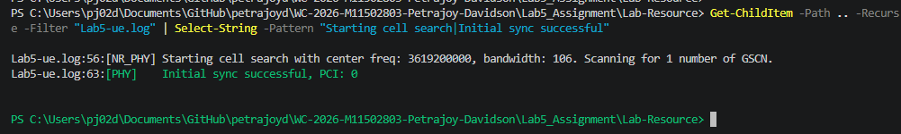
  <br>
  <em>Figure 1. The UE completes initial synchronization and identifies the cell with PCI 0.</em>
</p>

Record whether UE synchronization succeeded and the PCI value. Explain: after completing initial synchronization, what is the UE able to do?

**Answer:** Initial synchronization succeeded, and the detected PCI is `0`. The UE is now synchronized to the cell well enough to decode the broadcast MIB, then obtain SIB1 and the common configuration needed to begin random access.

#### Step 2: Find MIB and SIB1 — 8 points

In Wireshark, enter:

```text
nr-rrc
```

Find one `MIB` packet and one `SIB1` packet. Record the frame number of each and provide screenshots.

##### MIB
<p align="center">
  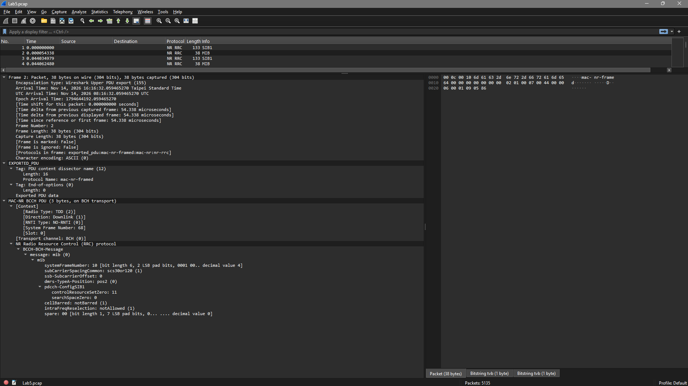
  <br>
  <em>Figure 2. The selected packet is the MIB in frame 2.</em>
</p>

##### SIB1
<p align="center">
  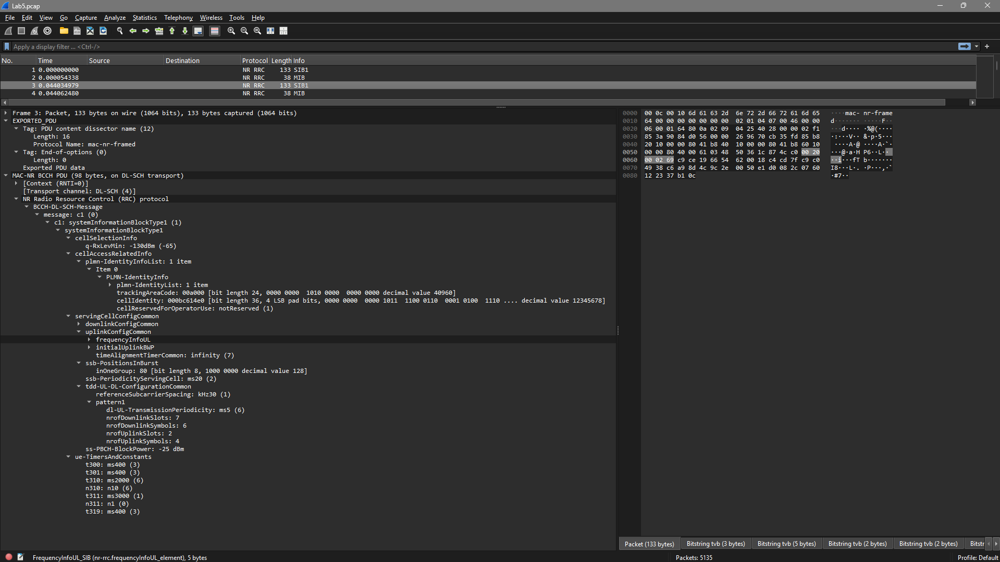
  <br>
  <em>Figure 3. The selected packet is SIB1 in frame 3.</em>
</p>

Record the frame number of each packet. MIB and SIB1 are repeatedly broadcast system-information messages. The UE must obtain the common configuration before it can continue the access procedure. Briefly explain the purpose of MIB and SIB1 for UE access.

**Answers:** The MIB is in frame `2`; SIB1 is in frame `3`. The MIB provides essential initial cell and radio configuration that lets the UE locate and decode SIB1. SIB1 provides the cell-access information and common radio configuration the UE needs to camp on the cell and prepare for random access.

#### Step 3: Find Msg1 PRACH — 8 points

Run the following command on the UE log:

```bash
grep -nE 'PRACH' lab5-artifacts/Lab5-ue.log
```

Record the Msg1 log line number. From the line that shows the actual PRACH transmission, find:

```text
frame.slot = 553.19
preambleIndex = 16
```

<p align="center">
  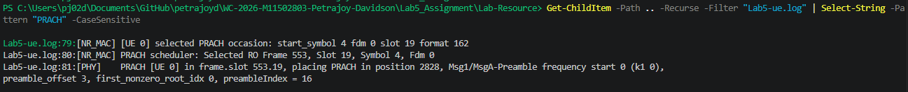
  <br>
  <em>Figure 4. The UE log records its PRACH transmission and selected preamble.</em>
</p>

Next, return to Wireshark. Clear the display filter, press `Cmd/Ctrl + F`, choose **Packet details** as the search scope, and search for:

```text
RACH Preamble chosen
```

After locating the PRACH event recorded by the gNB tracer, record:

<p align="center">
  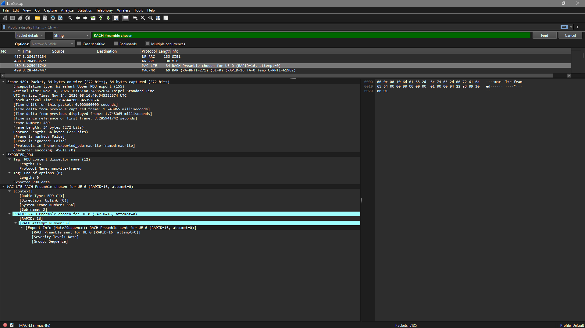
  <br>
  <em>Figure 5. The gNB tracer records the selected PRACH preamble as RAPID 16 in frame 489.</em>
</p>

```text
RAPID = 16
```

The UE log's `preambleIndex` and the gNB tracer's `RAPID` both equal `16`, showing that the gNB detected the preamble sent by the UE.

Submit one UE-log screenshot and one Wireshark screenshot. Briefly answer:

1. Which Random Access message is this PRACH transmission?

  This is Msg1, the UE's random-access preamble.

2. At which `frame.slot` and with which `preambleIndex` does the UE log show transmission?

  The UE log shows `frame.slot = 553.19` and `preambleIndex = 16` (log line 81).

3. Does the Wireshark `RAPID` match the UE-log `preambleIndex`? What does this show?

  Yes. The Wireshark event reports `RAPID 16`, matching the UE's `preambleIndex`. This confirms that the gNB detected the preamble the UE transmitted.

#### Step 4: Find Msg2 RAR in Wireshark — 11 points

Return to Wireshark and clear the display filter. Press `Cmd/Ctrl + F`, choose **Packet details** as the search scope, and search for `RAR` or `Random Access Response`. After locating the packet, record its frame number and find the following values in `MAC-NR RAR`:

<p align="center">
  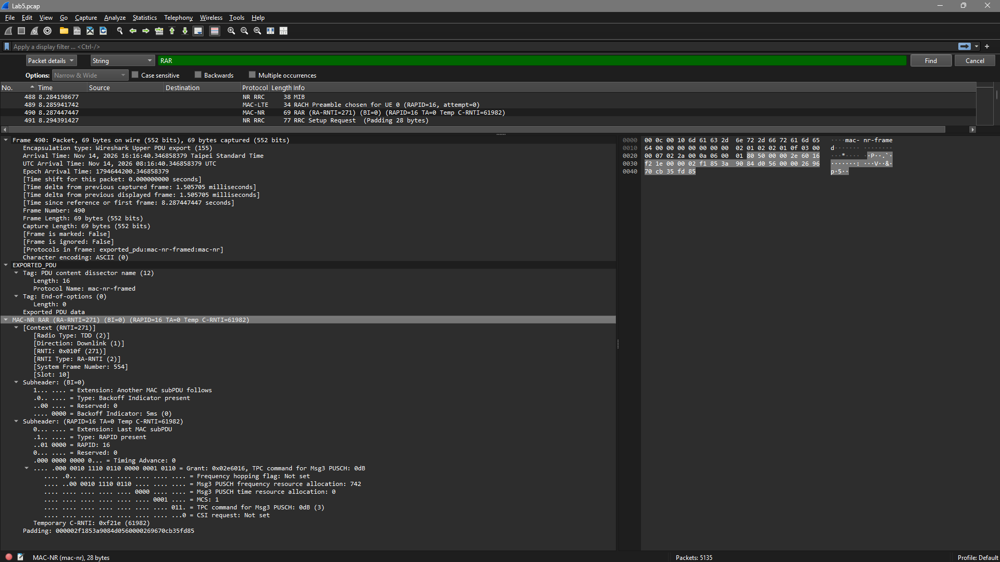
  <br>
  <em>Figure 6. The RAR in frame 490 echoes RAPID 16 and assigns Temporary C-RNTI 0xf21e.</em>
</p>

```text
Frame number = 490
RAPID = 16
Temporary C-RNTI = 0xf21e (61982)
```

The RAR acknowledges the UE's preamble, provides timing advance and an uplink grant for Msg3, and assigns the UE a temporary identifier.

### Task 2: Complete Random Access and RRC Connection Setup — 40 points

Complete the following steps in order. For each message, provide a screenshot and record the requested frame number, fields, and brief explanation.

#### Step 1: Find RRCSetupRequest — 10 points

In Wireshark, use:

```text
nr-rrc.rrcSetupRequest_element
```

Expand `UL-CCCH-Message → rrcSetupRequest` and find:

<p align="center">
  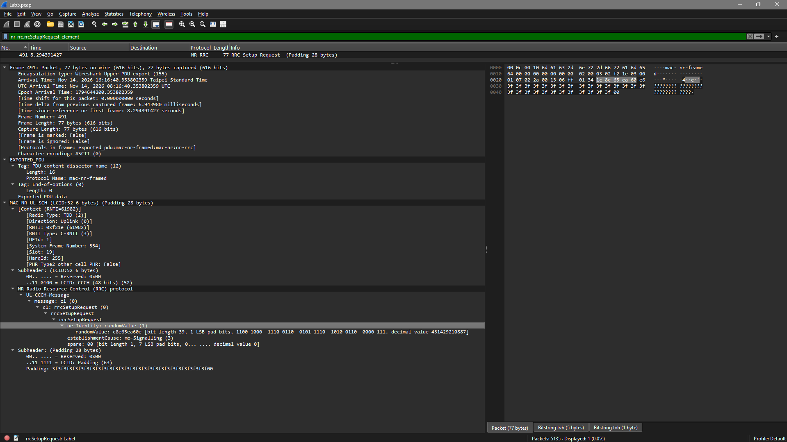
  <br>
  <em>Figure 7. The UE sends RRCSetupRequest in frame 491 using Context RNTI 61982.</em>
</p>

```text
Frame number = 491
Context RNTI = 61982 (0xf21e)
```

Briefly answer:

1. Does the `Context RNTI` match the `Temporary C-RNTI` in the Task 1 / Step 4 RAR? What does this show?

   Yes. Both are `0xf21e` (`61982`), showing the UE continues with the temporary identity assigned in the RAR.

2. Can you claim that the RRC connection has been established after seeing only `RRCSetupRequest`? Why or why not?

   No. `RRCSetupRequest` asks the gNB to establish an RRC connection; the UE has not yet received `RRCSetup` and sent `RRCSetupComplete` to finish the setup exchange.

#### Step 2: Find RRCSetup — 10 points

Clear the previous filter and enter:

```text
nr-rrc.rrcSetup_element
```

Expand `DL-CCCH-Message → rrcSetup` and find:

<p align="center">
  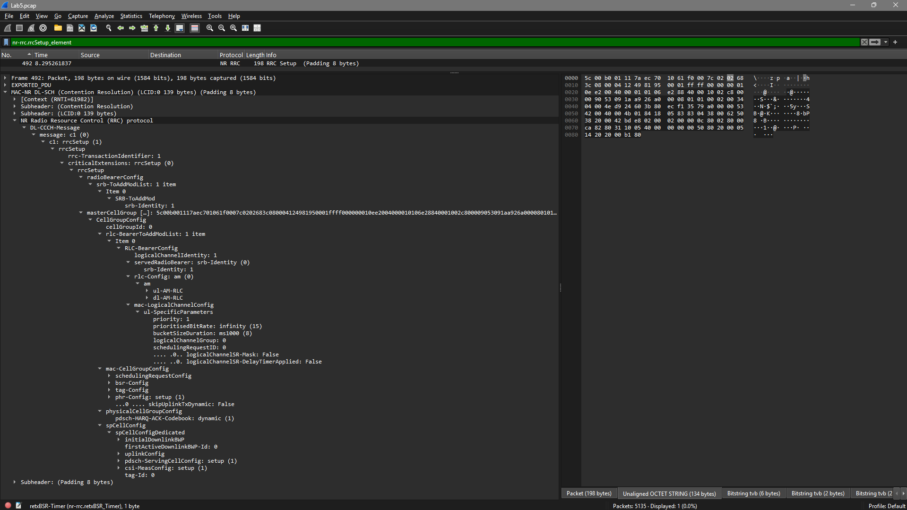
  <br>
  <em>Figure 8. The gNB sends RRCSetup in frame 492 as part of the downlink contention-resolution message.</em>
</p>

```text
Frame number = 492
Context RNTI = 61982 (0xf21e)
rrc-TransactionIdentifier = 1
```

Check whether `Contention Resolution` also appears in the packet.

Below the screenshot, briefly answer:

1. Which message is this in four-step Random Access?

  This is Msg4.

2. What does it mean that `Contention Resolution` and `RRCSetup` appear in the same downlink message?

  The gNB resolves contention for the UE's Msg3 and sends the RRC connection configuration in the same downlink transmission. The UE can identify that the response is for its access attempt and proceed with setup.

#### Step 3: Find RRCSetupComplete — 12 points

Clear the previous filter and enter:

```text
nr-rrc.rrcSetupComplete_element
```

Select the packet and first verify that `MAC-NR UL-SCH` appears at the top. Expand:

```text
RLC-NR → PDCP-NR → NR Radio Resource Control (RRC) protocol
  → UL-DCCH-Message → message: c1
```

Expand `message: c1` further and confirm that it contains `rrcSetupComplete`. Record:

<p align="center">
  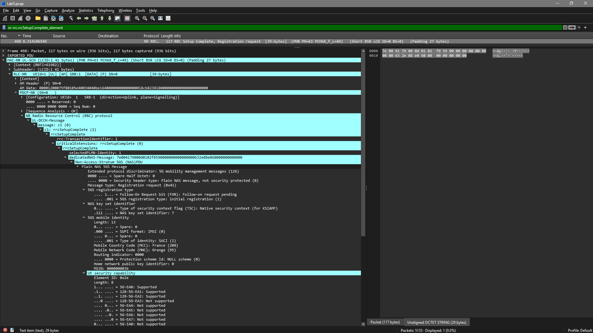
  <br>
  <em>Figure 9. The UE sends RRCSetupComplete in frame 498 under the same RNTI and setup transaction.</em>
</p>

```text
Frame number = 498
Context RNTI = 61982 (0xf21e)
rrc-TransactionIdentifier = 1
```

Below the screenshot, briefly answer:

1. Does the `Context RNTI` still match the `Temporary C-RNTI` in the RAR?

  Yes. The Context RNTI remains `0xf21e` (`61982`), matching the Temporary C-RNTI from the RAR.

2. Does the `rrc-TransactionIdentifier` match the `RRCSetup` in Step 2? What is the purpose of this comparison?

  Yes. Both transaction identifiers are `1`. This confirms that `RRCSetupComplete` acknowledges the same RRC setup transaction initiated by the gNB.

#### Step 4: Confirm the Final Random Access and RRC Connection Result — 8 points

Run the following command on the UE log:

```bash
grep -nE '4-Step RA procedure succeeded|Received NR_RRCSetup|RRCSetupComplete|State = NR_RRC_CONNECTED' \
  lab5-artifacts/Lab5-ue.log
```

From the output, record:

<p align="center">
  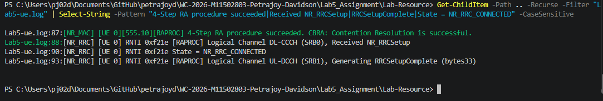
  <br>
  <em>Figure 10. The UE log confirms successful contention resolution, receipt of RRCSetup, transition to RRC_CONNECTED, and generation of RRCSetupComplete.</em>
</p>

```text
4-Step RA procedure succeeded: line 87
Received NR_RRCSetup: line 88
State = NR_RRC_CONNECTED: line 90
Generating RRCSetupComplete: line 93
```

Submit a screenshot of this log output and briefly answer:

1. In log order, what are the three events from successful Random Access to generating `RRCSetupComplete`?

  The UE reports successful four-step Random Access, receives `NR_RRCSetup`, enters `NR_RRC_CONNECTED`, and then generates `RRCSetupComplete`.

2. What do `4-Step RA procedure succeeded` and `State = NR_RRC_CONNECTED` each prove?

  `4-Step RA procedure succeeded` confirms that the random-access exchange completed, including contention resolution. `State = NR_RRC_CONNECTED` confirms the UE has entered the connected RRC state; it is not, by itself, proof of 5GC registration.

### Task 3: Draw an Initial Access MSC Diagram — 25 points

Using the log and Wireshark evidence found in Tasks 1 and 2, draw your own Message Sequence Chart (MSC). It must include two vertical lifelines, `UE` and `gNB`, and the following six messages: MIB/SIB1, Msg1, Msg2, Msg3, Msg4, and `RRCSetupComplete`.

Determine and draw the correct order and direction of the messages yourself. Add a one-sentence purpose next to each arrow.

| Item | Points |
|---|---:|
| UE and gNB lifelines, with the two UE states identified | 5 |
| Complete message order: MIB/SIB1, Msg1, Msg2, Msg3, Msg4, RRCSetupComplete | 12 |
| Correct direction for every message arrow | 5 |
| Reasonable brief purpose for every major stage | 3 |
| **Task 3 subtotal** | **25** |

**Answer:**

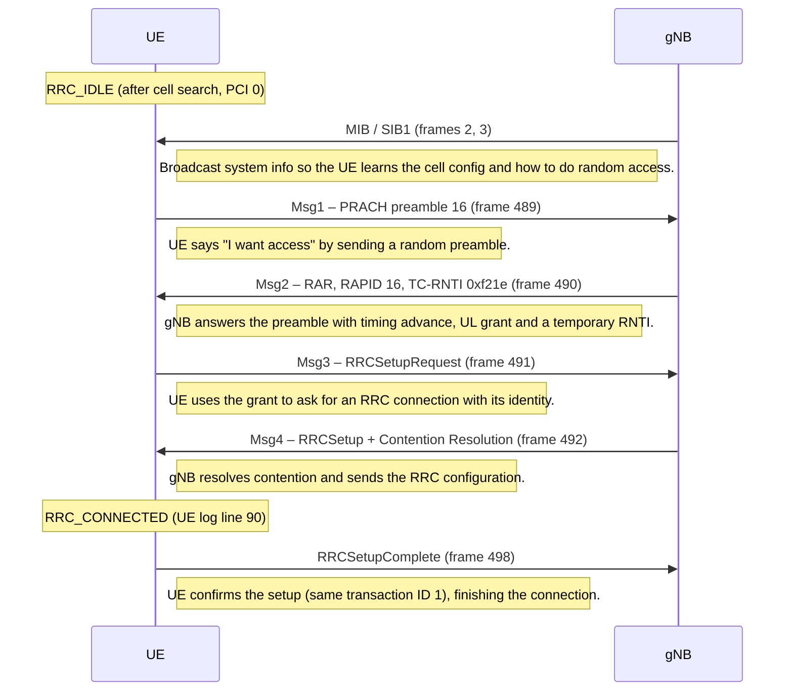

<p align="center"><em>Figure 11. Initial Access MSC between UE and gNB, built from the UE log and Wireshark frames.</em></p>

The UE starts in `RRC_IDLE`, reads the broadcast MIB/SIB1, then runs four-step Random Access. It switches to `RRC_CONNECTED` right after receiving `RRCSetup` (UE log line 90) and then sends `RRCSetupComplete` back to the gNB.

| Item | Points |
|---|---:|
| Task 1: Initial Access evidence timeline | 35 |
| Task 2: Key-message analysis | 40 |
| Task 3: Initial Access MSC diagram | 25 |
| **Total** | **100** |

## 7. Optional: Reproduce the Log and PCAP Files

This section is not required for the assignment. If you want to generate the same kind of evidence using your own OAI run, follow these steps in an OAI/5GC environment that was already set up in an earlier class.

The commands below assume that you are currently in the `openairinterface5g` repository root. Use three terminals and first create a directory for the artifacts:

```bash
mkdir -p lab5-artifacts
```

### Terminal A: Start the gNB and Wait for the Tracer

```bash
cd cmake_targets/ran_build/build

sudo -E env RFSIMULATOR=server ./nr-softmodem \
  -O ../../../ci-scripts/conf_files/gnb.sa.band78.106prb.rfsim.conf \
  --rfsim --T_stdout 2 \
  2>&1 | tee ../../../lab5-artifacts/Lab5-gnb.log
```

### Terminal B: Record the gNB MAC/RRC Trace

```bash
cd cmake_targets/ran_build/build

./common/utils/T/tracer/record \
  -d ../../../common/utils/T/T_messages.txt \
  -o ../../../lab5-artifacts/Lab5-gnb-wireshark.raw \
  -on WIRESHARK
```

The gNB in Terminal A continues after the tracer connects.

### Terminal C: Start the UE and Save the UE Log

```bash
cd cmake_targets/ran_build/build

sudo -E RFSIMULATOR=127.0.0.1 ./nr-uesoftmodem \
  -O ../../../targets/PROJECTS/GENERIC-NR-5GC/CONF/ue.conf \
  --rfsim -r 106 --numerology 1 --band 78 -C 3619200000 \
  2>&1 | tee ../../../lab5-artifacts/Lab5-ue.log
```

After `State = NR_RRC_CONNECTED` appears, wait a few seconds, then stop the terminals in this order: recorder in Terminal B, UE in Terminal C, and gNB in Terminal A.

### Convert the Trace to a Wireshark PCAP

```bash
cd cmake_targets/ran_build/build

./common/utils/T/tracer/macpdu2wireshark \
  -d ../../../common/utils/T/T_messages.txt \
  -i ../../../lab5-artifacts/Lab5-gnb-wireshark.raw \
  -to-file ../../../lab5-artifacts/Lab5.pcap
```

You should obtain:

```text
lab5-artifacts/Lab5-ue.log
lab5-artifacts/Lab5-gnb.log
lab5-artifacts/Lab5.pcap
```
